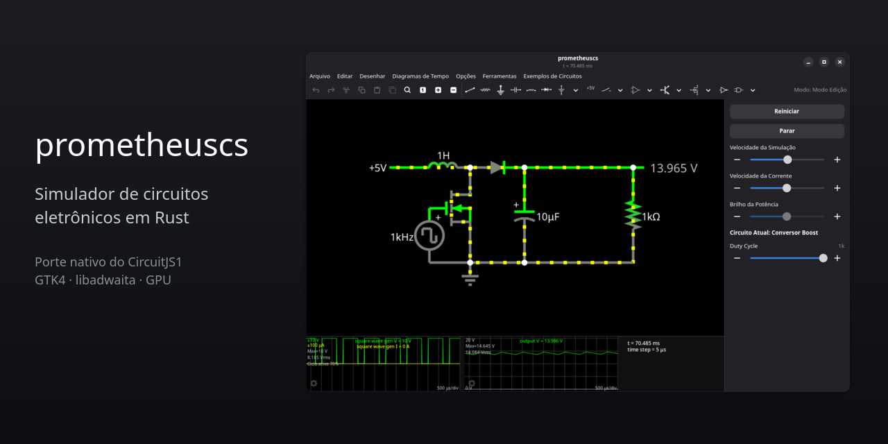
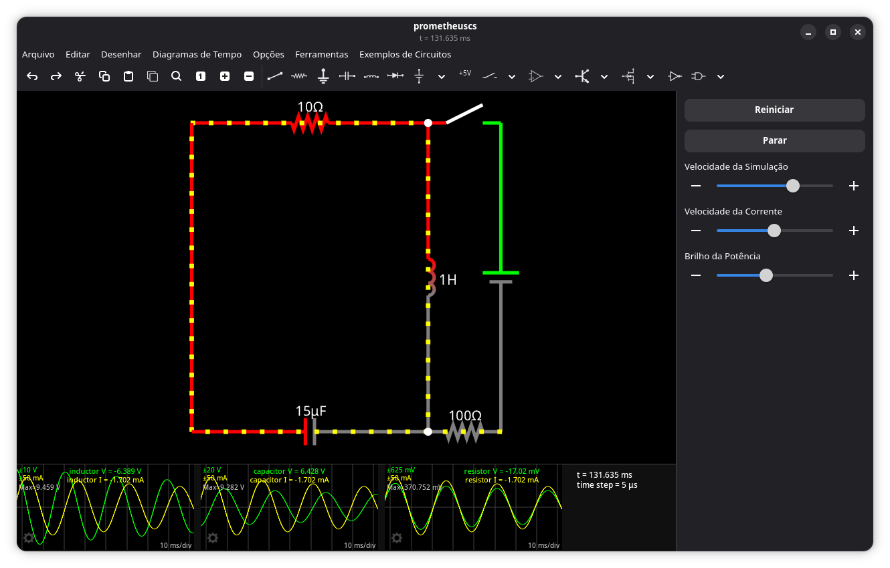
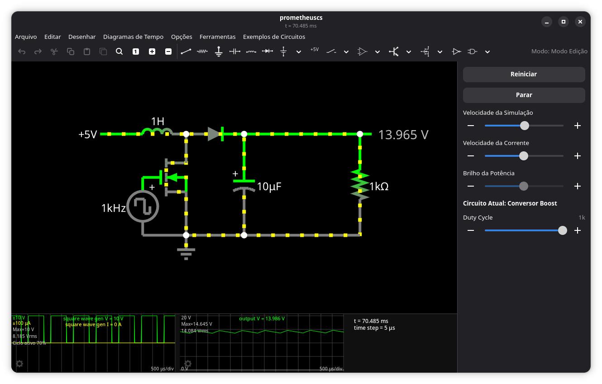
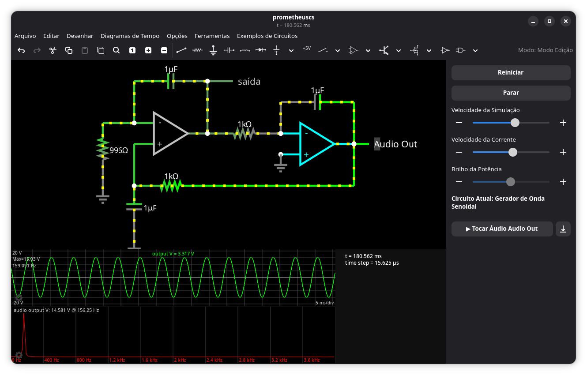
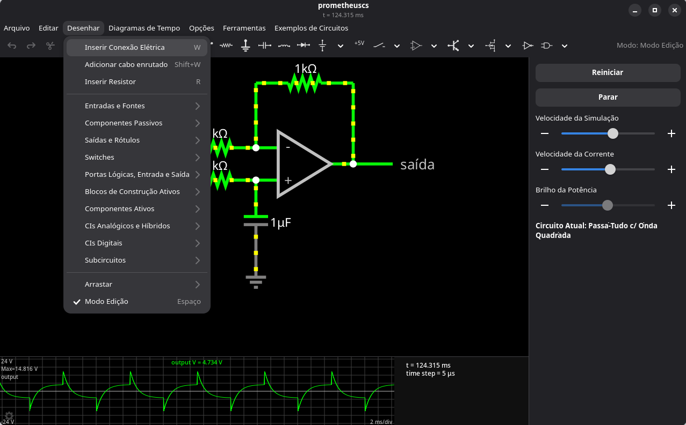

<p align="center">
  
</p>

Um simulador de circuitos eletrônicos para o desktop, escrito em Rust. É uma reescrita nativa do
[CircuitJS1](https://github.com/pfalstad/circuitjs1), o simulador que roda no navegador, com
interface GTK4 / libadwaita e um canvas acelerado por GPU.

Você monta o circuito na tela com resistores, capacitores, fontes, transistores, portas lógicas,
amplificadores operacionais e mais de cem outros componentes, aperta **Executar** e vê as tensões
e as correntes se moverem ao vivo: a cor dos fios mostra a tensão, os pontos amarelos mostram a
corrente, e os osciloscópios traçam as formas de onda.

## De onde vem

Este projeto existe por causa do trabalho de **Paul Falstad**, autor do *Circuit Simulator*
original, um dos simuladores de circuitos interativos mais conhecidos e usados no ensino de
eletrônica. O CircuitJS1 é a versão dele para o navegador, à qual **Iain Sharp** também deu
contribuições importantes; os dois assinam os direitos autorais do código.

O prometheuscs é um **porte** dessa obra, não uma criação independente:

- os modelos dos componentes, a análise nodal modificada e o formato de arquivo seguem o
  original, e foram traduzidos linha a linha de onde isso foi possível;
- os 373 circuitos de exemplo, as traduções e os ícones vêm do CircuitJS1 (veja
  [assets/ATTRIBUTION.md](assets/ATTRIBUTION.md));
- os resultados são conferidos contra gravações feitas no próprio CircuitJS1.

Se você gosta deste programa, o crédito é de Paul Falstad e Iain Sharp. O original está em
<https://github.com/pfalstad/circuitjs1> e a versão online em <https://www.falstad.com/circuit/>.

## O que é diferente

- **Nativo.** Roda como um programa comum, sem navegador. A simulação fica numa thread própria,
  então a janela não trava mesmo com circuitos grandes.
- **Compatível com os arquivos do original.** Abre e salva o mesmo formato (texto e XML), e os
  os links de compartilhamento são gerados no formato do CircuitJS1.
- **Rápido.** O solver usa fatoração LU esparsa. Em medições feitas aqui, um circuito de 500
  elementos é desenhado com folga para mais de 150 quadros por segundo, e a janela abre em cerca
  de um segundo (números e método em [tests/bench/README.md](tests/bench/README.md)).
- **Modular.** Cada família de componentes é um *feature* do Cargo e pode ser removida da
  compilação sem quebrar o resto.
- **Em português.** A interface está traduzida, e o programa traz mais 14 línguas herdadas do original (Opções > Idioma).

## Imagens

**Circuito RLC** com a corrente (pontos amarelos), a tensão (cor dos fios) e três osciloscópios
mostrando a oscilação amortecida:



**Conversor boost** com um slider para o ciclo de trabalho, um osciloscópio da onda quadrada que
liga o transistor e outro da tensão de saída (13,9 V a partir de 5 V):



**Gerador de onda senoidal** com a forma de onda, o espectro de frequências (pico em 156 Hz) e o
botão para tocar o áudio gravado (o amplificador em ciano é o componente destacado sob o
ponteiro):



**Menu Desenhar**, com todas as categorias de componentes, e um filtro passa-tudo com onda
quadrada:



## Como usar

```bash
cargo run --release --features gui
```

Dentro do programa, abra o menu **Exemplos de Circuitos** e escolha um circuito (por exemplo
*Circuito RLC*) para ver tudo funcionando. O passo a passo, com todas as funções, está em
[docs/guia-do-usuario.md](docs/guia-do-usuario.md).

### Requisitos para compilar

- Rust 1.99 ou mais novo (edição 2024)
- GTK 4 (4.12 ou mais novo) e os arquivos de desenvolvimento do libadwaita 1.x
- Uma sessão com OpenGL 3.3 / GLES 3. Sem aceleração por hardware ele funciona, mais devagar, e o
  programa avisa quando isso acontece.

Para o motor sozinho (sem janela), compile sem `--features gui`: o formato de arquivo, os
elementos, o solver e os osciloscópios não dependem do GTK.

## Documentação

| Documento | Para quê |
|-----------|----------|
| [docs/guia-do-usuario.md](docs/guia-do-usuario.md) | Todas as funções do simulador e como usá-las |
| [docs/arquitetura.md](docs/arquitetura.md) | Como o programa é organizado, para quem vai mantê-lo |
| [docs/adding-a-component.md](docs/adding-a-component.md) | Como acrescentar um componente novo (em inglês) |
| [tests/compat/README.md](tests/compat/README.md) | Como a compatibilidade com o original é conferida |
| [tests/bench/README.md](tests/bench/README.md) | Medidas de desempenho |
| [specs/001-circuit-simulator-migration/](specs/001-circuit-simulator-migration/) | Especificação, plano e lista de tarefas da migração |

## Qualidade

```bash
cargo fmt --check
cargo clippy --all-targets -- -D warnings
cargo test
```

O CI também compila e testa o projeto deixando de fora, uma de cada vez, cada uma das doze
famílias de componentes. Código de produção não usa `unwrap`, `expect` nem `panic!`.

## Licença

GPL-2.0-or-later, os mesmos termos do CircuitJS1 (copyright Paul Falstad e Iain Sharp), de onde
este projeto deriva. Veja [LICENSE](LICENSE).

Política dos arquivos-fonte:

- Todo arquivo começa com `// SPDX-License-Identifier: GPL-2.0-or-later`.
- Os arquivos traduzidos do CircuitJS1 mantêm a linha `// Derived from CircuitJS1 (C) Paul
  Falstad and Iain Sharp`.
- Os recursos importados (exemplos, traduções, ícones) estão listados em
  [assets/ATTRIBUTION.md](assets/ATTRIBUTION.md).
