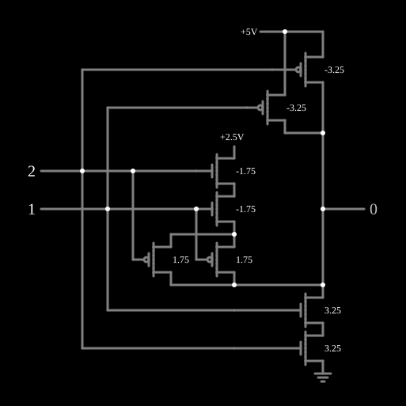

# CGAND (NAND ternária)

<!-- navegacao:inicio -->
[Índice](README.md) · [Próximo: CGOR](3-cgor.md)
<!-- navegacao:fim -->

## Objetivo

Mostrar uma porta de **lógica ternária** (de três valores) em CMOS: a porta CGAND dá o complemento do mínimo das duas entradas, que é a generalização da NAND para três níveis.

## O circuito

<!-- esquema:inicio -->

<!-- esquema:fim -->

Os três níveis lógicos são $0$ ($0\ \text{V}$), $1$ ($2{,}5\ \text{V}$) e $2$ ($5\ \text{V}$), com alimentações de $5\ \text{V}$ e $2{,}5\ \text{V}$. As duas entradas (elementos 44 e 45) são entradas lógicas ternárias, que avançam $0 \to 1 \to 2 \to 0$ a cada clique; a saída (elemento 43) é uma saída lógica ternária. Há três redes de transistores ligadas à saída:

- **para $5\ \text{V}$:** dois PMOS de enriquecimento com $|V_t| = 3{,}25\ \text{V}$ em paralelo (um por entrada), que só conduzem com a entrada em $0$;
- **para a terra:** dois NMOS de enriquecimento com $V_t = 3{,}25\ \text{V}$ em série, que só conduzem com as duas entradas em $2$;
- **para $2{,}5\ \text{V}$:** uma rede de MOSFETs de **depleção** ($V_t = -1{,}75\ \text{V}$), dois NMOS em série com dois PMOS em paralelo, que conduz quando nenhuma entrada está em $0$ e ao menos uma está em $1$.

O exemplo abre com $A = 2$ (elemento 44) e $B = 1$ (elemento 45).

<!-- componentes:inicio -->
| N.º | Tipo | Elemento | Valores |
|----:|------|----------|---------|
| 0 | `NMosfetElm` | MOSFET | Model = old-mosfet; Swap D/S = não |
| 1 | `NMosfetElm` | MOSFET | Model = old-mosfet; Swap D/S = não |
| 3 | `PMosfetElm` | MOSFET | Model = old-mosfet-2; Swap D/S = não |
| 4 | `PMosfetElm` | MOSFET | Model = old-mosfet-2; Swap D/S = não |
| 13 | `NMosfetElm` | MOSFET | Model = old-mosfet-2; Swap D/S = não |
| 14 | `NMosfetElm` | MOSFET | Model = old-mosfet-2; Swap D/S = não |
| 17 | `RailElm` | voltage source | Voltage = 2.5; Waveform = D/C; DC Offset (V) = 0; Internal Resistance (ohms) = 0 |
| 27 | `GroundElm` | ground | Symbol = Earth |
| 28 | `PMosfetElm` | MOSFET | Model = old-mosfet; Swap D/S = não |
| 29 | `PMosfetElm` | MOSFET | Model = old-mosfet; Swap D/S = não |
| 38 | `RailElm` | voltage source | Voltage = 5; Waveform = D/C; DC Offset (V) = 0; Internal Resistance (ohms) = 0 |
| 43 | `LogicOutputElm` | logic output | Threshold = 2.5; Current Required = não; Numeric = sim; Ternary = sim |
| 44 | `LogicInputElm` | logic input | Momentary Switch = não; High Logic Voltage = 5; Low Voltage = 0; Numeric = sim; Ternary = sim; Keyboard Shortcut =  |
| 45 | `LogicInputElm` | logic input | Momentary Switch = não; High Logic Voltage = 5; Low Voltage = 0; Numeric = sim; Ternary = sim; Keyboard Shortcut =  |
<!-- componentes:fim -->

## Teoria

Na lógica ternária de Kleene, o E e o OU generalizam-se como mínimo e máximo, e a negação como $\overline{x} = 2 - x$ (ver [Complement (F210)](3-invert.md)). A CGAND é

$$Y = 2 - \min(A, B).$$

O truque de circuito é usar limiares diferentes para separar os três níveis: um transistor de enriquecimento com $|V_t| = 3{,}25\ \text{V}$, com a fonte num trilho, só liga quando a porta está no extremo oposto (a $5\ \text{V}$ de distância), e não liga com $2{,}5\ \text{V}$. Os transistores de depleção com a fonte no trilho do meio, ao contrário, conduzem para qualquer entrada a menos de $1{,}75\ \text{V}$ da fonte e só desligam nos extremos. Combinando-os em série e em paralelo como numa porta CMOS binária, obtém-se exatamente uma rede ligada para cada combinação.

## Resultados esperados

O simulador dá a tabela da CGAND (saída em $0$, $2{,}5$ ou $5\ \text{V}$):

| $A \backslash B$ | 0 | 1 | 2 |
|---:|---:|---:|---:|
| **0** | 2 | 2 | 2 |
| **1** | 2 | 1 | 1 |
| **2** | 2 | 1 | 0 |

Os níveis de saída coincidem com os trilhos a menos de $10\ \mu\text{V}$.

## O que observar

Clique nas entradas para percorrer as nove combinações. A [CGOR](3-cgor.md) usa as mesmas ideias para o complemento do máximo; as portas de uma entrada estão em [Complement (F210)](3-invert.md), [F211](3-f211.md), [F220](3-f220.md) e [F221](3-f221.md).

## Limites do modelo

- Os limiares de $3{,}25\ \text{V}$ e $-1{,}75\ \text{V}$ são escolhidos para separar os níveis com margem; num processo real, ter MOSFETs com vários $V_t$ exige passos de fabricação extras, um dos motivos de a lógica ternária não ter se popularizado.
- Sem capacitâncias, a comutação é instantânea.

## Referências

Mouftah e Jordan, trabalhos sobre lógica ternária COS/MOS (IEEE, anos 1970); Hurst, "Multiple-Valued Logic — its Status and its Future", *IEEE Transactions on Computers*, 1984; Kleene, *Introduction to Metamathematics* (lógica de três valores).

O circuito deste exemplo faz parte da coleção do simulador original de Paul Falstad e Iain Sharp (CircuitJS1); a explicação é deste projeto.
