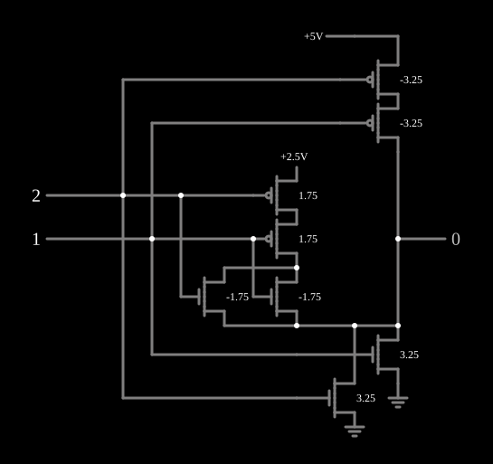

# CGOR (NOR ternária)

<!-- navegacao:inicio -->
[Índice](README.md) · [Anterior: CGAND](3-cgand.md) · [Próximo: Complement (F210)](3-invert.md)
<!-- navegacao:fim -->

## Objetivo

Mostrar a porta ternária **CGOR**, o complemento do máximo das duas entradas: a generalização da NOR para lógica de três valores, dual da [CGAND](3-cgand.md).

## O circuito

<!-- esquema:inicio -->

<!-- esquema:fim -->

Os níveis são $0$ ($0\ \text{V}$), $1$ ($2{,}5\ \text{V}$) e $2$ ($5\ \text{V}$); as entradas ternárias (elementos 29 e 30) avançam $0 \to 1 \to 2 \to 0$ a cada clique, e a saída ternária é o elemento 25. As três redes são as duais das da CGAND:

- **para $5\ \text{V}$:** dois PMOS de enriquecimento ($|V_t| = 3{,}25\ \text{V}$) **em série**, que só conduzem com as duas entradas em $0$;
- **para a terra:** dois NMOS de enriquecimento ($V_t = 3{,}25\ \text{V}$) **em paralelo**, que conduzem se alguma entrada estiver em $2$;
- **para $2{,}5\ \text{V}$:** dois PMOS de depleção ($V_t = -1{,}75\ \text{V}$) em série, seguidos de dois NMOS de depleção em paralelo, que conduzem quando nenhuma entrada está em $2$ e ao menos uma está em $1$.

O exemplo abre com $A = 2$ (elemento 29) e $B = 1$ (elemento 30).

<!-- componentes:inicio -->
| N.º | Tipo | Elemento | Valores |
|----:|------|----------|---------|
| 0 | `NMosfetElm` | MOSFET | Model = old-mosfet; Swap D/S = não |
| 11 | `RailElm` | voltage source | Voltage = 2.5; Waveform = D/C; DC Offset (V) = 0; Internal Resistance (ohms) = 0 |
| 21 | `PMosfetElm` | MOSFET | Model = old-mosfet; Swap D/S = não |
| 25 | `LogicOutputElm` | logic output | Threshold = 2.5; Current Required = não; Numeric = sim; Ternary = sim |
| 29 | `LogicInputElm` | logic input | Momentary Switch = não; High Logic Voltage = 5; Low Voltage = 0; Numeric = sim; Ternary = sim; Keyboard Shortcut =  |
| 30 | `LogicInputElm` | logic input | Momentary Switch = não; High Logic Voltage = 5; Low Voltage = 0; Numeric = sim; Ternary = sim; Keyboard Shortcut =  |
| 31 | `RailElm` | voltage source | Voltage = 5; Waveform = D/C; DC Offset (V) = 0; Internal Resistance (ohms) = 0 |
| 33 | `PMosfetElm` | MOSFET | Model = old-mosfet; Swap D/S = não |
| 37 | `NMosfetElm` | MOSFET | Model = old-mosfet; Swap D/S = não |
| 38 | `GroundElm` | ground | Symbol = Earth |
| 39 | `GroundElm` | ground | Symbol = Earth |
| 43 | `NMosfetElm` | MOSFET | Model = old-mosfet-2; Swap D/S = não |
| 44 | `NMosfetElm` | MOSFET | Model = old-mosfet-2; Swap D/S = não |
| 45 | `PMosfetElm` | MOSFET | Model = old-mosfet-2; Swap D/S = não |
| 46 | `PMosfetElm` | MOSFET | Model = old-mosfet-2; Swap D/S = não |
<!-- componentes:fim -->

## Teoria

Com o OU ternário definido como máximo e a negação como $2 - x$:

$$Y = 2 - \max(A, B).$$

Os transistores de enriquecimento de limiar alto só respondem às entradas no extremo oposto ao seu trilho, e os de depleção ligados ao trilho do meio só desligam nos extremos (ver a explicação em [CGAND](3-cgand.md)). A troca de série por paralelo entre as duas portas é a mesma dualidade de De Morgan da [CMOS NAND](cmosnand.md) e da [CMOS NOR](cmosnor.md).

## Resultados esperados

O simulador dá a tabela da CGOR:

| $A \backslash B$ | 0 | 1 | 2 |
|---:|---:|---:|---:|
| **0** | 2 | 1 | 0 |
| **1** | 1 | 1 | 0 |
| **2** | 0 | 0 | 0 |

Os níveis de saída coincidem com os trilhos a menos de $10\ \mu\text{V}$.

## O que observar

Percorra as nove combinações e compare com a tabela da CGAND: uma é a outra com os papéis de $0$ e $2$ trocados nas entradas e na saída.

## Limites do modelo

- Os vários limiares ($3{,}25\ \text{V}$ e $-1{,}75\ \text{V}$) exigiriam um processo com vários implantes de $V_t$.
- Sem capacitâncias, a comutação é instantânea.

## Referências

Mouftah e Jordan, trabalhos sobre lógica ternária COS/MOS (IEEE, anos 1970); Hurst, "Multiple-Valued Logic — its Status and its Future", *IEEE Transactions on Computers*, 1984.

O circuito deste exemplo faz parte da coleção do simulador original de Paul Falstad e Iain Sharp (CircuitJS1); a explicação é deste projeto.
