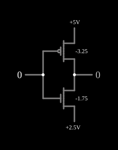

# Função ternária F211

<!-- navegacao:inicio -->
[Índice](README.md) · [Anterior: Complement (F210)](3-invert.md) · [Próximo: F220](3-f220.md)
<!-- navegacao:fim -->

## Objetivo

Mostrar a função ternária de uma entrada $F_{211}$, que dá $2$ para a entrada $0$ e $1$ para as entradas $1$ e $2$, feita com apenas dois transistores.

## O circuito

<!-- esquema:inicio -->

<!-- esquema:fim -->

Os níveis são $0$ ($0\ \text{V}$), $1$ ($2{,}5\ \text{V}$) e $2$ ($5\ \text{V}$). A entrada ternária (elemento 8, que avança $0 \to 1 \to 2 \to 0$ a cada clique) vai às portas de:

- um PMOS de enriquecimento ($|V_t| = 3{,}25\ \text{V}$) entre $5\ \text{V}$ e a saída;
- um NMOS de depleção ($V_t = -1{,}75\ \text{V}$) entre a saída e o trilho de $2{,}5\ \text{V}$.

A saída ternária é o elemento 7. O exemplo abre com a entrada em $0$.

<!-- componentes:inicio -->
| N.º | Tipo | Elemento | Valores |
|----:|------|----------|---------|
| 0 | `NMosfetElm` | MOSFET | Model = old-mosfet-2; Swap D/S = não |
| 3 | `PMosfetElm` | MOSFET | Model = old-mosfet; Swap D/S = não |
| 6 | `RailElm` | voltage source | Voltage = 5; Waveform = D/C; DC Offset (V) = 0; Internal Resistance (ohms) = 0 |
| 7 | `LogicOutputElm` | logic output | Threshold = 2.5; Current Required = não; Numeric = sim; Ternary = sim |
| 8 | `LogicInputElm` | logic input | Momentary Switch = não; High Logic Voltage = 5; Low Voltage = 0; Numeric = sim; Ternary = sim; Keyboard Shortcut =  |
| 9 | `RailElm` | voltage source | Voltage = 2.5; Waveform = D/C; DC Offset (V) = 0; Internal Resistance (ohms) = 0 |
<!-- componentes:fim -->

## Teoria

Na notação $F_{xyz}$, os índices são as saídas para as entradas $0$, $1$ e $2$ (o complemento é [F210](3-invert.md)). Aqui:

- **entrada $0$:** o PMOS liga ($V_{SG} = 5\ \text{V}$) e leva a saída a $5\ \text{V}$; o NMOS de depleção tem a porta $2{,}5\ \text{V}$ abaixo do trilho do meio, abaixo do seu limiar de $-1{,}75\ \text{V}$, e corta;
- **entradas $1$ e $2$:** o PMOS corta ($V_{SG} \le 2{,}5\ \text{V}$); o NMOS de depleção conduz e liga a saída a $2{,}5\ \text{V}$.

$F_{211}$ pode ser lida como "a entrada é $0$?", com a resposta em $2$ (sim) ou $1$ (não); funções assim servem para decodificar os níveis de um sinal ternário.

## Resultados esperados

O simulador dá:

| Entrada | Saída |
|--------:|------:|
| 0 | 2 ($5\ \text{V}$) |
| 1 | 1 ($2{,}5\ \text{V}$) |
| 2 | 1 ($2{,}5\ \text{V}$) |

## O que observar

Clique na entrada e compare com [F220](3-f220.md) e [F221](3-f221.md), que usam o mesmo par de transistores com outros limiares e outros trilhos.

## Limites do modelo

- Os limiares escolhidos ($3{,}25\ \text{V}$ e $-1{,}75\ \text{V}$) são parâmetros do modelo, não de um processo real.
- Sem capacitâncias, a comutação é instantânea.

## Referências

Mouftah e Jordan, trabalhos sobre lógica ternária COS/MOS (IEEE, anos 1970); Hurst, "Multiple-Valued Logic — its Status and its Future", *IEEE Transactions on Computers*, 1984.

O circuito deste exemplo faz parte da coleção do simulador original de Paul Falstad e Iain Sharp (CircuitJS1); a explicação é deste projeto.
