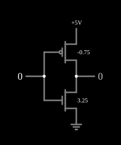

# Função ternária F220

<!-- navegacao:inicio -->
[Índice](README.md) · [Anterior: F211](3-f211.md) · [Próximo: F221](3-f221.md)
<!-- navegacao:fim -->

## Objetivo

Mostrar a função ternária $F_{220}$, que dá $2$ para as entradas $0$ e $1$ e $0$ para a entrada $2$: um inversor binário cujo limiar fica entre os níveis $1$ e $2$.

## O circuito

<!-- esquema:inicio -->

<!-- esquema:fim -->

Os níveis são $0$ ($0\ \text{V}$), $1$ ($2{,}5\ \text{V}$) e $2$ ($5\ \text{V}$). A entrada ternária (elemento 8, que avança $0 \to 1 \to 2 \to 0$ a cada clique) vai às portas de:

- um PMOS de enriquecimento com $|V_t| = 0{,}75\ \text{V}$ entre $5\ \text{V}$ e a saída;
- um NMOS de enriquecimento com $V_t = 3{,}25\ \text{V}$ entre a saída e a terra.

A saída ternária é o elemento 7. O exemplo abre com a entrada em $0$.

<!-- componentes:inicio -->
| N.º | Tipo | Elemento | Valores |
|----:|------|----------|---------|
| 0 | `NMosfetElm` | MOSFET | Model = old-mosfet; Swap D/S = não |
| 3 | `PMosfetElm` | MOSFET | Model = old-mosfet-3; Swap D/S = não |
| 6 | `RailElm` | voltage source | Voltage = 5; Waveform = D/C; DC Offset (V) = 0; Internal Resistance (ohms) = 0 |
| 7 | `LogicOutputElm` | logic output | Threshold = 2.5; Current Required = não; Numeric = sim; Ternary = sim |
| 8 | `LogicInputElm` | logic input | Momentary Switch = não; High Logic Voltage = 5; Low Voltage = 0; Numeric = sim; Ternary = sim; Keyboard Shortcut =  |
| 9 | `GroundElm` | ground | Symbol = Earth |
<!-- componentes:fim -->

## Teoria

É um [Inversor CMOS](cmosinverter.md) com limiares assimétricos:

- o PMOS, de limiar baixo, conduz sempre que a entrada estiver mais de $0{,}75\ \text{V}$ abaixo de $5\ \text{V}$, isto é, nas entradas $0$ e $1$;
- o NMOS, de limiar alto, só conduz com a entrada em $5\ \text{V}$.

O ponto de comutação fica, assim, entre $2{,}5\ \text{V}$ e $5\ \text{V}$, e a saída só desce para a entrada $2$. Uma saída que só usa os níveis $0$ e $2$ é binária: $F_{220}$ responde "a entrada é $2$?" com $0$ (sim) ou $2$ (não).

## Resultados esperados

O simulador dá:

| Entrada | Saída |
|--------:|------:|
| 0 | 2 ($5\ \text{V}$) |
| 1 | 2 ($5\ \text{V}$) |
| 2 | 0 ($1\ \mu\text{V}$) |

## O que observar

Clique na entrada e repare que o nível do meio é tratado como "baixo". Compare com [F211](3-f211.md), que separa o $0$ dos outros dois níveis, e com [F221](3-f221.md).

## Limites do modelo

- Com a entrada em $1$, o PMOS conduz com $V_{SG} = 2{,}5\ \text{V}$, só $1{,}75\ \text{V}$ acima do seu limiar; num circuito real, essa margem pequena tornaria o nível do meio sensível a ruído e a variações do processo.
- Sem capacitâncias, a comutação é instantânea.

## Referências

Mouftah e Jordan, trabalhos sobre lógica ternária COS/MOS (IEEE, anos 1970); Hurst, "Multiple-Valued Logic — its Status and its Future", *IEEE Transactions on Computers*, 1984.

O circuito deste exemplo faz parte da coleção do simulador original de Paul Falstad e Iain Sharp (CircuitJS1); a explicação é deste projeto.
