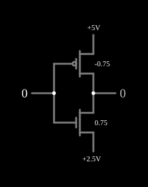

# Função ternária F221

<!-- navegacao:inicio -->
[Índice](README.md) · [Anterior: F220](3-f220.md)
<!-- navegacao:fim -->

## Objetivo

Mostrar a função ternária $F_{221}$, que dá $2$ para as entradas $0$ e $1$ e $1$ para a entrada $2$.

## O circuito

<!-- esquema:inicio -->

<!-- esquema:fim -->

Os níveis são $0$ ($0\ \text{V}$), $1$ ($2{,}5\ \text{V}$) e $2$ ($5\ \text{V}$). A entrada ternária (elemento 8, que avança $0 \to 1 \to 2 \to 0$ a cada clique) vai às portas de:

- um PMOS de enriquecimento com $|V_t| = 0{,}75\ \text{V}$ entre $5\ \text{V}$ e a saída;
- um NMOS de enriquecimento com $V_t = 0{,}75\ \text{V}$ entre a saída e o trilho de $2{,}5\ \text{V}$.

A saída ternária é o elemento 7. O exemplo abre com a entrada em $0$.

<!-- componentes:inicio -->
| N.º | Tipo | Elemento | Valores |
|----:|------|----------|---------|
| 0 | `NMosfetElm` | MOSFET | Model = old-mosfet-3; Swap D/S = não |
| 3 | `PMosfetElm` | MOSFET | Model = old-mosfet-3; Swap D/S = não |
| 6 | `RailElm` | voltage source | Voltage = 5; Waveform = D/C; DC Offset (V) = 0; Internal Resistance (ohms) = 0 |
| 7 | `LogicOutputElm` | logic output | Threshold = 2.5; Current Required = não; Numeric = sim; Ternary = sim |
| 8 | `LogicInputElm` | logic input | Momentary Switch = não; High Logic Voltage = 5; Low Voltage = 0; Numeric = sim; Ternary = sim; Keyboard Shortcut =  |
| 9 | `RailElm` | voltage source | Voltage = 2.5; Waveform = D/C; DC Offset (V) = 0; Internal Resistance (ohms) = 0 |
<!-- componentes:fim -->

## Teoria

O NMOS tem a fonte no trilho do meio: com a entrada em $0$ ou $2{,}5\ \text{V}$, $V_{GS} \le 0$ e ele corta; só com a entrada em $5\ \text{V}$ ($V_{GS} = 2{,}5\ \text{V} > 0{,}75\ \text{V}$) ele liga a saída a $2{,}5\ \text{V}$. O PMOS, de limiar baixo, conduz para as entradas $0$ e $1$ e leva a saída a $5\ \text{V}$; com a entrada em $5\ \text{V}$ ele corta. Resulta:

$$F_{221}(x) = \begin{cases} 2, & x \in \{0, 1\} \\ 1, & x = 2 \end{cases}$$

É a [F220](3-f220.md) com o transistor de baixo ligado ao trilho do meio em vez da terra.

## Resultados esperados

O simulador dá:

| Entrada | Saída |
|--------:|------:|
| 0 | 2 ($5\ \text{V}$) |
| 1 | 2 ($5\ \text{V}$) |
| 2 | 1 ($2{,}5\ \text{V}$) |

## O que observar

Clique na entrada e compare com [F220](3-f220.md) (mesma separação, saída em $0$) e com [F211](3-f211.md).

## Limites do modelo

- A margem do PMOS com a entrada em $1$ é pequena ($V_{SG} = 2{,}5\ \text{V}$ contra um limiar de $0{,}75\ \text{V}$ é suficiente aqui, mas sensível a variações num circuito real).
- Sem capacitâncias, a comutação é instantânea.

## Referências

Mouftah e Jordan, trabalhos sobre lógica ternária COS/MOS (IEEE, anos 1970); Hurst, "Multiple-Valued Logic — its Status and its Future", *IEEE Transactions on Computers*, 1984.

O circuito deste exemplo faz parte da coleção do simulador original de Paul Falstad e Iain Sharp (CircuitJS1); a explicação é deste projeto.
