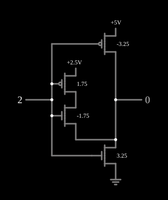

# Complemento ternário (F210)

<!-- navegacao:inicio -->
[Índice](README.md) · [Anterior: CGOR](3-cgor.md) · [Próximo: F211](3-f211.md)
<!-- navegacao:fim -->

## Objetivo

Mostrar o **inversor ternário**, que leva $0 \to 2$, $1 \to 1$ e $2 \to 0$, e com ele a notação $F_{xyz}$ das funções ternárias de uma entrada.

## O circuito

<!-- esquema:inicio -->

<!-- esquema:fim -->

Os níveis são $0$ ($0\ \text{V}$), $1$ ($2{,}5\ \text{V}$) e $2$ ($5\ \text{V}$). A entrada ternária (elemento 18, que avança $0 \to 1 \to 2 \to 0$ a cada clique) vai às portas de quatro MOSFETs:

- um PMOS de enriquecimento ($|V_t| = 3{,}25\ \text{V}$) entre $5\ \text{V}$ e a saída;
- um NMOS de enriquecimento ($V_t = 3{,}25\ \text{V}$) entre a saída e a terra;
- um PMOS e um NMOS de depleção ($V_t = -1{,}75\ \text{V}$) em série entre o trilho de $2{,}5\ \text{V}$ e a saída.

A saída ternária é o elemento 15. O exemplo abre com a entrada em $2$.

<!-- componentes:inicio -->
| N.º | Tipo | Elemento | Valores |
|----:|------|----------|---------|
| 0 | `NMosfetElm` | MOSFET | Model = old-mosfet; Swap D/S = não |
| 1 | `NMosfetElm` | MOSFET | Model = old-mosfet-2; Swap D/S = não |
| 2 | `PMosfetElm` | MOSFET | Model = old-mosfet-2; Swap D/S = não |
| 8 | `RailElm` | voltage source | Voltage = 2.5; Waveform = D/C; DC Offset (V) = 0; Internal Resistance (ohms) = 0 |
| 9 | `PMosfetElm` | MOSFET | Model = old-mosfet; Swap D/S = não |
| 11 | `RailElm` | voltage source | Voltage = 5; Waveform = D/C; DC Offset (V) = 0; Internal Resistance (ohms) = 0 |
| 12 | `GroundElm` | ground | Symbol = Earth |
| 15 | `LogicOutputElm` | logic output | Threshold = 2.5; Current Required = não; Numeric = sim; Ternary = sim |
| 18 | `LogicInputElm` | logic input | Momentary Switch = não; High Logic Voltage = 5; Low Voltage = 0; Numeric = sim; Ternary = sim; Keyboard Shortcut =  |
<!-- componentes:fim -->

## Teoria

Uma função ternária de uma entrada é dada pela lista das saídas para as entradas $0$, $1$ e $2$; o complemento é $F_{210}$, isto é, $\overline{x} = 2 - x$. No circuito:

- **entrada $0$:** o PMOS de enriquecimento tem $V_{SG} = 5\ \text{V} > 3{,}25\ \text{V}$ e liga a saída a $5\ \text{V}$; o NMOS de depleção, com a porta $2{,}5\ \text{V}$ abaixo do trilho do meio, corta;
- **entrada $1$:** os dois transistores de enriquecimento têm só $2{,}5\ \text{V}$ entre porta e fonte e ficam cortados; os de depleção, com porta e trilho no mesmo potencial, conduzem e ligam a saída a $2{,}5\ \text{V}$;
- **entrada $2$:** o NMOS de enriquecimento liga a saída à terra; o PMOS de depleção corta.

É o [Inversor CMOS](cmosinverter.md) com um terceiro caminho, para o nível do meio, que só conduz quando a entrada também está no meio.

## Resultados esperados

O simulador dá:

| Entrada | Saída |
|--------:|------:|
| 0 | 2 ($5\ \text{V}$) |
| 1 | 1 ($2{,}5\ \text{V}$) |
| 2 | 0 ($2\ \mu\text{V}$) |

## O que observar

Clique na entrada e veja a saída percorrer os três níveis em ordem inversa. As outras funções de uma entrada desta coleção são [F211](3-f211.md), [F220](3-f220.md) e [F221](3-f221.md).

## Limites do modelo

- Os transistores com vários limiares são parâmetros do modelo; num processo real exigiriam implantes de $V_t$ diferentes.
- Sem capacitâncias, a comutação é instantânea.

## Referências

Mouftah e Jordan, trabalhos sobre lógica ternária COS/MOS (IEEE, anos 1970); Hurst, "Multiple-Valued Logic — its Status and its Future", *IEEE Transactions on Computers*, 1984.

O circuito deste exemplo faz parte da coleção do simulador original de Paul Falstad e Iain Sharp (CircuitJS1); a explicação é deste projeto.
