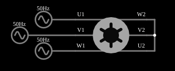

# Motor de indução trifásico

<!-- navegacao:inicio -->
[Índice](README.md) · [Anterior: Unijunction Oscillator](ujtosc.md) · [Próximo: Latching Relay](latchingrelay.md)
<!-- navegacao:fim -->

## Objetivo

Mostrar a partida de um **motor de indução trifásico**: três tensões defasadas de $120^\circ$ criam um campo magnético girante no estator, o rotor é arrastado por ele e acelera até quase a velocidade do campo, e a corrente cai da altíssima corrente de partida à corrente de regime.

## O circuito

<!-- esquema:inicio -->

<!-- esquema:fim -->

Três fontes senoidais de $220\ \text{V}$ de pico e $50\ \text{Hz}$, com fases de $0^\circ$, $-120^\circ$ e $+120^\circ$, alimentam o motor. O modelo do motor tem indutância do estator de $29{,}4\ \text{mH}$, do rotor de $29{,}7\ \text{mH}$, coeficiente de acoplamento de $0{,}971$, resistências de $67\ \text{m}\Omega$ (estator) e $32\ \text{m}\Omega$ (rotor), atrito de $0{,}05\ \text{N·m·s/rad}$ e momento de inércia de $0{,}067\ \text{kg·m}^2$. Um osciloscópio mostra a corrente numa fase.

<!-- componentes:inicio -->
| N.º | Tipo | Elemento | Valores |
|----:|------|----------|---------|
| 0 | `RailElm` | A/C source | Max Voltage = 220; Waveform = A/C; DC Offset (V) = 0; Internal Resistance (ohms) = 0; Show Voltage = não; Frequency (Hz) = 50; Phase Offset (degrees) = 0 |
| 1 | `RailElm` | A/C source | Max Voltage = 220; Waveform = A/C; DC Offset (V) = 0; Internal Resistance (ohms) = 0; Show Voltage = não; Frequency (Hz) = 50; Phase Offset (degrees) = -120 |
| 2 | `RailElm` | A/C source | Max Voltage = 220; Waveform = A/C; DC Offset (V) = 0; Internal Resistance (ohms) = 0; Show Voltage = não; Frequency (Hz) = 50; Phase Offset (degrees) = 120 |
| 3 | `ThreePhaseMotorElm` | 3-Phase Motor | Stator Inductance (H) = 29.4m; Rotor Inductance (H) = 29.7m; Coupling Coefficient = 971.2m; Stator Resistance (ohms) = 67m; Rotor Resistance (ohms) = 32m; Friction coefficient (Nms/rad) = 50m; Moment of inertia (Kg.m^2) = 67m |
<!-- componentes:fim -->

## Símbolos e parâmetros

Os símbolos usados neste documento (definições completas no [glossário](../glossario-simbolos.md)):

| Símbolo | Nome | Significado | Unidade |
|---------|------|-------------|---------|
| $a$ | fase a | fase a do motor trifásico | — |
| $s$ | variável de Laplace | frequência complexa; no regime senoidal, $s = j\omega$ | 1/s |
| $k$ | coeficiente de acoplamento | fração do fluxo de uma bobina que atravessa a outra (de $0$ a $1$) | — |
| $i_a$ | corrente do circuito a | corrente do primeiro circuito | A |
| $i_b$ | corrente da bobina | corrente que passa pela bobina do relé | A |
| $i_c$ | corrente de coletor de pequeno sinal | variação da corrente do coletor em torno do ponto de operação | A |
| $L_\sigma$ | indutância de dispersão | parte da indutância que não se acopla ao outro enrolamento | H |
| $L_s$ | indutância do estator | indutância do enrolamento do estator | H |
| $V_p$ | tensão de pico | valor máximo atingido por uma senoide | V |
| $R_s$ | resistência em série | resistor em série com a fonte ou com o dispositivo | Ω |
| $R_r$ | resistência do rotor | resistência do enrolamento do rotor | Ω |
| $\omega$ | frequência angular | $2\pi f$: a frequência medida em radianos por segundo | rad/s |

## Teoria

Três correntes $i_a, i_b, i_c$ defasadas de $120^\circ$ nos enrolamentos do estator produzem um campo de módulo constante que gira com a frequência da rede. O rotor, parado no início, vê esse campo passar por ele com *escorregamento* $s = 1$ e tem correntes induzidas altas; o torque resultante o acelera, o escorregamento diminui e a corrente cai. Com o rotor bloqueado, o motor se comporta como um transformador em curto no secundário, limitado só pela indutância de dispersão,

$$L_\sigma = (1 - k^2) L_s = (1 - 0{,}971^2)\cdot 29{,}4\ \text{mH} \approx 1{,}7\ \text{mH},$$

e pelas resistências. A corrente de pico de rotor bloqueado é da ordem de $V_p/\sqrt{(R_s + R_r)^2 + (\omega L_\sigma)^2} = 220/\sqrt{0{,}099^2 + 0{,}524^2} \approx 412\ \text{A}$; o primeiro pico real é maior ($650\ \text{A}$) pelo componente contínuo do transitório de ligação, que não aparece nessa conta em regime permanente senoidal. Essa estimativa de ordem de grandeza vale para um modelo de uma fase equivalente; não foi calculada com o modelo exato do simulador.

## Resultados esperados

O simulador dá a corrente de pico na fase $a$:

| Janela | Corrente de pico |
|---|---:|
| $0$ a $0{,}1\ \text{s}$ (partida) | $650\ \text{A}$ |
| $0{,}2$ a $0{,}3\ \text{s}$ | $140\ \text{A}$ |
| $0{,}9$ a $1\ \text{s}$ | $19{,}7\ \text{A}$ |
| $2{,}9$ a $3\ \text{s}$ (regime) | $19{,}0\ \text{A}$ |

A corrente de partida é $34$ vezes a de regime, e o motor atinge o regime em cerca de $1\ \text{s}$.

## O que observar

No osciloscópio, a corrente começa enorme e cai em poucas centenas de milissegundos; enquanto o rotor acelera, com a inércia de $0{,}067\ \text{kg·m}^2$ dando o tempo de aceleração. Troque duas das fases e o motor passa a girar ao contrário.

## Limites do modelo

- O modelo é de parâmetros concentrados, um motor de indução ideal de três fases; não inclui saturação magnética, perdas no ferro nem efeito pelicular.
- O valor de regime ($19{,}0\ \text{A}$ de pico) é a corrente a vazio mais a de um atrito pequeno; este projeto não a calculou a partir dos parâmetros.
- A estimativa de $412\ \text{A}$ acima é só de ordem de grandeza.

## Referências

Fitzgerald, Kingsley e Umans, *Electric Machinery*, capítulo sobre máquinas de indução; Chapman, *Electric Machinery Fundamentals*.

O circuito deste exemplo faz parte da coleção do simulador original de Paul Falstad e Iain Sharp (CircuitJS1); a explicação é deste projeto.
