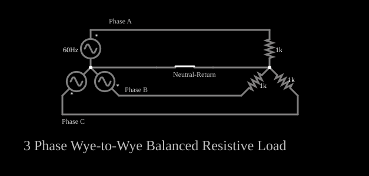

# Sistema trifásico estrela-estrela equilibrado

<!-- navegacao:inicio -->
[Índice](README.md) · [Anterior: Phase-Sequence Network](phaseseq.md)
<!-- navegacao:fim -->

## Objetivo

Mostrar um sistema trifásico equilibrado, com três fontes defasadas de $120^\circ$ ligadas em estrela a três cargas iguais, e que num sistema equilibrado a corrente do fio neutro é nula (por isso o neutro pode até ser retirado).

## O circuito

<!-- esquema:inicio -->

<!-- esquema:fim -->

Três fontes senoidais de $169{,}7\ \text{V}$ de pico ($120\ \text{V}$ eficazes), $60\ \text{Hz}$, com fases de $0^\circ$ (fase A), $120^\circ$ (fase B) e $240^\circ$ (fase C), têm um terminal comum (o neutro da fonte). Cada uma alimenta um resistor de $1\ \text{k}\Omega$; os outros terminais dos resistores se ligam no neutro da carga, que é ligado ao neutro da fonte por um fio com uma chave (o "retorno neutro"). Dois osciloscópios mostram as tensões e as correntes das três fases.

<!-- componentes:inicio -->
| N.º | Tipo | Elemento | Valores |
|----:|------|----------|---------|
| 0 | `VoltageElm` | A/C source | Max Voltage = 169.7; Waveform = A/C; DC Offset (V) = 0; Internal Resistance (ohms) = 0; Show Voltage = não; Frequency (Hz) = 60; Phase Offset (degrees) = 0 |
| 1 | `VoltageElm` | A/C source | Max Voltage = 169.7; Waveform = A/C; DC Offset (V) = 0; Internal Resistance (ohms) = 0; Show Voltage = não; Frequency (Hz) = 60; Phase Offset (degrees) = 120 |
| 2 | `VoltageElm` | A/C source | Max Voltage = 169.7; Waveform = A/C; DC Offset (V) = 0; Internal Resistance (ohms) = 0; Show Voltage = não; Frequency (Hz) = 60; Phase Offset (degrees) = 240 |
| 3 | `ResistorElm` | resistor | Resistance (ohms) = 1k |
| 5 | `ResistorElm` | resistor | Resistance (ohms) = 1k |
| 6 | `ResistorElm` | resistor | Resistance (ohms) = 1k |
| 13 | `SwitchElm` | switch (SPST) | Momentary Switch = não; IEC Symbol = não; Label (for linking) = ; Keyboard Shortcut = ; On Resistance (ohms) = 0 |
| 14 | `TextElm` | text | Text = Phase A; Size = 12; Draw Bar On Top = não; Color = #c0c0c0 |
| 15 | `TextElm` | text | Text = Phase C; Size = 12; Draw Bar On Top = não; Color = #c0c0c0 |
| 16 | `TextElm` | text | Text = Phase B; Size = 12; Draw Bar On Top = não; Color = #c0c0c0 |
| 17 | `TextElm` | text | Text = Neutral-Return; Size = 12; Draw Bar On Top = não; Color = #c0c0c0 |
| 18 | `TextElm` | text | Text = 3 Phase Wye-to-Wye Balanced Resistive Load; Size = 24; Draw Bar On Top = não; Color = #c0c0c0 |
<!-- componentes:fim -->

## Teoria

As três tensões de fase são

$$v_A = V_p\sin\omega t,\qquad v_B = V_p\sin(\omega t - 120^\circ),\qquad v_C = V_p\sin(\omega t - 240^\circ),$$

e sua soma é nula em todos os instantes ($v_A + v_B + v_C = 0$). Com cargas iguais $R$, as correntes de fase $i_k = v_k/R$ também somam zero, e a corrente no fio neutro,

$$i_N = i_A + i_B + i_C = 0.$$

Por isso, num sistema equilibrado o fio neutro não conduz corrente (ele só carrega o desequilíbrio entre as cargas), e retirá-lo não muda as tensões das cargas.

A tensão entre duas fases (tensão de linha) é $\sqrt3$ vezes a de fase: $V_{linha} = \sqrt3\cdot 120 = 208\ \text{V}$ eficazes. A potência total em cargas equilibradas é constante no tempo: $p = 3\,V_{ef}^2/R = 43{,}2\ \text{W}$, uma das vantagens do sistema trifásico para acionar motores.

## Resultados esperados

Cada resistor recebe $120\ \text{V}$ eficazes e uma corrente de $120\ \text{mA}$ eficazes ($169{,}7\ \text{mA}$ de pico), defasadas de $120^\circ$ entre si; a corrente no neutro é zero, com a chave fechada e com ela aberta. As verificações conferem a tensão eficaz dos três resistores e a corrente nula do neutro com a chave fechada (posição inicial) e aberta, numa janela de um ciclo (de $0{,}05$ a $0{,}0667\ \text{s}$), com tolerância de 1% (o simulador fica a menos de 0,1% da teoria).

## O que observar

- Abra e feche a chave do neutro: nada muda, porque a corrente que ele carregaria é nula.
- Os osciloscópios mostram três senoides defasadas de um terço de período.
- Mude uma das cargas: o sistema deixa de ser equilibrado, e a corrente do neutro deixa de ser nula (nessa situação, abrir o neutro altera as tensões das cargas).

## Limites do modelo

Fontes e cargas ideais, sem impedância de linha; as fontes são perfeitamente iguais e defasadas de exatamente $120^\circ$. Num sistema real há desequilíbrios e harmônicos (os de terceira ordem, em particular, somam-se no neutro em vez de se anularem).

## Referências

- C. K. Alexander e M. N. O. Sadiku, *Fundamentos de Circuitos Elétricos*, AMGH.
- J. W. Nilsson e S. A. Riedel, *Circuitos Elétricos*, Pearson.

O circuito deste exemplo faz parte da coleção do simulador original de Paul Falstad e Iain Sharp (CircuitJS1); a explicação é deste projeto.
