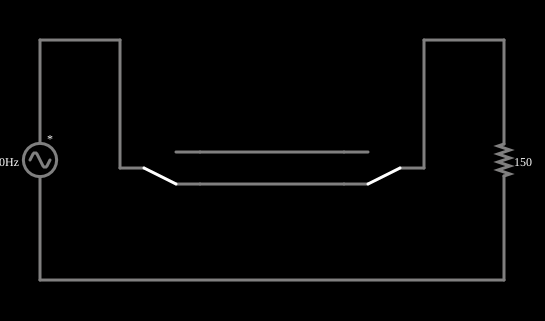

# Interruptores de três vias

<!-- navegacao:inicio -->
[Índice](README.md) · [Próximo: 3- and 4-Way Light Switches](4way.md)
<!-- navegacao:fim -->

## Objetivo

Mostrar como duas chaves de duas posições (SPDT), ligadas por dois fios "viajantes", comandam uma mesma lâmpada de dois lugares diferentes, como o interruptor de uma escada.

## O circuito

<!-- esquema:inicio -->

<!-- esquema:fim -->

Uma fonte de $120\ \text{V}$ eficazes ($169{,}7\ \text{V}$ de pico, $60\ \text{Hz}$) alimenta uma lâmpada, representada por um resistor de $150\ \Omega$, através de duas chaves SPDT em série. O polo de cada chave fica de um lado da fonte e da lâmpada, e os dois contatos de cada chave são ligados aos da outra por dois fios (os "viajantes"). Cada chave pode estar na posição de cima ou na de baixo.

<!-- componentes:inicio -->
| N.º | Tipo | Elemento | Valores |
|----:|------|----------|---------|
| 0 | `VoltageElm` | A/C source | Max Voltage = 169.7; Waveform = A/C; DC Offset (V) = 0; Internal Resistance (ohms) = 0; Show Voltage = não; Frequency (Hz) = 60; Phase Offset (degrees) = 0 |
| 1 | `ResistorElm` | resistor | Resistance (ohms) = 150 |
| 4 | `Switch2Elm` | switch (SPDT) | Momentary Switch = não; Group Number (for linking) = 0; # of Throws = 2; Keyboard Shortcut = ; On Resistance (ohms) = 0 |
| 7 | `Switch2Elm` | switch (SPDT) | Momentary Switch = não; Group Number (for linking) = 0; # of Throws = 2; Keyboard Shortcut = ; On Resistance (ohms) = 0 |
<!-- componentes:fim -->

## Teoria

Com um viajante superior e um inferior, existem dois caminhos entre as chaves; a corrente passa se e só se as duas chaves estiverem na mesma posição (as duas em cima ou as duas embaixo), o que é a função lógica

$$L = \overline{A \oplus B} = A\,B + \bar A\,\bar B,$$

um "OU exclusivo negado" (coincidência), em que $A$ e $B$ são as posições das chaves. Trocar a posição de **qualquer** das chaves inverte o estado da lâmpada, qualquer que seja a posição da outra, e por isso cada chave pode apagar ou acender a lâmpada.

A lâmpada de $R = 150\ \Omega$ ligada a $V_{ef} = 120\ \text{V}$ consome $P = V_{ef}^2/R = 96\ \text{W}$ e a corrente tem pico $I_p = 169{,}7/150 = 1{,}131\ \text{A}$.

## Resultados esperados

Na posição em que o exemplo abre, a lâmpada está acesa. Trocando uma das duas chaves, ela apaga; trocando a outra também, volta a acender:

| chave 1 trocada | chave 2 trocada | lâmpada |
|:--:|:--:|:--:|
| não | não | acesa ($I_p = 1{,}131\ \text{A}$) |
| não | sim | apagada |
| sim | não | apagada |
| sim | sim | acesa |

As quatro linhas são conferidas pela corrente de pico na lâmpada em um ciclo (de $0{,}1$ a $0{,}1167\ \text{s}$), com tolerância de 1%.

## O que observar

- Clique em cada chave e veja o caminho da corrente: ela percorre um dos viajantes de uma chave à outra.
- Apague a lâmpada com uma chave e acenda com a outra: cada uma comanda a lâmpada sozinha, sem depender da posição da outra.
- Nas instalações reais, esse arranjo é usado em corredores e escadas; para três ou mais pontos de comando se acrescenta o interruptor de quatro vias do próximo exemplo.

## Limites do modelo

Chaves e fios ideais (resistência de contato nula) e uma lâmpada resistiva constante; uma lâmpada incandescente real tem resistência que depende da temperatura (muito menor a frio), e uma lâmpada LED não é resistiva. A corrente alternada é só a forma de a lâmpada "acender": o comportamento é o mesmo com corrente contínua.

## Referências

- C. K. Alexander e M. N. O. Sadiku, *Fundamentos de Circuitos Elétricos*, AMGH.
- J. W. Nilsson e S. A. Riedel, *Circuitos Elétricos*, Pearson.

O circuito deste exemplo faz parte da coleção do simulador original de Paul Falstad e Iain Sharp (CircuitJS1); a explicação é deste projeto.
