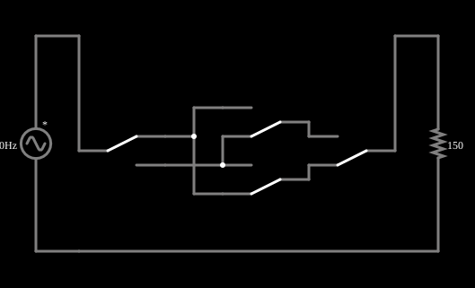

# Interruptores de três e quatro vias

<!-- navegacao:inicio -->
[Índice](README.md) · [Anterior: 3-Way Light Switches](3way.md) · [Próximo: Differentiator](diff.md)
<!-- navegacao:fim -->

## Objetivo

Mostrar como acrescentar um terceiro ponto de comando à lâmpada do exemplo anterior, com uma chave de quatro vias (reversora) entre as duas de três vias.

## O circuito

<!-- esquema:inicio -->

<!-- esquema:fim -->

A lâmpada de $150\ \Omega$ continua ligada a $120\ \text{V}$ eficazes, mas agora há três chaves em série: duas SPDT, nas pontas (como no exemplo anterior), e no meio uma chave de **quatro vias**, que é uma chave dupla ligada de modo a cruzar ou não cruzar os dois viajantes (aqui, dois contatos SPDT acoplados, que se movem juntos).

<!-- componentes:inicio -->
| N.º | Tipo | Elemento | Valores |
|----:|------|----------|---------|
| 0 | `VoltageElm` | A/C source | Max Voltage = 169.7; Waveform = A/C; DC Offset (V) = 0; Internal Resistance (ohms) = 0; Show Voltage = não; Frequency (Hz) = 60; Phase Offset (degrees) = 0 |
| 1 | `ResistorElm` | resistor | Resistance (ohms) = 150 |
| 3 | `Switch2Elm` | switch (SPDT) | Momentary Switch = não; Group Number (for linking) = 2; # of Throws = 2; Keyboard Shortcut = ; On Resistance (ohms) = 0 |
| 4 | `Switch2Elm` | switch (SPDT) | Momentary Switch = não; Group Number (for linking) = 2; # of Throws = 2; Keyboard Shortcut = ; On Resistance (ohms) = 0 |
| 11 | `Switch2Elm` | switch (SPDT) | Momentary Switch = não; Group Number (for linking) = 0; # of Throws = 2; Keyboard Shortcut = ; On Resistance (ohms) = 0 |
| 17 | `Switch2Elm` | switch (SPDT) | Momentary Switch = não; Group Number (for linking) = 0; # of Throws = 2; Keyboard Shortcut = ; On Resistance (ohms) = 0 |
<!-- componentes:fim -->

## Teoria

A chave de quatro vias só tem dois estados: ou liga os viajantes direto ou os cruza. Cada troca de estado de **qualquer** das três chaves inverte o estado da lâmpada (cada uma é um ponto de comando equivalente). Em termos lógicos, a lâmpada acesa corresponde a uma paridade fixa do número de chaves trocadas em relação à posição inicial:

$$L = \overline{A \oplus B \oplus C}.$$

Com mais pontos de comando se acrescentam mais chaves de quatro vias no meio, sempre entre as duas de três vias nas pontas.

## Resultados esperados

Com o exemplo abrindo com a lâmpada acesa, a lâmpada está acesa quando o número de chaves trocadas é **par** (zero ou duas) e apagada quando é ímpar (uma ou três):

| trocadas | lâmpada |
|:--------:|:-------:|
| nenhuma | acesa |
| uma qualquer | apagada |
| duas quaisquer | acesa |
| as três | apagada |

As oito combinações são conferidas pela corrente de pico na lâmpada em um ciclo (de $0{,}1$ a $0{,}1167\ \text{s}$), com tolerância de 1% ($1{,}131\ \text{A}$ quando acesa, $0$ quando apagada).

## O que observar

- Experimente todas as combinações: cada chave inverte o estado da lâmpada, mesmo estando as outras em qualquer posição.
- Siga com o ponteiro o caminho da corrente: com a chave do meio cruzada, os viajantes trocam de lugar.
- Compare com o exemplo de duas chaves: a lógica é a mesma, com um ponto de comando a mais.

## Limites do modelo

Chaves, fios e lâmpada ideais (veja os limites do exemplo anterior). A chave de quatro vias do exemplo é formada por dois contatos SPDT que o simulador move juntos, em um grupo ligado; uma chave de quatro vias real tem um só mecanismo de duas posições.

## Referências

- C. K. Alexander e M. N. O. Sadiku, *Fundamentos de Circuitos Elétricos*, AMGH.
- J. W. Nilsson e S. A. Riedel, *Circuitos Elétricos*, Pearson.

O circuito deste exemplo faz parte da coleção do simulador original de Paul Falstad e Iain Sharp (CircuitJS1); a explicação é deste projeto.
