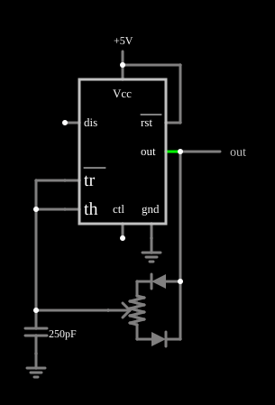

# Oscilador com ciclo de trabalho ajustável

<!-- navegacao:inicio -->
[Índice](README.md) · [Anterior: Missing Pulse Detector](555missing.md)
<!-- navegacao:fim -->

## Objetivo

Mostrar como variar o ciclo de trabalho de um oscilador 555 sem alterar a frequência: um potenciômetro com dois diodos divide a resistência total em um caminho de carga e outro de descarga.

## O circuito

<!-- esquema:inicio -->

<!-- esquema:fim -->

Um 555 alimentado com $5\ \text{V}$ tem o capacitor de $250\ \text{pF}$ nos pinos *tr* e *th*. Um potenciômetro de $100\ \text{k}\Omega$ ("Resistance", em $50\%$ ao abrir) e dois diodos em sentidos opostos, ligados às duas partes do potenciômetro, formam os caminhos de carga e de descarga do capacitor: um diodo deixa passar a corrente de carga (pela parte do potenciômetro entre o cursor e uma extremidade) e o outro, a de descarga (pela outra parte). Um elemento de saída e dois osciloscópios mostram o resultado. O passo de tempo da simulação é de $50\ \text{ns}$, por causa da frequência alta.

<!-- componentes:inicio -->
| N.º | Tipo | Elemento | Valores |
|----:|------|----------|---------|
| 0 | `TimerElm` | 555 Timer | Ground Pin = sim; Show Pin Numbers = não |
| 4 | `CapacitorElm` | capacitor | Capacitance (F) = 250p; Trapezoidal Approximation = sim; Initial Voltage (on Reset) = 1m; Series Resistance = 0 |
| 5 | `GroundElm` | ground | Symbol = Earth |
| 6 | `DiodeElm` | diode | Model = default |
| 8 | `RailElm` | voltage source | Voltage = 5; Waveform = D/C; DC Offset (V) = 0; Internal Resistance (ohms) = 0 |
| 9 | `OutputElm` | output | Show Voltage = não |
| 10 | `GroundElm` | ground | Symbol = Earth |
| 13 | `PotElm` | potentiometer | Resistance (ohms) = 100k; Slider Text = Resistance; Show Values = sim; Group Number (for linking) = 0 |
| 14 | `DiodeElm` | diode | Model = default |
<!-- componentes:fim -->

## Teoria

Se $R_a$ é a parte do potenciômetro que carrega e $R_b$ a que descarrega, com $R_a + R_b = R_\text{pot}$,

$$t_h = 0{,}693\,R_a\,C,\quad t_l = 0{,}693\,R_b\,C,\quad T = 0{,}693\,R_\text{pot}\,C,\quad D = \frac{R_a}{R_\text{pot}}.$$

A **soma** $R_a + R_b$ não depende da posição do cursor: o período fica constante e só a divisão entre nível alto e baixo muda. Com $R_\text{pot} = 100\ \text{k}\Omega$ e $C = 250\ \text{pF}$,

$$T = 0{,}693\cdot 100\ \text{k}\Omega\cdot 250\ \text{pF} = 17{,}3\ \mu\text{s} \quad(57{,}7\ \text{kHz}), \qquad D = 50\%\ \text{com o cursor no meio}.$$

## Resultados esperados

| Grandeza | Teoria (diodos ideais) | Simulador |
|----------|----------------------:|----------:|
| Frequência | $57{,}7\ \text{kHz}$ | $50{,}5\ \text{kHz}$ |
| Ciclo de trabalho | $50\%$ | $49{,}5\%$ (valor médio $2{,}475\ \text{V}$ de $5\ \text{V}$) |

A frequência do simulador é $12\%$ menor que a ideal porque a queda dos diodos ($\approx 0{,}6\ \text{V}$ numa alimentação de só $5\ \text{V}$) reduz a tensão efetiva de carga e alonga os tempos. As verificações conferem a frequência, o ciclo de trabalho e o máximo da saída em uma janela de $0{,}3\ \text{ms}$ (cerca de $15$ ciclos).

## O que observar

- Mexa no *slider* "Resistance": o ciclo de trabalho muda (a teoria prevê de $0$ a $100\%$) enquanto a frequência quase não muda.
- Os dois diodos funcionam como chaves: apenas uma parte do potenciômetro atua em cada fase do ciclo.
- Compare com o exemplo "Low-duty-cycle Oscillator", que tem resistores fixos e ciclo de trabalho fixo.

## Limites do modelo

O 555 do simulador é um modelo ideal: o divisor interno é de $5\ \text{k}\Omega$ e $10\ \text{k}\Omega$ (o pino de controle fica em $2V_{CC}/3$), os comparadores são perfeitos, a saída liga-se a $V_{CC}$ ou à terra por $1\ \Omega$ (ela vai de trilho a trilho, ao contrário de um 555 bipolar real, cuja saída alta fica $1$ a $2\ \text{V}$ abaixo de $V_{CC}$) e o transistor de descarga é uma resistência de $10\ \Omega$. Não há atraso de propagação, corrente de polarização dos comparadores nem pico de corrente de alimentação na comutação. A queda dos diodos é o maior erro em relação à teoria ideal, principalmente com $V_{CC}$ baixo; a teoria que prevê frequência constante vale para diodos ideais. A variação do ciclo de trabalho com o cursor não foi medida neste documento, pois a verificação usa a posição inicial.

## Referências

- Signetics/Philips, *NE555 Timer* (folha de dados).
- P. Horowitz e W. Hill, *The Art of Electronics*, Cambridge University Press.
- U. Tietze e C. Schenk, *Electronic Circuits: Handbook for Design and Application*, Springer.

O circuito deste exemplo faz parte da coleção do simulador original de Paul Falstad e Iain Sharp (CircuitJS1); a explicação é deste projeto.
