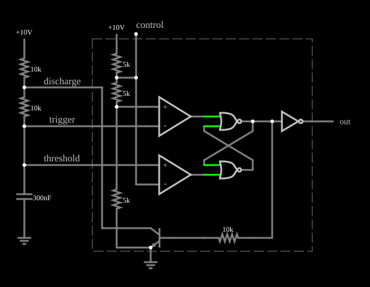

# Funcionamento interno do 555

<!-- navegacao:inicio -->
[Índice](README.md) · [Anterior: Square Wave Generator](555square.md) · [Próximo: Sawtooth Oscillator](555saw.md)
<!-- navegacao:fim -->

## Objetivo

Mostrar como um 555 é feito por dentro: dois comparadores, um divisor de três resistores, um latch SR e um transistor de descarga. O exemplo monta essas partes com componentes individuais e as faz trabalhar como oscilador astável.

## O circuito

<!-- esquema:inicio -->

<!-- esquema:fim -->

Três resistores iguais de $5\ \text{k}\Omega$ ligados em série entre $10\ \text{V}$ e a terra dão as tensões de referência de $2/3$ e de $1/3$ de $V_{CC}$ ($6{,}667$ e $3{,}333\ \text{V}$). Dois amplificadores operacionais com saída limitada entre $0$ e $10\ \text{V}$ fazem o papel de comparadores: um compara o nó do capacitor ao limiar superior (*threshold*), o outro, ao inferior (*trigger*). Duas portas NOR realimentadas formam o latch SR, cuja saída passa por um inversor. Um transistor NPN, comandado pelo latch, descarrega o capacitor (*discharge*). Externamente há o circuito astável clássico: dois resistores de $10\ \text{k}\Omega$ ($R_A$ e $R_B$) e um capacitor de $300\ \text{nF}$.

<!-- componentes:inicio -->
| N.º | Tipo | Elemento | Valores |
|----:|------|----------|---------|
| 0 | `OpAmpElm` | op-amp | Max Output (V) = 10; Min Output (V) = 0; Gain = 100k |
| 1 | `OpAmpElm` | op-amp | Max Output (V) = 10; Min Output (V) = 0; Gain = 100k |
| 2 | `ResistorElm` | resistor | Resistance (ohms) = 5k |
| 3 | `ResistorElm` | resistor | Resistance (ohms) = 5k |
| 5 | `ResistorElm` | resistor | Resistance (ohms) = 5k |
| 16 | `RailElm` | voltage source | Voltage = 10; Waveform = D/C; DC Offset (V) = 0; Internal Resistance (ohms) = 0 |
| 17 | `RailElm` | voltage source | Voltage = 10; Waveform = D/C; DC Offset (V) = 0; Internal Resistance (ohms) = 0 |
| 18 | `ResistorElm` | resistor | Resistance (ohms) = 10k |
| 19 | `ResistorElm` | resistor | Resistance (ohms) = 10k |
| 23 | `CapacitorElm` | capacitor | Capacitance (F) = 300n; Trapezoidal Approximation = sim; Initial Voltage (on Reset) = 1m; Series Resistance = 0 |
| 24 | `GroundElm` | ground | Symbol = Earth |
| 25 | `ResistorElm` | resistor | Resistance (ohms) = 10k |
| 28 | `NorGateElm` | NOR gate | # of Inputs = 2; High Logic Voltage = 10; Schmitt Inputs = não; Invert Inputs = não; Propagation Delay (s) = 0; DeMorgan's Symbol = não |
| 29 | `NorGateElm` | NOR gate | # of Inputs = 2; High Logic Voltage = 10; Schmitt Inputs = não; Invert Inputs = não; Propagation Delay (s) = 0; DeMorgan's Symbol = não |
| 31 | `OutputElm` | output | Show Voltage = não |
| 34 | `NTransistorElm` | transistor | Beta/hFE = 100; Swap E/C = não; Draw Circle = não; Model = default |
| 36 | `GroundElm` | ground | Symbol = Earth |
| 38 | `TextElm` | text | Text = discharge; Size = 16; Draw Bar On Top = não; Color = #c0c0c0 |
| 39 | `TextElm` | text | Text = trigger; Size = 16; Draw Bar On Top = não; Color = #c0c0c0 |
| 40 | `TextElm` | text | Text = threshold; Size = 16; Draw Bar On Top = não; Color = #c0c0c0 |
| 42 | `TextElm` | text | Text = control; Size = 16; Draw Bar On Top = não; Color = #c0c0c0 |
| 43 | `BoxElm` |  |  |
| 46 | `InverterElm` | inverter | Slew Rate (V/ns) = 500m; High Logic Voltage = 10; DeMorgan's Symbol = não |
<!-- componentes:fim -->

## Teoria

Os comparadores zeram ou acionam o latch conforme a tensão no capacitor $v_C$ cruza os limiares:

- se $v_C > 2V_{CC}/3$, o latch é zerado: a saída vai a nível baixo e o transistor descarrega o capacitor;
- se $v_C < V_{CC}/3$, o latch é ativado: a saída vai a nível alto e o transistor corta, deixando o capacitor carregar.

No astável, o capacitor carrega por $R_A + R_B$ e descarrega só por $R_B$ (pelo transistor):

$$t_h = 0{,}693\,(R_A + R_B)\,C, \qquad t_l = 0{,}693\,R_B\,C,$$

$$f = \frac{1{,}44}{(R_A + 2R_B)\,C}, \qquad \text{ciclo de trabalho} = \frac{R_A + R_B}{R_A + 2R_B}.$$

Com $R_A = R_B = 10\ \text{k}\Omega$ e $C = 300\ \text{nF}$: $t_h = 4{,}16\ \text{ms}$, $t_l = 2{,}08\ \text{ms}$, $f = 160{,}3\ \text{Hz}$ e ciclo de trabalho de $66{,}7\%$.

## Resultados esperados

| Grandeza | Teoria | Simulador |
|----------|-------:|----------:|
| Frequência | $160{,}3\ \text{Hz}$ | $158{,}9\ \text{Hz}$ |
| Ciclo de trabalho | $66{,}7\%$ | $66{,}2\%$ (valor médio $6{,}624\ \text{V}$) |
| Saída | $0$ e $10\ \text{V}$ | $0$ e $10\ \text{V}$ |

As diferenças de menos de $1\%$ vêm de os limiares do exemplo não serem exatamente os ideais (as tensões de comutação dependem do ganho finito dos comparadores). As verificações conferem a frequência, o valor médio e os extremos em uma janela de $50\ \text{ms}$.

## O que observar

- A tensão do capacitor sobe devagar (por $R_A + R_B$) e cai mais depressa (por $R_B$): a saída fica mais tempo alta que baixa.
- Siga os sinais dos comparadores e do latch: a saída de cada comparador só fica alta durante um instante, quando o capacitor cruza o seu limiar.
- Esta montagem equivale ao exemplo "Square Wave Generator", mas com os blocos internos visíveis.

## Limites do modelo

Os comparadores são amplificadores operacionais ideais com saída entre $0$ e $10\ \text{V}$, as portas NOR não têm atraso e o transistor de descarga é um NPN comum. O 555 real (bipolar ou CMOS) tem um transistor de descarga com resistência e saturação próprias, comparadores com corrente de polarização e saída de classe B, o que o aproxima, mas não o iguala, deste modelo.

## Referências

- Signetics/Philips, *NE555 Timer* (folha de dados).
- A. S. Sedra e K. C. Smith, *Microeletrônica*, Pearson.
- P. Horowitz e W. Hill, *The Art of Electronics*, Cambridge University Press.

O circuito deste exemplo faz parte da coleção do simulador original de Paul Falstad e Iain Sharp (CircuitJS1); a explicação é deste projeto.
