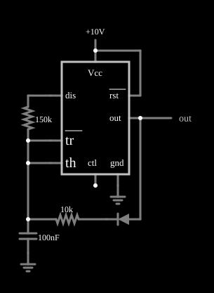

# Oscilador de ciclo de trabalho baixo com 555

<!-- navegacao:inicio -->
[Índice](README.md) · [Anterior: Sawtooth Oscillator](555saw.md) · [Próximo: Monostable Multivibrator](555monostable.md)
<!-- navegacao:fim -->

## Objetivo

Mostrar como obter, com um 555, uma saída com nível alto muito curto (pulsos estreitos) e nível baixo longo, separando os caminhos de carga e de descarga do capacitor. O astável comum não consegue ciclo de trabalho abaixo de $50\%$.

## O circuito

<!-- esquema:inicio -->

<!-- esquema:fim -->

Um 555 alimentado com $10\ \text{V}$ tem o capacitor de $100\ \text{nF}$ ligado aos pinos *tr* e *th*. O circuito tem um resistor de $150\ \text{k}\Omega$ ligado ao capacitor e ao pino de descarga *dis*, e um ramo de $10\ \text{k}\Omega$ em série com um diodo, também ligado ao capacitor. Um elemento de saída e dois osciloscópios mostram o capacitor e a saída.

<!-- componentes:inicio -->
| N.º | Tipo | Elemento | Valores |
|----:|------|----------|---------|
| 0 | `TimerElm` | 555 Timer | Ground Pin = sim; Show Pin Numbers = não |
| 2 | `ResistorElm` | resistor | Resistance (ohms) = 150k |
| 7 | `CapacitorElm` | capacitor | Capacitance (F) = 100n; Trapezoidal Approximation = sim; Initial Voltage (on Reset) = 1m; Series Resistance = 0 |
| 8 | `GroundElm` | ground | Symbol = Earth |
| 9 | `ResistorElm` | resistor | Resistance (ohms) = 10k |
| 10 | `DiodeElm` | diode | Model = default |
| 12 | `RailElm` | voltage source | Voltage = 10; Waveform = D/C; DC Offset (V) = 0; Internal Resistance (ohms) = 0 |
| 13 | `OutputElm` | output | Show Voltage = não |
| 14 | `GroundElm` | ground | Symbol = Earth |
<!-- componentes:fim -->

## Teoria

Com dois caminhos de resistência diferente para carregar e para descarregar o capacitor entre $V_{CC}/3$ e $2V_{CC}/3$, os tempos em cada nível são

$$t_h = 0{,}693\,R_\text{carga}\,C, \qquad t_l = 0{,}693\,R_\text{descarga}\,C, \qquad f = \frac{1}{0{,}693\,(R_\text{carga} + R_\text{descarga})\,C}, \qquad D = \frac{R_\text{carga}}{R_\text{carga} + R_\text{descarga}}.$$

Os tempos medidos no simulador coincidem com esta fórmula para $R_\text{carga} = 10\ \text{k}\Omega$ (nível alto de $0{,}68\ \text{ms}$, contra $0{,}693\ \text{ms}$) e $R_\text{descarga} = 150\ \text{k}\Omega$ (nível baixo de $10{,}5\ \text{ms}$, contra $10{,}4\ \text{ms}$). O diodo isola um caminho do outro: o de $10\ \text{k}\Omega$ só conduz durante a carga. Assim,

$$f = \frac{1}{0{,}693\cdot 160\ \text{k}\Omega\cdot 100\ \text{nF}} = 90{,}2\ \text{Hz}, \qquad D = \frac{10}{160} = 6{,}25\%.$$

## Resultados esperados

| Grandeza | Teoria | Simulador |
|----------|-------:|----------:|
| Frequência | $90{,}2\ \text{Hz}$ | $89{,}7\ \text{Hz}$ |
| Ciclo de trabalho | $6{,}25\%$ | $6{,}1\%$ (valor médio $0{,}612\ \text{V}$ de $10\ \text{V}$) |
| Saída | $0$ e $10\ \text{V}$ | $0$ e $10\ \text{V}$ |

As verificações conferem a frequência, o valor médio e o máximo da saída em uma janela de $50\ \text{ms}$.

## O que observar

- Os pulsos de saída são bem estreitos (cerca de $0{,}7\ \text{ms}$ a cada $11\ \text{ms}$), como em um disparador para LEDs ou relés que precisam de pouca potência média.
- A tensão do capacitor sobe rápido (pelo resistor menor, com o diodo) e desce devagar (pelo maior).
- Trocar os dois resistores inverte o sentido da assimetria (ciclo de trabalho de $94\%$).

## Limites do modelo

O 555 do simulador é um modelo ideal: o divisor interno é de $5\ \text{k}\Omega$ e $10\ \text{k}\Omega$ (o pino de controle fica em $2V_{CC}/3$), os comparadores são perfeitos, a saída liga-se a $V_{CC}$ ou à terra por $1\ \Omega$ (ela vai de trilho a trilho, ao contrário de um 555 bipolar real, cuja saída alta fica $1$ a $2\ \text{V}$ abaixo de $V_{CC}$) e o transistor de descarga é uma resistência de $10\ \Omega$. Não há atraso de propagação, corrente de polarização dos comparadores nem pico de corrente de alimentação na comutação. O diodo é o modelo exponencial simples do simulador, cuja queda ($\approx 0{,}6\ \text{V}$ em corrente alta) desloca um pouco os tempos.

## Referências

- Signetics/Philips, *NE555 Timer* (folha de dados).
- P. Horowitz e W. Hill, *The Art of Electronics*, Cambridge University Press.
- U. Tietze e C. Schenk, *Electronic Circuits: Handbook for Design and Application*, Springer.

O circuito deste exemplo faz parte da coleção do simulador original de Paul Falstad e Iain Sharp (CircuitJS1); a explicação é deste projeto.
