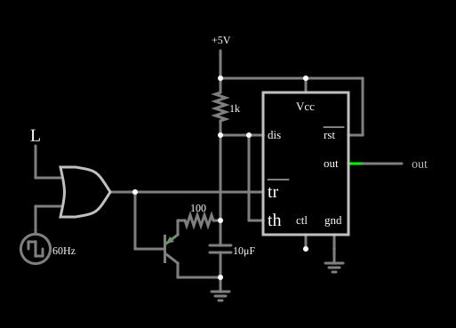

# Detector de pulso faltante com 555

<!-- navegacao:inicio -->
[Índice](README.md) · [Anterior: Schmitt Trigger (inverting)](555schmitt.md) · [Próximo: Adjustable Duty Cycle Oscillator](555dutycycle.md)
<!-- navegacao:fim -->

## Objetivo

Mostrar o detector de pulso faltante: um 555 em que cada pulso de um trem de pulsos reinicia o tempo, de modo que a saída só muda de nível quando um pulso deixa de chegar a tempo.

## O circuito

<!-- esquema:inicio -->

<!-- esquema:fim -->

Um 555 alimentado com $5\ \text{V}$ tem um resistor de $1\ \text{k}\Omega$ da alimentação ao capacitor de temporização de $10\ \mu\text{F}$. Um transistor PNP, com um resistor de $100\ \Omega$, descarrega o capacitor enquanto a saída de uma porta OR está em nível baixo; essa mesma saída está ligada ao pino de disparo *tr*. As duas entradas da porta são uma onda quadrada de $60\ \text{Hz}$ e uma entrada lógica manual. Um elemento de saída e dois osciloscópios mostram o capacitor e a saída.

<!-- componentes:inicio -->
| N.º | Tipo | Elemento | Valores |
|----:|------|----------|---------|
| 0 | `TimerElm` | 555 Timer | Ground Pin = sim; Show Pin Numbers = não |
| 4 | `CapacitorElm` | capacitor | Capacitance (F) = 10μ; Trapezoidal Approximation = sim; Initial Voltage (on Reset) = 1m; Series Resistance = 0 |
| 5 | `GroundElm` | ground | Symbol = Earth |
| 6 | `ResistorElm` | resistor | Resistance (ohms) = 1k |
| 8 | `OutputElm` | output | Show Voltage = não |
| 9 | `RailElm` | voltage source | Voltage = 5; Waveform = D/C; DC Offset (V) = 0; Internal Resistance (ohms) = 0 |
| 10 | `PTransistorElm` | transistor | Beta/hFE = 100; Swap E/C = não; Draw Circle = não; Model = default |
| 12 | `ResistorElm` | resistor | Resistance (ohms) = 100 |
| 16 | `OrGateElm` | OR gate | # of Inputs = 2; High Logic Voltage = 5; Schmitt Inputs = não; Invert Inputs = não; Propagation Delay (s) = 0; DeMorgan's Symbol = não |
| 17 | `RailElm` | square wave gen | Max Voltage = 2.5; Waveform = Square Wave; DC Offset (V) = 2.5; Internal Resistance (ohms) = 0; Show Voltage = não; Specify As = Frequency/Duty Cycle; Frequency (Hz) = 60; Phase Offset (degrees) = 0; Duty Cycle = 50; Rise/Fall Time (s) = 0 |
| 18 | `LogicInputElm` | logic input | Momentary Switch = não; High Logic Voltage = 5; Low Voltage = 0; Numeric = não; Ternary = não; Keyboard Shortcut =  |
| 22 | `GroundElm` | ground | Symbol = Earth |
<!-- componentes:fim -->

## Teoria

Enquanto o trem de $60\ \text{Hz}$ chega, a saída da porta OR fica em nível baixo durante metade de cada ciclo ($8{,}33\ \text{ms}$): o transistor descarrega o capacitor, o pino *tr* dispara o 555 e a saída fica **alta**. Na outra metade do ciclo o capacitor carrega pelo resistor, com constante de tempo $RC = 1\ \text{k}\Omega\cdot 10\ \mu\text{F} = 10\ \text{ms}$, mas em $8{,}33\ \text{ms}$ só chega a $5\,(1 - e^{-0{,}833}) = 2{,}83\ \text{V}$, abaixo do limiar de $2V_{CC}/3 = 3{,}33\ \text{V}$. Se o trem é interrompido (aqui, a entrada manual fixa a saída da porta OR em nível alto), o capacitor carrega sem ser descarregado, e em

$$T = RC\,\ln 3 \approx 11\ \text{ms}$$

ele chega ao limiar superior: a saída cai a nível baixo, sinalizando o pulso faltante. O tempo $T$ deve ser maior que a parte alta do ciclo normal ($8{,}33\ \text{ms}$, para que o circuito não dispare em falso) e menor que o tempo máximo tolerado de falta.

## Resultados esperados

| Situação | Saída |
|----------|------:|
| Pulsos de $60\ \text{Hz}$ chegando (em $t = 50\ \text{ms}$) | $5\ \text{V}$ |
| Mínimo da saída entre $0{,}1$ e $0{,}2\ \text{s}$ (pulsos chegando) | $5\ \text{V}$ (nunca cai) |
| $20\ \text{ms}$ depois de a entrada manual interromper os pulsos (em $50\ \text{ms}$) | $0\ \text{V}$ |
| $70\ \text{ms}$ depois da interrupção | $0\ \text{V}$ |

As verificações conferem as quatro situações (a interrupção é simulada pelo acionamento da entrada lógica em $t = 50\ \text{ms}$).

## O que observar

- Com os pulsos chegando, a tensão do capacitor sobe só um pouco entre pulsos e é puxada para baixo pelo transistor; a saída fica alta.
- Acione a entrada lógica: os pulsos acabam, o capacitor sobe até $3{,}33\ \text{V}$ e a saída cai depois de uns $11\ \text{ms}$.
- Esse circuito é usado como *watchdog* (vigia de funcionamento) e como detector de falha de um sinal periódico.

## Limites do modelo

O 555 do simulador é um modelo ideal: o divisor interno é de $5\ \text{k}\Omega$ e $10\ \text{k}\Omega$ (o pino de controle fica em $2V_{CC}/3$), os comparadores são perfeitos, a saída liga-se a $V_{CC}$ ou à terra por $1\ \Omega$ (ela vai de trilho a trilho, ao contrário de um 555 bipolar real, cuja saída alta fica $1$ a $2\ \text{V}$ abaixo de $V_{CC}$) e o transistor de descarga é uma resistência de $10\ \Omega$. Não há atraso de propagação, corrente de polarização dos comparadores nem pico de corrente de alimentação na comutação. O instante exato em que a saída cai, depois da interrupção, depende do ponto do ciclo em que o último pulso ocorreu; este documento só verifica que a saída já está baixa $20\ \text{ms}$ depois (cerca de $2T$ no pior caso).

## Referências

- Signetics/Philips, *NE555 Timer* (folha de dados).
- P. Horowitz e W. Hill, *The Art of Electronics*, Cambridge University Press.
- U. Tietze e C. Schenk, *Electronic Circuits: Handbook for Design and Application*, Springer.

O circuito deste exemplo faz parte da coleção do simulador original de Paul Falstad e Iain Sharp (CircuitJS1); a explicação é deste projeto.
