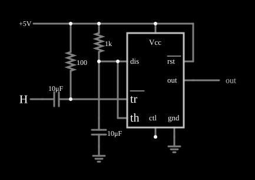

# Multivibrador monoestável com 555

<!-- navegacao:inicio -->
[Índice](README.md) · [Anterior: Low-duty-cycle Oscillator](555lowduty.md) · [Próximo: Pulse Width Modulator](555pulsemod.md)
<!-- navegacao:fim -->

## Objetivo

Mostrar o 555 como monoestável (*one-shot*): um pulso de disparo curto produz, na saída, um único pulso de duração fixa, determinada por um resistor e um capacitor.

## O circuito

<!-- esquema:inicio -->

<!-- esquema:fim -->

Um 555 alimentado com $5\ \text{V}$ tem um resistor de $1\ \text{k}\Omega$ da alimentação ao capacitor de temporização de $10\ \mu\text{F}$, ligado aos pinos *th* e *dis*. O pino de disparo *tr* é mantido em nível alto por um resistor de $100\ \Omega$ e recebe o sinal de um interruptor momentâneo (entrada lógica) por um capacitor de acoplamento de $10\ \mu\text{F}$: ao acionar o interruptor, o capacitor leva *tr* a nível baixo por um instante. Dois osciloscópios mostram o capacitor e a saída.

<!-- componentes:inicio -->
| N.º | Tipo | Elemento | Valores |
|----:|------|----------|---------|
| 0 | `TimerElm` | 555 Timer | Ground Pin = sim; Show Pin Numbers = não |
| 5 | `CapacitorElm` | capacitor | Capacitance (F) = 10μ; Trapezoidal Approximation = sim; Initial Voltage (on Reset) = 1m; Series Resistance = 0 |
| 6 | `GroundElm` | ground | Symbol = Earth |
| 7 | `ResistorElm` | resistor | Resistance (ohms) = 1k |
| 9 | `RailElm` | voltage source | Voltage = 5; Waveform = D/C; DC Offset (V) = 0; Internal Resistance (ohms) = 0 |
| 10 | `OutputElm` | output | Show Voltage = não |
| 11 | `ResistorElm` | resistor | Resistance (ohms) = 100 |
| 13 | `CapacitorElm` | capacitor | Capacitance (F) = 10μ; Trapezoidal Approximation = sim; Initial Voltage (on Reset) = 1m; Series Resistance = 0 |
| 14 | `LogicInputElm` | logic input | Momentary Switch = sim; High Logic Voltage = 5; Low Voltage = 0; Numeric = não; Ternary = não; Keyboard Shortcut =  |
| 15 | `GroundElm` | ground | Symbol = Earth |
<!-- componentes:fim -->

## Teoria

No estado de repouso o transistor de descarga está ligado e mantém o capacitor em $0\ \text{V}$; a saída está baixa. Quando *tr* cai abaixo de $V_{CC}/3$, o latch interno é ativado: a saída sobe e o transistor de descarga é cortado, de modo que o capacitor carrega pelo resistor $R$ em direção a $V_{CC}$. Quando a tensão do capacitor chega a $2V_{CC}/3$, o comparador de limiar zera o latch: a saída desce e o capacitor é descarregado. O tempo em que a saída fica alta é

$$T = RC\,\ln\frac{V_{CC}}{V_{CC} - 2V_{CC}/3} = RC\ln 3 \approx 1{,}1\,RC = 1{,}1\cdot 1\ \text{k}\Omega\cdot 10\ \mu\text{F} = 11\ \text{ms}.$$

O capacitor de acoplamento e o resistor de $100\ \Omega$ dão um pulso de disparo de curta duração (constante de tempo de $1\ \text{ms}$), e é preciso que ele termine **antes** do fim do pulso de saída; do contrário, o 555 seria disparado de novo.

## Resultados esperados

Em repouso, a saída fica em $0\ \text{V}$. Acionado o interruptor em $t = 100\ \text{ms}$:

| Instante | Saída |
|----------|------:|
| $t = 110{,}5\ \text{ms}$ ($10{,}5\ \text{ms}$ depois) | $5\ \text{V}$ (nível alto) |
| $t = 111{,}2\ \text{ms}$ ($11{,}2\ \text{ms}$ depois) | $0\ \text{V}$ (nível baixo) |

O fim do pulso fica entre os dois instantes, de acordo com os $11\ \text{ms}$ da teoria. As verificações conferem o repouso e os dois instantes (com o acionamento do interruptor em $100\ \text{ms}$).

## O que observar

- Clique no interruptor (a entrada lógica): a saída sobe e, depois de cerca de $11\ \text{ms}$, desce sozinha.
- A tensão do capacitor sobe pela exponencial de constante de tempo $10\ \text{ms}$ até $3{,}33\ \text{V}$ ($2/3$ de $5\ \text{V}$) e depois cai de uma vez.
- Dobre $R$ ou $C$ e o pulso dura o dobro.

## Limites do modelo

O 555 do simulador é um modelo ideal: o divisor interno é de $5\ \text{k}\Omega$ e $10\ \text{k}\Omega$ (o pino de controle fica em $2V_{CC}/3$), os comparadores são perfeitos, a saída liga-se a $V_{CC}$ ou à terra por $1\ \Omega$ (ela vai de trilho a trilho, ao contrário de um 555 bipolar real, cuja saída alta fica $1$ a $2\ \text{V}$ abaixo de $V_{CC}$) e o transistor de descarga é uma resistência de $10\ \Omega$. Não há atraso de propagação, corrente de polarização dos comparadores nem pico de corrente de alimentação na comutação. O interruptor do exemplo é momentâneo: o acoplamento por capacitor só transmite a transição (de alto a baixo), e não o nível; num circuito real o pulso de disparo deve ser mais curto que o pulso de saída.

## Referências

- Signetics/Philips, *NE555 Timer* (folha de dados).
- P. Horowitz e W. Hill, *The Art of Electronics*, Cambridge University Press.
- U. Tietze e C. Schenk, *Electronic Circuits: Handbook for Design and Application*, Springer.

O circuito deste exemplo faz parte da coleção do simulador original de Paul Falstad e Iain Sharp (CircuitJS1); a explicação é deste projeto.
