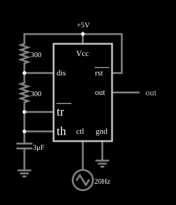

# Modulador de largura de pulso com 555

<!-- navegacao:inicio -->
[Índice](README.md) · [Anterior: Monostable Multivibrator](555monostable.md) · [Próximo: Pulse Sequencer](555sequencer.md)
<!-- navegacao:fim -->

## Objetivo

Mostrar a modulação por largura de pulso (PWM) com um 555: um sinal aplicado ao pino de controle desloca os limiares do 555 e, com isso, altera o ciclo de trabalho da saída, que continua oscilando a uma frequência próxima da original.

## O circuito

<!-- esquema:inicio -->

<!-- esquema:fim -->

Um 555 alimentado com $5\ \text{V}$ é um astável com dois resistores de $300\ \Omega$ ($R_A$, da alimentação ao pino de descarga, e $R_B$, do pino de descarga ao capacitor de $3\ \mu\text{F}$). O pino de controle *ctl* recebe uma onda triangular de $20\ \text{Hz}$ que vai de $1$ a $5\ \text{V}$ (gerador com $2\ \text{V}$ de amplitude sobre $3\ \text{V}$ de nível contínuo). Um elemento de saída e dois osciloscópios mostram a saída e a tensão do capacitor.

<!-- componentes:inicio -->
| N.º | Tipo | Elemento | Valores |
|----:|------|----------|---------|
| 0 | `TimerElm` | 555 Timer | Ground Pin = sim; Show Pin Numbers = não |
| 1 | `RailElm` | voltage source | Voltage = 5; Waveform = D/C; DC Offset (V) = 0; Internal Resistance (ohms) = 0 |
| 2 | `RailElm` | triangle gen | Max Voltage = 2; Waveform = Triangle; DC Offset (V) = 3; Internal Resistance (ohms) = 0; Show Voltage = não; Frequency (Hz) = 20; Phase Offset (degrees) = 0 |
| 3 | `OutputElm` | output | Show Voltage = não |
| 5 | `ResistorElm` | resistor | Resistance (ohms) = 300 |
| 8 | `CapacitorElm` | capacitor | Capacitance (F) = 3μ; Trapezoidal Approximation = sim; Initial Voltage (on Reset) = 1m; Series Resistance = 0 |
| 9 | `GroundElm` | ground | Symbol = Earth |
| 12 | `ResistorElm` | resistor | Resistance (ohms) = 300 |
| 15 | `GroundElm` | ground | Symbol = Earth |
<!-- componentes:fim -->

## Teoria

O pino de controle fixa o limiar superior em $V_c$ e o inferior em $V_c/2$. O capacitor carrega por $R_A + R_B$ de $V_c/2$ a $V_c$ e descarrega por $R_B$ (mais os $10\ \Omega$ do transistor) de $V_c$ a $V_c/2$:

$$t_h = (R_A + R_B)\,C\,\ln\frac{V_{CC} - V_c/2}{V_{CC} - V_c}, \qquad t_l = (R_B + 10\ \Omega)\,C\,\ln 2 = 0{,}64\ \text{ms}.$$

O tempo baixo $t_l$ é **constante**, e o tempo alto $t_h$ cresce com $V_c$ (e tende ao infinito quando $V_c \to V_{CC}$, quando o capacitor deixa de alcançar o limiar). O ciclo de trabalho $D = t_h/(t_h + t_l)$ cresce, portanto, com a tensão de controle: o 555 converte uma tensão em largura de pulso.

Por exemplo, com $V_{CC} = 5\ \text{V}$: $V_c = 1\ \text{V}$ dá $t_h = 0{,}21\ \text{ms}$ ($D = 25\%$); $V_c = 3\ \text{V}$ dá $1{,}0\ \text{ms}$ ($D = 61\%$); $V_c = 4\ \text{V}$ dá $1{,}98\ \text{ms}$ ($D = 75\%$).

## Resultados esperados

Como a tensão de controle varia durante cada janela, o valor médio da saída em cada janela de $5\ \text{ms}$ mede o ciclo de trabalho médio dela (a saída vai de $0$ a $5\ \text{V}$):

| Janela | $V_c$ na janela | Valor médio da saída | Ciclo de trabalho |
|--------|----------------:|---------------------:|------------------:|
| $0$ a $5\ \text{ms}$ | $1{,}0$ a $1{,}8\ \text{V}$ | $1{,}91\ \text{V}$ | $38\%$ |
| $10$ a $15\ \text{ms}$ | $2{,}6$ a $3{,}4\ \text{V}$ | $2{,}99\ \text{V}$ | $60\%$ |
| $12{,}5$ a $17{,}5\ \text{ms}$ | $3{,}0$ a $3{,}8\ \text{V}$ | $3{,}665\ \text{V}$ | $73\%$ |
| $20$ a $25\ \text{ms}$ | $4{,}2$ a $5{,}0\ \text{V}$ | $5{,}00\ \text{V}$ | $100\%$ |

O ciclo de trabalho cresce de $38\%$ a $100\%$ com a tensão de controle, de acordo com a teoria; no fim da rampa ($V_c$ perto de $5\ \text{V}$) o capacitor não alcança mais o limiar e a saída fica alta o tempo todo. A frequência de comutação, de cerca de $0{,}9\ \text{kHz}$ no início, cai quando $t_h$ cresce. As verificações conferem os quatro valores médios (tolerância de 1%).

## O que observar

- No osciloscópio, a largura dos pulsos de saída cresce enquanto a triangular sobe e diminui quando ela desce.
- Filtrando a saída com um passa-baixas $RC$ (de frequência de corte bem abaixo de $0{,}9\ \text{kHz}$) recupera-se a triangular de $20\ \text{Hz}$: o princípio do amplificador classe D.
- Em $V_c$ perto de $5\ \text{V}$ a modulação deixa de funcionar (pulso contínuo).

## Limites do modelo

O 555 do simulador é um modelo ideal: o divisor interno é de $5\ \text{k}\Omega$ e $10\ \text{k}\Omega$ (o pino de controle fica em $2V_{CC}/3$), os comparadores são perfeitos, a saída liga-se a $V_{CC}$ ou à terra por $1\ \Omega$ (ela vai de trilho a trilho, ao contrário de um 555 bipolar real, cuja saída alta fica $1$ a $2\ \text{V}$ abaixo de $V_{CC}$) e o transistor de descarga é uma resistência de $10\ \Omega$. Não há atraso de propagação, corrente de polarização dos comparadores nem pico de corrente de alimentação na comutação. O resultado depende da forma de onda de controle (a janela de $5\ \text{ms}$ contém só de $4$ a $6$ ciclos, então o valor médio tem alguns por cento de incerteza). A relação $D(V_c)$ é não linear (logarítmica), o que distorce a modulação em um PWM real.

## Referências

- Signetics/Philips, *NE555 Timer* (folha de dados).
- P. Horowitz e W. Hill, *The Art of Electronics*, Cambridge University Press.
- U. Tietze e C. Schenk, *Electronic Circuits: Handbook for Design and Application*, Springer.

O circuito deste exemplo faz parte da coleção do simulador original de Paul Falstad e Iain Sharp (CircuitJS1); a explicação é deste projeto.
