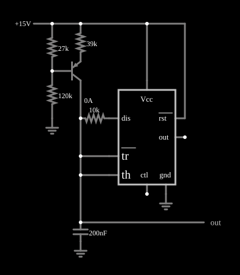

# Oscilador dente de serra com 555

<!-- navegacao:inicio -->
[Índice](README.md) · [Anterior: Internals](555int.md) · [Próximo: Low-duty-cycle Oscillator](555lowduty.md)
<!-- navegacao:fim -->

## Objetivo

Mostrar como transformar o astável do 555 em um gerador de dente de serra linear: basta carregar o capacitor com uma **corrente constante** (uma fonte de corrente com transistor PNP), em vez de por um resistor, para que a tensão suba em rampa reta.

## O circuito

<!-- esquema:inicio -->

<!-- esquema:fim -->

Um 555 alimentado com $15\ \text{V}$ tem o capacitor de $200\ \text{nF}$ ligado aos pinos *tr* e *th*. Um transistor PNP, polarizado por um divisor ($27\ \text{k}\Omega$ da alimentação à base e $120\ \text{k}\Omega$ da base à terra) com um resistor de emissor de $39\ \text{k}\Omega$, funciona como fonte de corrente que carrega o capacitor. Um resistor de $10\ \text{k}\Omega$ liga o capacitor ao pino de descarga *dis*. Um elemento de saída e um osciloscópio mostram a tensão do capacitor.

<!-- componentes:inicio -->
| N.º | Tipo | Elemento | Valores |
|----:|------|----------|---------|
| 0 | `ResistorElm` | resistor | Resistance (ohms) = 39k |
| 1 | `ResistorElm` | resistor | Resistance (ohms) = 27k |
| 2 | `ResistorElm` | resistor | Resistance (ohms) = 120k |
| 4 | `RailElm` | voltage source | Voltage = 15; Waveform = D/C; DC Offset (V) = 0; Internal Resistance (ohms) = 0 |
| 6 | `GroundElm` | ground | Symbol = Earth |
| 10 | `CapacitorElm` | capacitor | Capacitance (F) = 200n; Trapezoidal Approximation = sim; Initial Voltage (on Reset) = 1m; Series Resistance = 0 |
| 11 | `GroundElm` | ground | Symbol = Earth |
| 12 | `ResistorElm` | resistor | Resistance (ohms) = 10k |
| 17 | `OutputElm` | output | Show Voltage = não |
| 18 | `PTransistorElm` | transistor | Beta/hFE = 100; Swap E/C = não; Draw Circle = não; Model = default |
| 19 | `TimerElm` | 555 Timer | Ground Pin = sim; Show Pin Numbers = não |
| 22 | `GroundElm` | ground | Symbol = Earth |
<!-- componentes:fim -->

## Teoria

A base do PNP fica em $V_B = 15\,\dfrac{120}{120 + 27} = 12{,}24\ \text{V}$ e o emissor, uma tensão $V_{EB} \approx 0{,}5\ \text{V}$ acima (aqui $12{,}78\ \text{V}$). A corrente no resistor de emissor, que vai quase toda ao coletor e ao capacitor, é praticamente constante:

$$I = \frac{15 - 12{,}78}{39\ \text{k}\Omega} \approx 57\ \mu\text{A}.$$

Com corrente constante, a tensão do capacitor sobe em reta, com $dv/dt = I/C = 57\ \mu\text{A}/200\ \text{nF} = 285\ \text{V/s}$, entre os limiares do 555, $V_{CC}/3 = 5\ \text{V}$ e $2V_{CC}/3 = 10\ \text{V}$ ($\Delta V = 5\ \text{V}$):

$$t_\text{carga} = \frac{C\,\Delta V}{I} = \frac{200\ \text{nF}\cdot 5\ \text{V}}{57\ \mu\text{A}} \approx 17{,}5\ \text{ms}.$$

Ao atingir $10\ \text{V}$, o 555 liga o transistor de descarga e o capacitor cai a $5\ \text{V}$ pelo resistor de $10\ \text{k}\Omega$ (mais $10\ \Omega$ do transistor), com constante de tempo de $2\ \text{ms}$: $t_\text{desc} \approx 2\ \text{ms}\cdot\ln 2 = 1{,}4\ \text{ms}$. O período é $T \approx 18{,}9\ \text{ms}$ ($\approx 53\ \text{Hz}$).

## Resultados esperados

| Grandeza | Teoria | Simulador |
|----------|-------:|----------:|
| Corrente de carga | $57\ \mu\text{A}$ | $57{,}0\ \mu\text{A}$ (em $t = 50\ \text{ms}$) |
| Tensão do capacitor | de $5$ a $10\ \text{V}$ | de $4{,}99$ a $10{,}00\ \text{V}$ |
| Frequência | $\approx 53\ \text{Hz}$ | $51{,}87\ \text{Hz}$ |

A frequência do simulador é um pouco menor porque a descarga demora um pouco mais que o cálculo simples. As verificações conferem a frequência e os dois extremos da tensão do capacitor em uma janela de $0{,}1\ \text{s}$ (tolerância de 1%).

## O que observar

- A tensão do capacitor sobe em linha reta (comparada à exponencial do astável comum) e cai rapidamente: um dente de serra.
- Mude o resistor de emissor ($39\ \text{k}\Omega$) e a inclinação e a frequência mudam na proporção inversa.
- A corrente do PNP é quase constante mesmo com a tensão do capacitor variando, porque o coletor está longe da saturação.

## Limites do modelo

O 555 do simulador é um modelo ideal: o divisor interno é de $5\ \text{k}\Omega$ e $10\ \text{k}\Omega$ (o pino de controle fica em $2V_{CC}/3$), os comparadores são perfeitos, a saída liga-se a $V_{CC}$ ou à terra por $1\ \Omega$ (ela vai de trilho a trilho, ao contrário de um 555 bipolar real, cuja saída alta fica $1$ a $2\ \text{V}$ abaixo de $V_{CC}$) e o transistor de descarga é uma resistência de $10\ \Omega$. Não há atraso de propagação, corrente de polarização dos comparadores nem pico de corrente de alimentação na comutação. O PNP é um modelo de Ebers-Moll simples (hFE = 100), sem efeito Early, de modo que a corrente de coletor é mais constante que a de um transistor real.

## Referências

- Signetics/Philips, *NE555 Timer* (folha de dados).
- P. Horowitz e W. Hill, *The Art of Electronics*, Cambridge University Press.
- U. Tietze e C. Schenk, *Electronic Circuits: Handbook for Design and Application*, Springer.

O circuito deste exemplo faz parte da coleção do simulador original de Paul Falstad e Iain Sharp (CircuitJS1); a explicação é deste projeto.
