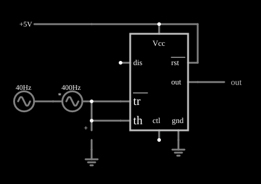

# Disparador de Schmitt inversor com 555

<!-- navegacao:inicio -->
[Índice](README.md) · [Anterior: Pulse Sequencer](555sequencer.md) · [Próximo: Missing Pulse Detector](555missing.md)
<!-- navegacao:fim -->

## Objetivo

Mostrar que o 555, com os pinos de disparo e de limiar ligados juntos, é um disparador de Schmitt inversor, com dois limiares ($V_{CC}/3$ e $2V_{CC}/3$), que limpa um sinal analógico com ruído e o transforma em uma onda digital.

## O circuito

<!-- esquema:inicio -->

<!-- esquema:fim -->

Um 555 alimentado com $5\ \text{V}$ tem *tr* e *th* ligados juntos à entrada. A entrada é uma senoide de $40\ \text{Hz}$ entre $0$ e $5\ \text{V}$ ($2{,}5\ \text{V}$ de nível contínuo e $2{,}5\ \text{V}$ de pico), somada em série a um "ruído" senoidal de $400\ \text{Hz}$ e $1\ \text{V}$ de pico. Um elemento de saída e dois osciloscópios mostram a entrada e a saída.

<!-- componentes:inicio -->
| N.º | Tipo | Elemento | Valores |
|----:|------|----------|---------|
| 0 | `TimerElm` | 555 Timer | Ground Pin = sim; Show Pin Numbers = não |
| 2 | `RailElm` | voltage source | Voltage = 5; Waveform = D/C; DC Offset (V) = 0; Internal Resistance (ohms) = 0 |
| 3 | `OutputElm` | output | Show Voltage = não |
| 7 | `VoltageElm` | A/C source | Max Voltage = 1; Waveform = A/C; DC Offset (V) = 0; Internal Resistance (ohms) = 0; Show Voltage = não; Frequency (Hz) = 400; Phase Offset (degrees) = 0 |
| 8 | `RailElm` | A/C source | Max Voltage = 2.5; Waveform = A/C; DC Offset (V) = 2.5; Internal Resistance (ohms) = 0; Show Voltage = não; Frequency (Hz) = 40; Phase Offset (degrees) = 0 |
| 9 | `ProbeElm` | voltmeter | Show Voltage = não; Value = Voltage; Scale = Auto; Use Circle Symbol = não; Series Resistance (0 = infinite) = 0 |
| 10 | `GroundElm` | ground | Symbol = Earth |
| 11 | `GroundElm` | ground | Symbol = Earth |
<!-- componentes:fim -->

## Teoria

Os limiares do 555 são $V_{CC}/3 = 1{,}667\ \text{V}$ (inferior) e $2V_{CC}/3 = 3{,}333\ \text{V}$ (superior), com histerese de $1{,}667\ \text{V}$. A saída é **invertida**: vai a nível baixo quando a entrada sobe acima de $3{,}333\ \text{V}$ e a nível alto quando a entrada cai abaixo de $1{,}667\ \text{V}$, e fica onde está quando a entrada está entre os dois limiares. Como em qualquer disparador de Schmitt, só um ruído de amplitude maior que a histerese consegue provocar comutações extras.

## Resultados esperados

Com a entrada de $40\ \text{Hz}$ e o ruído de $400\ \text{Hz}$ (cuja variação pico a pico, $2\ \text{V}$, passa da histerese de $1{,}667\ \text{V}$), o simulador dá, em uma janela de $0{,}1\ \text{s}$ (quatro ciclos):

| Grandeza | Valor |
|----------|------:|
| Frequência da saída | $40{,}000\ \text{Hz}$ (nenhuma comutação extra) |
| Níveis de saída | $0$ e $5\ \text{V}$ |
| Valor médio | $2{,}697\ \text{V}$ ($53{,}9\%$ em nível alto) |

A saída é uma onda quadrada de $40\ \text{Hz}$, sem os pulsos que o ruído provocaria em um comparador simples de um limiar só. As verificações conferem a frequência (tolerância de 0,5%), os níveis e o valor médio.

## O que observar

- No osciloscópio de entrada, o sinal tem uma "pelugem" de $400\ \text{Hz}$ em torno da senoide; na saída, nenhuma delas aparece.
- O ciclo de trabalho não é exatamente $50\%$ ($53{,}9\%$) porque o ruído desloca um pouco os instantes de comutação.
- Pela teoria, um ruído bem maior que o do exemplo (por exemplo, de $1{,}5\ \text{V}$ de pico ou mais) faria a saída apresentar comutações extras nos cruzamentos; isso não foi simulado aqui.

## Limites do modelo

O 555 do simulador é um modelo ideal: o divisor interno é de $5\ \text{k}\Omega$ e $10\ \text{k}\Omega$ (o pino de controle fica em $2V_{CC}/3$), os comparadores são perfeitos, a saída liga-se a $V_{CC}$ ou à terra por $1\ \Omega$ (ela vai de trilho a trilho, ao contrário de um 555 bipolar real, cuja saída alta fica $1$ a $2\ \text{V}$ abaixo de $V_{CC}$) e o transistor de descarga é uma resistência de $10\ \Omega$. Não há atraso de propagação, corrente de polarização dos comparadores nem pico de corrente de alimentação na comutação. O resultado depende do instante em que o ruído cruza os limiares; com outra fase do ruído poderiam ocorrer comutações extras, já que a variação pico a pico do ruído é maior que a histerese. A última observação, a de comutações extras com ruído acima de $1{,}5\ \text{V}$, é uma previsão da teoria e não foi simulada aqui.

## Referências

- Signetics/Philips, *NE555 Timer* (folha de dados).
- P. Horowitz e W. Hill, *The Art of Electronics*, Cambridge University Press.
- U. Tietze e C. Schenk, *Electronic Circuits: Handbook for Design and Application*, Springer.

O circuito deste exemplo faz parte da coleção do simulador original de Paul Falstad e Iain Sharp (CircuitJS1); a explicação é deste projeto.
