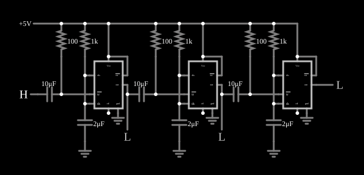

# Sequenciador de pulsos com 555

<!-- navegacao:inicio -->
[Índice](README.md) · [Anterior: Pulse Width Modulator](555pulsemod.md) · [Próximo: Schmitt Trigger (inverting)](555schmitt.md)
<!-- navegacao:fim -->

## Objetivo

Mostrar como encadear três monoestáveis 555 para gerar uma sequência de pulsos consecutivos: o fim do pulso de cada um dispara o seguinte, como em um sequenciador ou em um temporizador de várias etapas.

## O circuito

<!-- esquema:inicio -->

<!-- esquema:fim -->

Três 555 alimentados com $5\ \text{V}$ são monoestáveis idênticos, cada um com um resistor de $1\ \text{k}\Omega$ e um capacitor de $2\ \mu\text{F}$. O primeiro é disparado por um interruptor momentâneo (entrada lógica) por um capacitor de $10\ \mu\text{F}$ e um resistor de $100\ \Omega$. A saída de cada um liga-se ao pino de disparo do seguinte por um acoplamento igual (capacitor de $10\ \mu\text{F}$ e resistor de $100\ \Omega$), de modo que a *descida* da saída de um dispara o próximo. Três saídas lógicas mostram o estado de cada etapa.

<!-- componentes:inicio -->
| N.º | Tipo | Elemento | Valores |
|----:|------|----------|---------|
| 0 | `TimerElm` | 555 Timer | Ground Pin = sim; Show Pin Numbers = não |
| 4 | `CapacitorElm` | capacitor | Capacitance (F) = 2μ; Trapezoidal Approximation = sim; Initial Voltage (on Reset) = 1m; Series Resistance = 0 |
| 6 | `ResistorElm` | resistor | Resistance (ohms) = 1k |
| 7 | `ResistorElm` | resistor | Resistance (ohms) = 100 |
| 10 | `CapacitorElm` | capacitor | Capacitance (F) = 10μ; Trapezoidal Approximation = sim; Initial Voltage (on Reset) = 1m; Series Resistance = 0 |
| 11 | `LogicInputElm` | logic input | Momentary Switch = sim; High Logic Voltage = 5; Low Voltage = 0; Numeric = não; Ternary = não; Keyboard Shortcut =  |
| 15 | `RailElm` | voltage source | Voltage = 5; Waveform = D/C; DC Offset (V) = 0; Internal Resistance (ohms) = 0 |
| 16 | `GroundElm` | ground | Symbol = Earth |
| 18 | `CapacitorElm` | capacitor | Capacitance (F) = 10μ; Trapezoidal Approximation = sim; Initial Voltage (on Reset) = 1m; Series Resistance = 0 |
| 20 | `ResistorElm` | resistor | Resistance (ohms) = 100 |
| 21 | `ResistorElm` | resistor | Resistance (ohms) = 1k |
| 24 | `TimerElm` | 555 Timer | Ground Pin = sim; Show Pin Numbers = não |
| 32 | `CapacitorElm` | capacitor | Capacitance (F) = 2μ; Trapezoidal Approximation = sim; Initial Voltage (on Reset) = 1m; Series Resistance = 0 |
| 33 | `GroundElm` | ground | Symbol = Earth |
| 35 | `CapacitorElm` | capacitor | Capacitance (F) = 10μ; Trapezoidal Approximation = sim; Initial Voltage (on Reset) = 1m; Series Resistance = 0 |
| 37 | `ResistorElm` | resistor | Resistance (ohms) = 100 |
| 38 | `ResistorElm` | resistor | Resistance (ohms) = 1k |
| 41 | `TimerElm` | 555 Timer | Ground Pin = sim; Show Pin Numbers = não |
| 49 | `CapacitorElm` | capacitor | Capacitance (F) = 2μ; Trapezoidal Approximation = sim; Initial Voltage (on Reset) = 1m; Series Resistance = 0 |
| 50 | `GroundElm` | ground | Symbol = Earth |
| 51 | `LogicOutputElm` | logic output | Threshold = 2.5; Current Required = não; Numeric = não; Ternary = não |
| 52 | `LogicOutputElm` | logic output | Threshold = 2.5; Current Required = não; Numeric = não; Ternary = não |
| 53 | `LogicOutputElm` | logic output | Threshold = 2.5; Current Required = não; Numeric = não; Ternary = não |
| 60 | `GroundElm` | ground | Symbol = Earth |
| 61 | `GroundElm` | ground | Symbol = Earth |
| 62 | `GroundElm` | ground | Symbol = Earth |
<!-- componentes:fim -->

## Teoria

Cada monoestável produz um pulso de duração $T = 1{,}1\,RC = 1{,}1\cdot 1\ \text{k}\Omega\cdot 2\ \mu\text{F} = 2{,}2\ \text{ms}$. O acoplamento por capacitor transmite só as **transições**: quando a saída do primeiro 555 desce ao fim do pulso, o capacitor leva o pino de disparo do segundo a nível baixo por um instante, e o segundo dispara. O terceiro faz o mesmo com o segundo. Os pulsos ficam, portanto, em sequência, sem sobreposição:

$$[t_0,\,t_0 + T],\quad [t_0 + T,\,t_0 + 2T],\quad [t_0 + 2T,\,t_0 + 3T].$$

## Resultados esperados

Acionado o interruptor em $t_0 = 10\ \text{ms}$, a duração total da sequência é $3T = 6{,}6\ \text{ms}$:

| Instante | 1.º 555 | 2.º 555 | 3.º 555 |
|----------|:-------:|:-------:|:-------:|
| $11{,}1\ \text{ms}$ | alto | baixo | baixo |
| $13{,}3\ \text{ms}$ | baixo | alto | baixo |
| $15{,}5\ \text{ms}$ | baixo | baixo | alto |
| $20\ \text{ms}$ | baixo | baixo | baixo |

As verificações conferem essas quatro linhas (as saídas altas ficam em $5\ \text{V}$ com tolerância de 1%).

## O que observar

- Clique no interruptor e veja as três saídas lógicas acenderem uma de cada vez, por $2{,}2\ \text{ms}$ cada.
- A sequência não recomeça sozinha: só um novo acionamento a repete.
- Mude o resistor ou o capacitor de uma etapa para alterar a duração do seu pulso.

## Limites do modelo

O 555 do simulador é um modelo ideal: o divisor interno é de $5\ \text{k}\Omega$ e $10\ \text{k}\Omega$ (o pino de controle fica em $2V_{CC}/3$), os comparadores são perfeitos, a saída liga-se a $V_{CC}$ ou à terra por $1\ \Omega$ (ela vai de trilho a trilho, ao contrário de um 555 bipolar real, cuja saída alta fica $1$ a $2\ \text{V}$ abaixo de $V_{CC}$) e o transistor de descarga é uma resistência de $10\ \Omega$. Não há atraso de propagação, corrente de polarização dos comparadores nem pico de corrente de alimentação na comutação. Se o pulso de saída de um estágio terminasse antes de o pulso de disparo do estágio anterior acabar, haveria disparos espúrios; aqui as constantes de tempo ($1\ \text{ms}$ de acoplamento contra $2{,}2\ \text{ms}$ de pulso) evitam isso.

## Referências

- Signetics/Philips, *NE555 Timer* (folha de dados).
- P. Horowitz e W. Hill, *The Art of Electronics*, Cambridge University Press.
- U. Tietze e C. Schenk, *Electronic Circuits: Handbook for Design and Application*, Springer.

O circuito deste exemplo faz parte da coleção do simulador original de Paul Falstad e Iain Sharp (CircuitJS1); a explicação é deste projeto.
