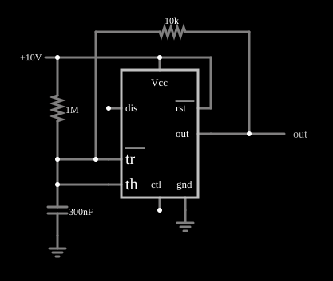

# Gerador de onda quadrada com 555

<!-- navegacao:inicio -->
[Índice](README.md) · [Próximo: Internals](555int.md)
<!-- navegacao:fim -->

## Objetivo

Mostrar o 555 funcionando como oscilador de onda quadrada com o menor número de componentes: um resistor e um capacitor. Os pinos de disparo e de limiar ficam juntos, e o resistor de realimentação liga a saída ao capacitor.

## O circuito

<!-- esquema:inicio -->

<!-- esquema:fim -->

Um 555 alimentado com $10\ \text{V}$ tem os pinos *tr* e *th* ligados ao mesmo nó, o do capacitor de $300\ \text{nF}$. Um resistor de $10\ \text{k}\Omega$ liga a saída *out* a esse nó. Um resistor de $1\ \text{M}\Omega$ entre a alimentação e o nó dá apenas um pequeno empurrão (ele ajuda a partida e quase não altera a frequência). Um elemento de saída e dois osciloscópios mostram a tensão do capacitor e a da saída.

<!-- componentes:inicio -->
| N.º | Tipo | Elemento | Valores |
|----:|------|----------|---------|
| 2 | `CapacitorElm` | capacitor | Capacitance (F) = 300n; Trapezoidal Approximation = sim; Initial Voltage (on Reset) = 1m; Series Resistance = 0 |
| 3 | `GroundElm` | ground | Symbol = Earth |
| 4 | `ResistorElm` | resistor | Resistance (ohms) = 1M |
| 6 | `RailElm` | voltage source | Voltage = 10; Waveform = D/C; DC Offset (V) = 0; Internal Resistance (ohms) = 0 |
| 7 | `OutputElm` | output | Show Voltage = não |
| 8 | `TimerElm` | 555 Timer | Ground Pin = sim; Show Pin Numbers = não |
| 13 | `ResistorElm` | resistor | Resistance (ohms) = 10k |
| 17 | `GroundElm` | ground | Symbol = Earth |
<!-- componentes:fim -->

## Teoria

Os pinos do 555 neste documento são referidos pelo nome: *dis* (descarga), *tr* (disparo, sensível ao nível baixo), *th* (limiar), *ctl* (controle), *out* (saída), *rst* (reinício). Com $tr$ e $th$ no mesmo nó, o 555 é um disparador de Schmitt inversor: a saída vai a nível baixo quando a tensão passa de $2V_{CC}/3$ e a nível alto quando cai abaixo de $V_{CC}/3$. Realimentando a saída pelo resistor $R$ ao capacitor $C$, o capacitor carrega quando a saída está alta e descarrega quando está baixa, oscilando entre os dois limiares.

Com a saída variando entre $0$ e $V_{CC}$, a carga vai de $V_{CC}/3$ a $2V_{CC}/3$ em direção a $V_{CC}$:

$$t_h = RC\,\ln\frac{V_{CC} - V_{CC}/3}{V_{CC} - 2V_{CC}/3} = RC\ln 2,$$

e a descarga é simétrica, $t_l = RC\ln 2$. Portanto

$$T = 2\,RC\ln 2 = 1{,}386\,RC, \qquad f = \frac{0{,}721}{RC} = \frac{0{,}721}{10\ \text{k}\Omega\cdot 300\ \text{nF}} \approx 240{,}5\ \text{Hz},$$

com ciclo de trabalho de $50\%$, independente de $V_{CC}$.

## Resultados esperados

| Grandeza | Valor |
|----------|------:|
| Frequência (teoria, $0{,}721/RC$) | $240{,}5\ \text{Hz}$ |
| Frequência (simulador) | $239{,}5\ \text{Hz}$ |
| Saída | onda quadrada de $0$ a $10\ \text{V}$ |
| Valor médio da saída (simulador) | $4{,}956\ \text{V}$ (ciclo de trabalho de $49{,}6\%$) |

A diferença de $0{,}4\%$ na frequência vem do resistor de $1\ \text{M}\Omega$ ligado à alimentação. As verificações conferem a frequência, o valor médio e os extremos da saída em uma janela de $50\ \text{ms}$.

## O que observar

- A tensão no capacitor sobe e desce exponencialmente entre $3{,}33$ e $6{,}67\ \text{V}$ ($1/3$ e $2/3$ de $10\ \text{V}$), e a saída comuta quando ela toca um dos limiares.
- Mude $V_{CC}$ e a frequência não muda, porque os limiares são proporcionais à alimentação.
- Dobre $R$ ou $C$ e a frequência cai à metade.

## Limites do modelo

O 555 do simulador é um modelo ideal: o divisor interno é de $5\ \text{k}\Omega$ e $10\ \text{k}\Omega$ (o pino de controle fica em $2V_{CC}/3$), os comparadores são perfeitos, a saída liga-se a $V_{CC}$ ou à terra por $1\ \Omega$ (ela vai de trilho a trilho, ao contrário de um 555 bipolar real, cuja saída alta fica $1$ a $2\ \text{V}$ abaixo de $V_{CC}$) e o transistor de descarga é uma resistência de $10\ \Omega$. Não há atraso de propagação, corrente de polarização dos comparadores nem pico de corrente de alimentação na comutação. Num 555 real a saída alta não chega a $V_{CC}$, o que desloca a frequência e o ciclo de trabalho do oscilador de realimentação direta (que é mais sensível que a configuração clássica com dois resistores).

## Referências

- Signetics/Philips, *NE555 Timer* (folha de dados).
- P. Horowitz e W. Hill, *The Art of Electronics*, Cambridge University Press.
- U. Tietze e C. Schenk, *Electronic Circuits: Handbook for Design and Application*, Springer.

O circuito deste exemplo faz parte da coleção do simulador original de Paul Falstad e Iain Sharp (CircuitJS1); a explicação é deste projeto.
