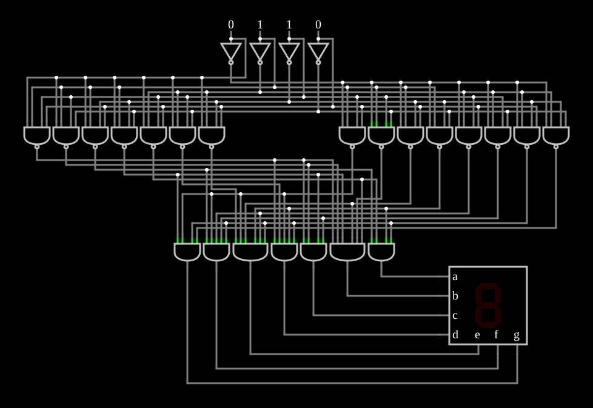

# Decodificador para display de 7 segmentos

<!-- navegacao:inicio -->
[Índice](README.md) · [Anterior: 2-Bit Comparator](digcompare.md) · [Próximo: Brent-Kung Adder](brentkung.md)
<!-- navegacao:fim -->

## Objetivo

Mostrar o **decodificador de 7 segmentos**: um número de $4$ bits ($0$ a $15$) é convertido nos sinais que acendem os segmentos de um display, que mostra os dígitos hexadecimais $0$–$9$ e $\text{A}$–$\text{F}$.

## O circuito

<!-- esquema:inicio -->

<!-- esquema:fim -->

Quatro entradas lógicas numéricas, da esquerda para a direita $D_3$ (elemento 11, o bit mais significativo), $D_2$ (elemento 10), $D_1$ (elemento 9) e $D_0$ (elemento 8), e quatro inversores que geram os complementos. Dezesseis portas NAND de quatro entradas decodificam cada um dos dezesseis valores (cada uma vai a $0$ só para o seu valor). Sete portas AND, uma por segmento, juntam as NANDs dos valores em que o segmento deve ficar **apagado**, e acionam as sete entradas do display (elemento 0), na ordem $a$ a $g$. O exemplo abre com $0110 = 6$.

<!-- componentes:inicio -->
| N.º | Tipo | Elemento | Valores |
|----:|------|----------|---------|
| 0 | `SevenSegElm` | segment display | High Logic Voltage = 5; Bit Order = MSB First; Segments = 7 Segment; Extra Segment = None; Diodes = None (logic inputs) |
| 4 | `InverterElm` | inverter | Slew Rate (V/ns) = 500m; High Logic Voltage = 5; DeMorgan's Symbol = não |
| 5 | `InverterElm` | inverter | Slew Rate (V/ns) = 500m; High Logic Voltage = 5; DeMorgan's Symbol = não |
| 6 | `InverterElm` | inverter | Slew Rate (V/ns) = 500m; High Logic Voltage = 5; DeMorgan's Symbol = não |
| 7 | `InverterElm` | inverter | Slew Rate (V/ns) = 500m; High Logic Voltage = 5; DeMorgan's Symbol = não |
| 8 | `LogicInputElm` | logic input | Momentary Switch = não; High Logic Voltage = 5; Low Voltage = 0; Numeric = sim; Ternary = não; Keyboard Shortcut =  |
| 9 | `LogicInputElm` | logic input | Momentary Switch = não; High Logic Voltage = 5; Low Voltage = 0; Numeric = sim; Ternary = não; Keyboard Shortcut =  |
| 10 | `LogicInputElm` | logic input | Momentary Switch = não; High Logic Voltage = 5; Low Voltage = 0; Numeric = sim; Ternary = não; Keyboard Shortcut =  |
| 11 | `LogicInputElm` | logic input | Momentary Switch = não; High Logic Voltage = 5; Low Voltage = 0; Numeric = sim; Ternary = não; Keyboard Shortcut =  |
| 13 | `NandGateElm` | NAND gate | # of Inputs = 4; High Logic Voltage = 5; Schmitt Inputs = não; Invert Inputs = não; Propagation Delay (s) = 0; DeMorgan's Symbol = não |
| 14 | `NandGateElm` | NAND gate | # of Inputs = 4; High Logic Voltage = 5; Schmitt Inputs = não; Invert Inputs = não; Propagation Delay (s) = 0; DeMorgan's Symbol = não |
| 15 | `NandGateElm` | NAND gate | # of Inputs = 4; High Logic Voltage = 5; Schmitt Inputs = não; Invert Inputs = não; Propagation Delay (s) = 0; DeMorgan's Symbol = não |
| 16 | `NandGateElm` | NAND gate | # of Inputs = 4; High Logic Voltage = 5; Schmitt Inputs = não; Invert Inputs = não; Propagation Delay (s) = 0; DeMorgan's Symbol = não |
| 17 | `NandGateElm` | NAND gate | # of Inputs = 4; High Logic Voltage = 5; Schmitt Inputs = não; Invert Inputs = não; Propagation Delay (s) = 0; DeMorgan's Symbol = não |
| 18 | `NandGateElm` | NAND gate | # of Inputs = 4; High Logic Voltage = 5; Schmitt Inputs = não; Invert Inputs = não; Propagation Delay (s) = 0; DeMorgan's Symbol = não |
| 19 | `NandGateElm` | NAND gate | # of Inputs = 4; High Logic Voltage = 5; Schmitt Inputs = não; Invert Inputs = não; Propagation Delay (s) = 0; DeMorgan's Symbol = não |
| 20 | `AndGateElm` | AND gate | # of Inputs = 4; High Logic Voltage = 5; Schmitt Inputs = não; Invert Inputs = não; Propagation Delay (s) = 0; DeMorgan's Symbol = não |
| 21 | `AndGateElm` | AND gate | # of Inputs = 6; High Logic Voltage = 5; Schmitt Inputs = não; Invert Inputs = não; Propagation Delay (s) = 0; DeMorgan's Symbol = não |
| 22 | `AndGateElm` | AND gate | # of Inputs = 5; High Logic Voltage = 5; Schmitt Inputs = não; Invert Inputs = não; Propagation Delay (s) = 0; DeMorgan's Symbol = não |
| 23 | `AndGateElm` | AND gate | # of Inputs = 4; High Logic Voltage = 5; Schmitt Inputs = não; Invert Inputs = não; Propagation Delay (s) = 0; DeMorgan's Symbol = não |
| 24 | `AndGateElm` | AND gate | # of Inputs = 5; High Logic Voltage = 5; Schmitt Inputs = não; Invert Inputs = não; Propagation Delay (s) = 0; DeMorgan's Symbol = não |
| 25 | `AndGateElm` | AND gate | # of Inputs = 6; High Logic Voltage = 5; Schmitt Inputs = não; Invert Inputs = não; Propagation Delay (s) = 0; DeMorgan's Symbol = não |
| 26 | `AndGateElm` | AND gate | # of Inputs = 4; High Logic Voltage = 5; Schmitt Inputs = não; Invert Inputs = não; Propagation Delay (s) = 0; DeMorgan's Symbol = não |
| 54 | `NandGateElm` | NAND gate | # of Inputs = 4; High Logic Voltage = 5; Schmitt Inputs = não; Invert Inputs = não; Propagation Delay (s) = 0; DeMorgan's Symbol = não |
| 123 | `NandGateElm` | NAND gate | # of Inputs = 4; High Logic Voltage = 5; Schmitt Inputs = não; Invert Inputs = não; Propagation Delay (s) = 0; DeMorgan's Symbol = não |
| 127 | `NandGateElm` | NAND gate | # of Inputs = 4; High Logic Voltage = 5; Schmitt Inputs = não; Invert Inputs = não; Propagation Delay (s) = 0; DeMorgan's Symbol = não |
| 128 | `NandGateElm` | NAND gate | # of Inputs = 4; High Logic Voltage = 5; Schmitt Inputs = não; Invert Inputs = não; Propagation Delay (s) = 0; DeMorgan's Symbol = não |
| 129 | `NandGateElm` | NAND gate | # of Inputs = 4; High Logic Voltage = 5; Schmitt Inputs = não; Invert Inputs = não; Propagation Delay (s) = 0; DeMorgan's Symbol = não |
| 130 | `NandGateElm` | NAND gate | # of Inputs = 4; High Logic Voltage = 5; Schmitt Inputs = não; Invert Inputs = não; Propagation Delay (s) = 0; DeMorgan's Symbol = não |
| 131 | `NandGateElm` | NAND gate | # of Inputs = 4; High Logic Voltage = 5; Schmitt Inputs = não; Invert Inputs = não; Propagation Delay (s) = 0; DeMorgan's Symbol = não |
| 132 | `NandGateElm` | NAND gate | # of Inputs = 4; High Logic Voltage = 5; Schmitt Inputs = não; Invert Inputs = não; Propagation Delay (s) = 0; DeMorgan's Symbol = não |
<!-- componentes:fim -->

## Teoria

O circuito é um [decodificador](decoder.md) de 4 para 16 seguido de uma porta por segmento. Seja $m_k$ o mintermo do valor $k$ (a NAND do valor $k$ dá $\overline{m_k}$). Cada segmento acende **exceto** nos valores do seu conjunto de apagados $Z_s$:

$$s = \prod_{k \in Z_s} \overline{m_k} = \overline{\sum_{k \in Z_s} m_k}.$$

Por exemplo, o segmento $a$ (o de cima) só fica apagado nos dígitos $1$, $4$, $\text{b}$ e $\text{d}$, e a sua AND tem quatro entradas. Os conjuntos de apagados dos sete segmentos têm 4, 6, 4, 5, 6, 5 e 4 valores (de $a$ a $g$), e o circuito tem, de fato, três ANDs de 4 entradas, duas de 5 e duas de 6. Escolher entre juntar os valores em que o segmento acende ou aqueles em que apaga é escolher o conjunto menor; a minimização por mapas de Karnaugh reduziria ainda mais as portas.

## Resultados esperados

O simulador acende os segmentos corretos para os dezesseis valores; nas verificações, para os valores $6$ (inicial), $0$, $1$, $8$ e $\text{F}$:

| Entrada | Dígito | Segmentos acesos |
|--------:|:------:|------|
| $0000$ | 0 | a b c d e f |
| $0001$ | 1 | b c |
| $0110$ | 6 | a c d e f g |
| $1000$ | 8 | a b c d e f g |
| $1111$ | F | a e f g |

## O que observar

Percorra os dezesseis valores e veja os dígitos $0$–$9$ e as letras $\text{A}$, $\text{b}$, $\text{C}$, $\text{d}$, $\text{E}$, $\text{F}$ (o $\text{b}$ e o $\text{d}$ minúsculos para não se confundirem com o $8$ e o $0$).

## Limites do modelo

- As portas são ideais; um display de LEDs real precisa de resistores limitadores de corrente e, conforme o tipo (ânodo ou cátodo comum), de saídas ativas em nível baixo, como nos decodificadores 7447/7448.
- O display do simulador lê as entradas como níveis lógicos, sem corrente.

## Referências

Mano e Ciletti, *Digital Design*, capítulos sobre decodificadores e mapas de Karnaugh (o decodificador BCD para 7 segmentos é um exercício clássico); Texas Instruments, folha de dados dos 7447/7448.

O circuito deste exemplo faz parte da coleção do simulador original de Paul Falstad e Iain Sharp (CircuitJS1); a explicação é deste projeto.
