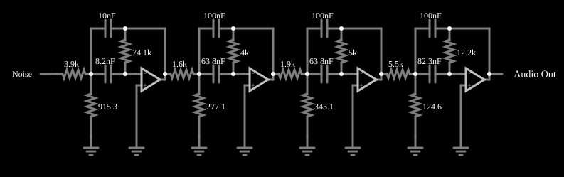

# Filtro Butterworth passa-faixa ativo

<!-- navegacao:inicio -->
[Índice](README.md) · [Anterior: Butterworth High-Pass](actbutterhi.md)
<!-- navegacao:fim -->

## Objetivo

Mostrar um filtro passa-faixa ativo de ordem elevada, construído com quatro seções ativas de segunda ordem em cascata, e medir a sua largura de banda por um ruído branco.

## O circuito

<!-- esquema:inicio -->

<!-- esquema:fim -->

A entrada é um gerador de ruído branco (valores aleatórios uniformes entre $-5$ e $+5\ \text{V}$, com passo de $15{,}6\ \mu\text{s}$, ou seja, $64\ \text{kHz}$). A simulação é determinística (a sequência é sempre a mesma), mas o valor de cada amostra não é previsível; só as grandezas estatísticas, como o valor eficaz (RMS), são comparáveis com a teoria. O filtro tem quatro seções, cada uma com um amplificador operacional, dois capacitores ($8{,}2$ a $100\ \text{nF}$) e três resistores (de $124\ \Omega$ a $74\ \text{k}\Omega$) de valores diferentes em cada seção, o que indica sintonia escalonada: cada seção deve responder em uma faixa um pouco distinta, para que o conjunto tenha uma banda de passagem mais larga e de topo mais plano que a de uma seção só. A saída vai a um elemento de áudio de $8\ \text{kHz}$.

<!-- componentes:inicio -->
| N.º | Tipo | Elemento | Valores |
|----:|------|----------|---------|
| 4 | `CapacitorElm` | capacitor | Capacitance (F) = 8.2n; Trapezoidal Approximation = sim; Initial Voltage (on Reset) = 1m; Series Resistance = 0 |
| 5 | `CapacitorElm` | capacitor | Capacitance (F) = 10n; Trapezoidal Approximation = sim; Initial Voltage (on Reset) = 1m; Series Resistance = 0 |
| 6 | `ResistorElm` | resistor | Resistance (ohms) = 74.1k |
| 8 | `ResistorElm` | resistor | Resistance (ohms) = 3.9k |
| 9 | `ResistorElm` | resistor | Resistance (ohms) = 915.3 |
| 10 | `GroundElm` | ground | Symbol = Earth |
| 11 | `OpAmpElm` | op-amp | Max Output (V) = 15; Min Output (V) = -15; Gain = 100k |
| 12 | `GroundElm` | ground | Symbol = Earth |
| 17 | `CapacitorElm` | capacitor | Capacitance (F) = 63.8n; Trapezoidal Approximation = sim; Initial Voltage (on Reset) = 1m; Series Resistance = 0 |
| 18 | `CapacitorElm` | capacitor | Capacitance (F) = 100n; Trapezoidal Approximation = sim; Initial Voltage (on Reset) = 1m; Series Resistance = 0 |
| 19 | `ResistorElm` | resistor | Resistance (ohms) = 4k |
| 21 | `ResistorElm` | resistor | Resistance (ohms) = 1.6k |
| 22 | `ResistorElm` | resistor | Resistance (ohms) = 277.1 |
| 23 | `GroundElm` | ground | Symbol = Earth |
| 24 | `OpAmpElm` | op-amp | Max Output (V) = 15; Min Output (V) = -15; Gain = 100k |
| 25 | `GroundElm` | ground | Symbol = Earth |
| 30 | `CapacitorElm` | capacitor | Capacitance (F) = 63.8n; Trapezoidal Approximation = sim; Initial Voltage (on Reset) = 1m; Series Resistance = 0 |
| 31 | `CapacitorElm` | capacitor | Capacitance (F) = 100n; Trapezoidal Approximation = sim; Initial Voltage (on Reset) = 1m; Series Resistance = 0 |
| 32 | `ResistorElm` | resistor | Resistance (ohms) = 5k |
| 34 | `ResistorElm` | resistor | Resistance (ohms) = 1.9k |
| 35 | `ResistorElm` | resistor | Resistance (ohms) = 343.1 |
| 36 | `GroundElm` | ground | Symbol = Earth |
| 37 | `OpAmpElm` | op-amp | Max Output (V) = 15; Min Output (V) = -15; Gain = 100k |
| 38 | `GroundElm` | ground | Symbol = Earth |
| 43 | `CapacitorElm` | capacitor | Capacitance (F) = 82.3n; Trapezoidal Approximation = sim; Initial Voltage (on Reset) = 1m; Series Resistance = 0 |
| 44 | `CapacitorElm` | capacitor | Capacitance (F) = 100n; Trapezoidal Approximation = sim; Initial Voltage (on Reset) = 1m; Series Resistance = 0 |
| 45 | `ResistorElm` | resistor | Resistance (ohms) = 12.2k |
| 47 | `ResistorElm` | resistor | Resistance (ohms) = 5.5k |
| 48 | `ResistorElm` | resistor | Resistance (ohms) = 124.6 |
| 49 | `GroundElm` | ground | Symbol = Earth |
| 50 | `OpAmpElm` | op-amp | Max Output (V) = 15; Min Output (V) = -15; Gain = 100k |
| 51 | `GroundElm` | ground | Symbol = Earth |
| 52 | `RailElm` | noise gen | Max Voltage = 5; Waveform = Noise; DC Offset (V) = 0; Internal Resistance (ohms) = 0; Show Voltage = não |
| 53 | `AudioOutputElm` | audio output | Duration (s) = 1; Sampling Rate = 8000 |
<!-- componentes:fim -->

## Teoria

Um passa-faixa de segunda ordem tem uma frequência central $f_0$ e uma largura de banda $B = f_0/Q$. Ligar várias seções com $f_0$ ligeiramente diferentes (sintonia escalonada) reproduz uma resposta de Butterworth passa-faixa, de topo plano e bordas íngremes.

Para um ruído branco de densidade espectral constante, a potência na saída mede a **largura de banda equivalente de ruído** do filtro:

$$B_\text{eq} = f_N\left(\frac{V_{\text{rms,out}}}{V_{\text{rms,in}}}\right)^2, \qquad f_N = 32\ \text{kHz}.$$

## Resultados esperados

| Grandeza | Valor |
|----------|------:|
| Valor eficaz da entrada | $2{,}871\ \text{V}$ |
| Valor eficaz da saída | $0{,}495\ \text{V}$ |
| Largura de banda equivalente de ruído | $32\ \text{kHz}\cdot (0{,}495/2{,}871)^2 \approx 0{,}95\ \text{kHz}$ |

O pico da saída em uma janela de $0{,}3\ \text{s}$ é de $1{,}98\ \text{V}$. Este documento não calcula a frequência central exata das seções, que depende da topologia de cada uma; a verificação confere o valor eficaz da entrada e o da saída (tolerância de 3%), que dependem só da simulação.

## O que observar

- Ao ouvir o som, ouve-se um tom "de rádio" estreito, sem graves nem agudos.
- A saída é uma senoide modulada em amplitude e fase de forma aleatória, com a banda de cerca de $1\ \text{kHz}$ de largura.
- Aumente um dos capacitores de uma seção e veja o valor eficaz da saída mudar: a seção cuja frequência central se desloca estreita ou alarga a banda total.

## Limites do modelo

Os valores dos componentes têm precisão de décimos de ohm, e o filtro real exigiria tolerâncias de 1% ou menores. Operacionais ideais; num filtro real a banda de cada operacional limita a frequência central máxima. A largura de banda de ruído é a equivalente (retangular), e não a de $-3\ \text{dB}$.

## Referências

- A. S. Sedra e K. C. Smith, *Microeletrônica*, Pearson.
- R. P. Sallen e E. L. Key, "A practical method of designing RC active filters", *IRE Transactions on Circuit Theory*, 2, 1955.
- S. Franco, *Design with Operational Amplifiers and Analog Integrated Circuits*, McGraw-Hill.

O circuito deste exemplo faz parte da coleção do simulador original de Paul Falstad e Iain Sharp (CircuitJS1); a explicação é deste projeto.
