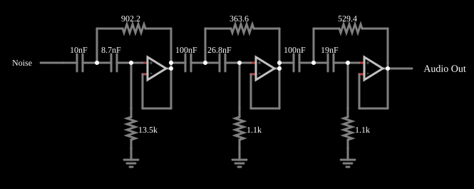

# Filtro Butterworth passa-altas ativo (6.ª ordem)

<!-- navegacao:inicio -->
[Índice](README.md) · [Anterior: Butterworth Low-Pass](actbutterlo.md) · [Próximo: Butterworth Band-Pass](actbutterband.md)
<!-- navegacao:fim -->

## Objetivo

Mostrar um filtro de Butterworth de sexta ordem, passa-altas, com três seções Sallen-Key em cascata, e comparar o resultado com a teoria usando um ruído branco como sinal de teste.

## O circuito

<!-- esquema:inicio -->

<!-- esquema:fim -->

A entrada é um gerador de ruído branco (valores aleatórios uniformes entre $-5$ e $+5\ \text{V}$, com passo de $15{,}6\ \mu\text{s}$, ou seja, $64\ \text{kHz}$). A simulação é determinística (a sequência é sempre a mesma), mas o valor de cada amostra não é previsível; só as grandezas estatísticas, como o valor eficaz (RMS), são comparáveis com a teoria. Cada uma das três seções de segunda ordem tem um amplificador operacional seguidor de tensão, dois capacitores em série na entrada e dois resistores (um ligado do nó entre os capacitores à saída, outro da entrada não inversora à terra). Os capacitores são de $10\ \text{nF}$ e $8{,}71\ \text{nF}$ (primeira seção), $100\ \text{nF}$ e $26{,}8\ \text{nF}$ (segunda) e $100\ \text{nF}$ e $19{,}0\ \text{nF}$ (terceira), e os resistores, de $902\ \Omega$ e $13{,}5\ \text{k}\Omega$, $364\ \Omega$ e $1{,}09\ \text{k}\Omega$, $529\ \Omega$ e $1{,}06\ \text{k}\Omega$. A saída vai a um elemento de áudio de $8\ \text{kHz}$.

<!-- componentes:inicio -->
| N.º | Tipo | Elemento | Valores |
|----:|------|----------|---------|
| 0 | `OpAmpElm` | op-amp | Max Output (V) = 15; Min Output (V) = -15; Gain = 100k |
| 5 | `GroundElm` | ground | Symbol = Earth |
| 10 | `CapacitorElm` | capacitor | Capacitance (F) = 10n; Trapezoidal Approximation = sim; Initial Voltage (on Reset) = 1m; Series Resistance = 0 |
| 11 | `CapacitorElm` | capacitor | Capacitance (F) = 8.7n; Trapezoidal Approximation = sim; Initial Voltage (on Reset) = 1m; Series Resistance = 0 |
| 12 | `ResistorElm` | resistor | Resistance (ohms) = 902.2 |
| 13 | `ResistorElm` | resistor | Resistance (ohms) = 13.5k |
| 14 | `OpAmpElm` | op-amp | Max Output (V) = 15; Min Output (V) = -15; Gain = 100k |
| 19 | `GroundElm` | ground | Symbol = Earth |
| 24 | `CapacitorElm` | capacitor | Capacitance (F) = 100n; Trapezoidal Approximation = sim; Initial Voltage (on Reset) = 1m; Series Resistance = 0 |
| 25 | `CapacitorElm` | capacitor | Capacitance (F) = 26.8n; Trapezoidal Approximation = sim; Initial Voltage (on Reset) = 1m; Series Resistance = 0 |
| 26 | `ResistorElm` | resistor | Resistance (ohms) = 363.6 |
| 27 | `ResistorElm` | resistor | Resistance (ohms) = 1.1k |
| 28 | `OpAmpElm` | op-amp | Max Output (V) = 15; Min Output (V) = -15; Gain = 100k |
| 33 | `GroundElm` | ground | Symbol = Earth |
| 38 | `CapacitorElm` | capacitor | Capacitance (F) = 100n; Trapezoidal Approximation = sim; Initial Voltage (on Reset) = 1m; Series Resistance = 0 |
| 39 | `CapacitorElm` | capacitor | Capacitance (F) = 19n; Trapezoidal Approximation = sim; Initial Voltage (on Reset) = 1m; Series Resistance = 0 |
| 40 | `ResistorElm` | resistor | Resistance (ohms) = 529.4 |
| 41 | `ResistorElm` | resistor | Resistance (ohms) = 1.1k |
| 42 | `AudioOutputElm` | audio output | Duration (s) = 1; Sampling Rate = 8000 |
| 43 | `RailElm` | noise gen | Max Voltage = 5; Waveform = Noise; DC Offset (V) = 0; Internal Resistance (ohms) = 0; Show Voltage = não |
<!-- componentes:fim -->

## Teoria

Para uma seção Sallen-Key passa-altas de ganho unitário, com capacitores $C_1$ e $C_2$ em série e resistores $R_1$ (à saída) e $R_2$ (à terra),

$$f_0 = \frac{1}{2\pi\sqrt{R_1 R_2 C_1 C_2}}, \qquad Q = \frac{\sqrt{R_1R_2C_1C_2}}{R_1\,(C_1 + C_2)}.$$

Com os valores deste exemplo, as três seções têm todas $f_0 \approx 4{,}88\ \text{kHz}$ e $Q = 1{,}932$; $0{,}707$; $0{,}518$ (os fatores de qualidade de Butterworth de $6.^\text{a}$ ordem): o conjunto é um filtro passa-altas de Butterworth de sexta ordem com frequência de corte $f_c \approx 4{,}88\ \text{kHz}$.

Como $|H_\text{pa}|^2 + |H_\text{pb}|^2 = 1$ para Butterworth de mesma frequência de corte, a potência de um ruído branco que o passa-altas deixa passar é a do ruído total (até a frequência de Nyquist de $32\ \text{kHz}$) menos a que o passa-baixas equivalente deixaria passar:

$$\frac{V_{\text{rms,out}}^2}{V_{\text{rms,in}}^2} = \frac{32 - 1{,}0115\cdot 4{,}88}{32} = 0{,}8457 \quad\Longrightarrow\quad \frac{V_{\text{rms,out}}}{V_{\text{rms,in}}} = 0{,}9196.$$

## Resultados esperados

| Grandeza | Valor |
|----------|------:|
| Valor eficaz da entrada | $2{,}871\ \text{V}$ |
| Valor eficaz da saída (teoria) | $0{,}9196\times 2{,}871 = 2{,}640\ \text{V}$ |
| Valor eficaz da saída (simulador) | $2{,}656\ \text{V}$ |

A concordância é de $0{,}6\%$. O máximo da saída em uma janela de $0{,}3\ \text{s}$ é de $7{,}85\ \text{V}$, maior que os $5\ \text{V}$ da entrada: o passa-altas realça as variações rápidas do ruído e o pico da saída pode passar do da entrada. As verificações conferem os valores eficazes (tolerâncias de 2% e 3%).

## O que observar

- Ao ouvir a saída, soa "metálica" e fina: só restam os agudos.
- Em $4{,}88\ \text{kHz}$ a atenuação é de $3\ \text{dB}$ e para baixo ela aumenta de $120\ \text{dB}$ por década.
- Compare com o exemplo passa-baixas: a soma das potências dos dois filtros (mesma $f_c$) é a do ruído de entrada.

## Limites do modelo

Operacionais ideais e componentes sem tolerância, com valores de projeto de $4$ casas decimais: num filtro físico, a tolerância dos capacitores e resistores altera $f_c$ e os $Q$. A frequência de $4{,}88\ \text{kHz}$ está acima da frequência de Nyquist do áudio de $8\ \text{kHz}$ do exemplo (ouve-se só uma parte do sinal).

## Referências

- A. S. Sedra e K. C. Smith, *Microeletrônica*, Pearson.
- R. P. Sallen e E. L. Key, "A practical method of designing RC active filters", *IRE Transactions on Circuit Theory*, 2, 1955.
- S. Franco, *Design with Operational Amplifiers and Analog Integrated Circuits*, McGraw-Hill.

O circuito deste exemplo faz parte da coleção do simulador original de Paul Falstad e Iain Sharp (CircuitJS1); a explicação é deste projeto.
