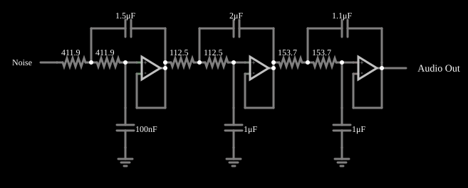

# Filtro Butterworth passa-baixas ativo (6.ª ordem)

<!-- navegacao:inicio -->
[Índice](README.md) · [Anterior: Allpass w/ Square](allpass2.md) · [Próximo: Butterworth High-Pass](actbutterhi.md)
<!-- navegacao:fim -->

## Objetivo

Mostrar um filtro de Butterworth de sexta ordem, passa-baixas, com frequência de corte de $1\ \text{kHz}$, feito com três seções Sallen-Key em cascata, e comparar o resultado com a previsão teórica usando um ruído branco como sinal de teste.

## O circuito

<!-- esquema:inicio -->

<!-- esquema:fim -->

A entrada é um gerador de ruído branco (valores aleatórios uniformes entre $-5$ e $+5\ \text{V}$, com passo de $15{,}6\ \mu\text{s}$, ou seja, $64\ \text{kHz}$). A simulação é determinística (a sequência é sempre a mesma), mas o valor de cada amostra não é previsível; só as grandezas estatísticas, como o valor eficaz (RMS), são comparáveis com a teoria. O filtro tem três seções de segunda ordem Sallen-Key (cada uma com um amplificador operacional seguidor de tensão, dois resistores iguais e dois capacitores: um à terra e outro de realimentação). Os capacitores à terra são de $100\ \text{nF}$, $1\ \mu\text{F}$ e $1\ \mu\text{F}$, e os de realimentação, de $1{,}493\ \mu\text{F}$, $2\ \mu\text{F}$ e $1{,}072\ \mu\text{F}$, com resistores de $411{,}9\ \Omega$, $112{,}5\ \Omega$ e $153{,}7\ \Omega$. A saída vai a um elemento de áudio de $8\ \text{kHz}$.

<!-- componentes:inicio -->
| N.º | Tipo | Elemento | Valores |
|----:|------|----------|---------|
| 0 | `OpAmpElm` | op-amp | Max Output (V) = 15; Min Output (V) = -15; Gain = 100k |
| 4 | `CapacitorElm` | capacitor | Capacitance (F) = 100n; Trapezoidal Approximation = sim; Initial Voltage (on Reset) = 1m; Series Resistance = 0 |
| 6 | `ResistorElm` | resistor | Resistance (ohms) = 411.9 |
| 7 | `ResistorElm` | resistor | Resistance (ohms) = 411.9 |
| 8 | `GroundElm` | ground | Symbol = Earth |
| 9 | `CapacitorElm` | capacitor | Capacitance (F) = 1.5μ; Trapezoidal Approximation = sim; Initial Voltage (on Reset) = 1m; Series Resistance = 0 |
| 14 | `OpAmpElm` | op-amp | Max Output (V) = 15; Min Output (V) = -15; Gain = 100k |
| 18 | `CapacitorElm` | capacitor | Capacitance (F) = 1μ; Trapezoidal Approximation = sim; Initial Voltage (on Reset) = 1m; Series Resistance = 0 |
| 20 | `ResistorElm` | resistor | Resistance (ohms) = 112.5 |
| 21 | `ResistorElm` | resistor | Resistance (ohms) = 112.5 |
| 22 | `GroundElm` | ground | Symbol = Earth |
| 23 | `CapacitorElm` | capacitor | Capacitance (F) = 2μ; Trapezoidal Approximation = sim; Initial Voltage (on Reset) = 1m; Series Resistance = 0 |
| 28 | `OpAmpElm` | op-amp | Max Output (V) = 15; Min Output (V) = -15; Gain = 100k |
| 32 | `CapacitorElm` | capacitor | Capacitance (F) = 1μ; Trapezoidal Approximation = sim; Initial Voltage (on Reset) = 1m; Series Resistance = 0 |
| 34 | `ResistorElm` | resistor | Resistance (ohms) = 153.7 |
| 35 | `ResistorElm` | resistor | Resistance (ohms) = 153.7 |
| 36 | `GroundElm` | ground | Symbol = Earth |
| 37 | `CapacitorElm` | capacitor | Capacitance (F) = 1.1μ; Trapezoidal Approximation = sim; Initial Voltage (on Reset) = 1m; Series Resistance = 0 |
| 42 | `RailElm` | noise gen | Max Voltage = 5; Waveform = Noise; DC Offset (V) = 0; Internal Resistance (ohms) = 0; Show Voltage = não |
| 43 | `AudioOutputElm` | audio output | Duration (s) = 1; Sampling Rate = 8000 |
<!-- componentes:fim -->

## Teoria

Um filtro de Butterworth de ordem $n$ tem

$$|H(f)|^2 = \frac{1}{1 + (f/f_c)^{2n}},$$

e pode ser construído por $n/2$ seções de segunda ordem, todas com frequência natural $f_c$ e fatores de qualidade $Q_k = 1/\bigl(2\cos\theta_k\bigr)$ com $\theta_k = (2k-1)\pi/(2n)$. Para $n = 6$: $Q = 0{,}5176$, $0{,}7071$ e $1{,}9319$.

Numa seção Sallen-Key de ganho unitário com resistores iguais $R$, o capacitor de realimentação $C_f$ e o à terra $C_g$ dão

$$f_0 = \frac{1}{2\pi R\sqrt{C_f C_g}}, \qquad Q = \frac12\sqrt{\frac{C_f}{C_g}}.$$

Os valores deste exemplo dão $Q = \tfrac12\sqrt{1{,}493/0{,}1} = 1{,}932$ (primeira seção), $\tfrac12\sqrt{2} = 0{,}707$ (segunda) e $\tfrac12\sqrt{1{,}072} = 0{,}518$ (terceira), e $f_0 = 1000\ \text{Hz}$ nas três ($411{,}9\ \Omega\cdot\sqrt{1{,}493\ \mu\text{F}\cdot 100\ \text{nF}}\cdot 2\pi = 1{,}0\ \text{ms}$, e similarmente nas outras): é um Butterworth de $6.^\text{a}$ ordem com $f_c = 1\ \text{kHz}$.

Para um ruído branco de densidade espectral constante até a frequência de Nyquist $f_N = 32\ \text{kHz}$, a potência na saída é a da banda equivalente de ruído do filtro, que para o Butterworth de ordem $n$ é $f_c\,\dfrac{\pi/2n}{\sin(\pi/2n)} = 1{,}0115\ \text{kHz}$ ($n = 6$). O valor eficaz da saída é, portanto,

$$V_{\text{rms,out}} = V_{\text{rms,in}}\sqrt{\frac{1{,}0115\ \text{kHz}}{32\ \text{kHz}}} = 0{,}1778\,V_{\text{rms,in}}.$$

## Resultados esperados

Em uma janela de $0{,}3\ \text{s}$ (cerca de $19\,000$ amostras):

| Grandeza | Valor |
|----------|------:|
| Valor eficaz da entrada | $2{,}871\ \text{V}$ (teoria para ruído uniforme de $\pm 5\ \text{V}$: $5/\sqrt 3 = 2{,}887\ \text{V}$) |
| Valor eficaz da saída (teoria) | $0{,}1778 \times 2{,}887 = 0{,}513\ \text{V}$ |
| Valor eficaz da saída (simulador) | $0{,}502\ \text{V}$ |

A diferença de $2\%$ é compatível com a incerteza estatística de uma amostra finita de ruído. As verificações conferem o valor eficaz da entrada (tolerância de 2%) e o da saída contra $0{,}510\ \text{V}$ (tolerância de 3%).

## O que observar

- Ao ouvir a saída, o ruído da entrada (um chiado) passa a ser um som grave, "abafado", de espectro limitado a cerca de $1\ \text{kHz}$.
- A queda de amplitude depois de $f_c$ é de $120\ \text{dB}$ por década (seis polos).
- O máximo da saída em uma janela de $0{,}3\ \text{s}$ é de cerca de $1{,}5\ \text{V}$, muito menor que os $5\ \text{V}$ da entrada.

## Limites do modelo

Operacionais ideais e componentes sem tolerância, e valores de projeto com precisão de décimos de ohm; o filtro real exige resistores e capacitores de 1% ou melhores, ou um ajuste. A banda equivalente de ruído supõe um ruído branco ideal; o do simulador é amostrado a $64\ \text{kHz}$ e mantido entre amostras, o que muda a densidade espectral perto da frequência de Nyquist.

## Referências

- A. S. Sedra e K. C. Smith, *Microeletrônica*, Pearson.
- R. P. Sallen e E. L. Key, "A practical method of designing RC active filters", *IRE Transactions on Circuit Theory*, 2, 1955.
- S. Franco, *Design with Operational Amplifiers and Analog Integrated Circuits*, McGraw-Hill.

O circuito deste exemplo faz parte da coleção do simulador original de Paul Falstad e Iain Sharp (CircuitJS1); a explicação é deste projeto.
