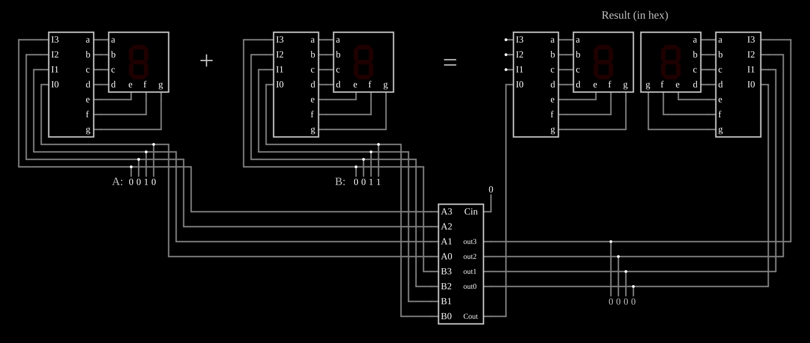

# Somador de 4 bits com subcircuitos aninhados

<!-- navegacao:inicio -->
[Índice](README.md) · [Anterior: Full Rectifier](fullrect-sc.md)
<!-- navegacao:fim -->

## Objetivo

Mostrar **subcircuitos aninhados**: um somador completo (*full adder*) de uma porta lógica é um subcircuito, o somador de 4 bits é outro subcircuito que usa quatro somadores completos, e o circuito principal usa o somador de 4 bits.

## O circuito

<!-- esquema:inicio -->

<!-- esquema:fim -->

Oito chaves de entrada (cada uma com valor $0$ ou $1$) formam dois números de 4 bits, $A$ e $B$, e uma nona chave é o *vai-um* de entrada $C_{in}$. Quatro saídas lógicas mostram os 4 bits da soma, e mostradores de 7 segmentos exibem $A$, $B$ e o resultado em hexadecimal.

Os elementos de entrada 19 a 22 são os bits de $A$ ($A_0$ no 19 até $A_3$ no 22), os 23 a 26 são os bits de $B$ ($B_3$ no 23 até $B_0$ no 26) e o 0 é $C_{in}$. As saídas 84 a 87 são os bits 3 a 0 da soma. No início, $A = 2$ e $B = 3$.

Dentro, o somador completo tem duas portas XOR, duas AND e uma OR; o somador de 4 bits liga quatro somadores completos em cascata, com a saída de vai-um de cada um na entrada do seguinte (somador *ripple-carry*).

<!-- componentes:inicio -->
| N.º | Tipo | Elemento | Valores |
|----:|------|----------|---------|
| 0 | `LogicInputElm` | logic input | Momentary Switch = não; High Logic Voltage = 5; Low Voltage = 0; Numeric = sim; Ternary = não; Keyboard Shortcut =  |
| 1 | `SevenSegDecoderElm` | 7-Segment Decoder | High Logic Voltage = 5; Bit Order = MSB First; Segments = 7 Segment; Blank Pin = não; Blank on 1111 = não |
| 2 | `SevenSegElm` | segment display | High Logic Voltage = 5; Bit Order = MSB First; Segments = 7 Segment; Extra Segment = None; Diodes = None (logic inputs) |
| 19 | `LogicInputElm` | logic input | Momentary Switch = não; High Logic Voltage = 5; Low Voltage = 0; Numeric = sim; Ternary = não; Keyboard Shortcut =  |
| 20 | `LogicInputElm` | logic input | Momentary Switch = não; High Logic Voltage = 5; Low Voltage = 0; Numeric = sim; Ternary = não; Keyboard Shortcut =  |
| 21 | `LogicInputElm` | logic input | Momentary Switch = não; High Logic Voltage = 5; Low Voltage = 0; Numeric = sim; Ternary = não; Keyboard Shortcut =  |
| 22 | `LogicInputElm` | logic input | Momentary Switch = não; High Logic Voltage = 5; Low Voltage = 0; Numeric = sim; Ternary = não; Keyboard Shortcut =  |
| 23 | `LogicInputElm` | logic input | Momentary Switch = não; High Logic Voltage = 5; Low Voltage = 0; Numeric = sim; Ternary = não; Keyboard Shortcut =  |
| 24 | `LogicInputElm` | logic input | Momentary Switch = não; High Logic Voltage = 5; Low Voltage = 0; Numeric = sim; Ternary = não; Keyboard Shortcut =  |
| 25 | `LogicInputElm` | logic input | Momentary Switch = não; High Logic Voltage = 5; Low Voltage = 0; Numeric = sim; Ternary = não; Keyboard Shortcut =  |
| 26 | `LogicInputElm` | logic input | Momentary Switch = não; High Logic Voltage = 5; Low Voltage = 0; Numeric = sim; Ternary = não; Keyboard Shortcut =  |
| 43 | `SevenSegElm` | segment display | High Logic Voltage = 5; Bit Order = MSB First; Segments = 7 Segment; Extra Segment = None; Diodes = None (logic inputs) |
| 44 | `SevenSegDecoderElm` | 7-Segment Decoder | High Logic Voltage = 5; Bit Order = MSB First; Segments = 7 Segment; Blank Pin = não; Blank on 1111 = não |
| 45 | `SevenSegDecoderElm` | 7-Segment Decoder | High Logic Voltage = 5; Bit Order = MSB First; Segments = 7 Segment; Blank Pin = não; Blank on 1111 = não |
| 46 | `SevenSegElm` | segment display | High Logic Voltage = 5; Bit Order = MSB First; Segments = 7 Segment; Extra Segment = None; Diodes = None (logic inputs) |
| 52 | `SevenSegElm` | segment display | High Logic Voltage = 5; Bit Order = MSB First; Segments = 7 Segment; Extra Segment = None; Diodes = None (logic inputs) |
| 53 | `SevenSegDecoderElm` | 7-Segment Decoder | High Logic Voltage = 5; Bit Order = MSB First; Segments = 7 Segment; Blank Pin = não; Blank on 1111 = não |
| 84 | `LogicOutputElm` | logic output | Threshold = 2.5; Current Required = não; Numeric = sim; Ternary = não |
| 85 | `LogicOutputElm` | logic output | Threshold = 2.5; Current Required = não; Numeric = sim; Ternary = não |
| 86 | `LogicOutputElm` | logic output | Threshold = 2.5; Current Required = não; Numeric = sim; Ternary = não |
| 87 | `LogicOutputElm` | logic output | Threshold = 2.5; Current Required = não; Numeric = sim; Ternary = não |
| 88 | `TextElm` | text | Text = +; Size = 56; Draw Bar On Top = não; Color = #c0c0c0 |
| 89 | `TextElm` | text | Text = =; Size = 56; Draw Bar On Top = não; Color = #c0c0c0 |
| 106 | `CustomCompositeElm` | subcircuit (adder-4) | Model Name = adder-4; High Logic Voltage (0=default) = 0 |
| 107 | `TextElm` | text | Text = A:; Size = 24; Draw Bar On Top = não; Color = #c0c0c0 |
| 108 | `TextElm` | text | Text = B:; Size = 24; Draw Bar On Top = não; Color = #c0c0c0 |
| 109 | `TextElm` | text | Text = Result (in hex); Size = 24; Draw Bar On Top = não; Color = #c0c0c0 |
<!-- componentes:fim -->

## Símbolos e parâmetros

Os símbolos usados neste documento (definições completas no [glossário](../glossario-simbolos.md)):

| Símbolo | Nome | Significado | Unidade |
|---------|------|-------------|---------|
| $A$ | entrada lógica A | primeira entrada da porta ou do circuito lógico | — |
| $n$ | número inteiro n | quantidade ou índice inteiro definido no texto (ordem do filtro, número de bits, de nós ou de espiras) | — |
| $S$ | sinal lógico S | entrada de seleção, de ajuste (*set*) ou de soma, conforme o circuito | — |
| $B$ | entrada lógica B | segunda entrada da porta ou do circuito lógico | — |
| $C_{\text{in}}$ | vai-um de entrada | bit de transporte que entra no somador | — |
| $A_0$ | bit 0 da entrada A | bit de índice 0 do número de 4 bits A | — |
| $A_3$ | bit 3 da entrada A | bit de índice 3 do número de 4 bits A | — |
| $B_3$ | bit 3 da entrada B | bit de índice 3 do número de 4 bits B | — |
| $B_0$ | bit 0 da entrada B | bit de índice 0 do número de 4 bits B | — |
| $C_{\text{out}}$ | vai-um de saída | bit de transporte que sai do somador | — |
| $S_i$ | bit i da soma | bit de índice $i$ do resultado da soma | — |

## Teoria

Um somador completo soma três bits $A$, $B$ e $C_{in}$:

$$S = A \oplus B \oplus C_{in},\qquad C_{out} = AB + C_{in}(A \oplus B).$$

Ligando $n$ deles em cascata, com o vai-um de saída de cada estágio como entrada do próximo, obtém-se um somador de $n$ bits:

$$A + B + C_{in} = \sum_{i=0}^{n-1} S_i\thinspace 2^i + C_{out}\thinspace 2^n.$$

O atraso de propagação do vai-um cresce com $n$ (é o ponto fraco do *ripple-carry*); os somadores de verdade usam antecipação de vai-um (por exemplo, o de Brent–Kung do exemplo *brentkung*). Aqui as portas não têm atraso, então a soma aparece de imediato.

Com $A = 2$ e $B = 3$: $2 + 3 = 5 = 0101_2$.

## Resultados esperados

O simulador dá:

- **Estado inicial** ($A = 2$, $B = 3$, $C_{in} = 0$): a soma é $5 = 0101_2$, isto é, as saídas 85 e 87 em nível alto e as 84 e 86 em nível baixo.
- **$A = 10$, $B = 15$** (acionando as chaves 22, 24 e 23): $10 + 15 = 25 = 11001_2$; as quatro saídas mostram os 4 bits menos significativos, $1001_2 = 9$ (saídas 84 e 87 em nível alto), e o quinto bit ($C_{out}$) não é mostrado.
- **Vai-um de entrada** (chave 0): a soma passa de $5$ a $6$.

## O que observar

Acione as chaves de $A$ e $B$ e confira, no mostrador hexadecimal, que o resultado é a soma. Observe o que acontece quando a soma passa de $15$: só os 4 bits menos significativos aparecem.

## Limites do modelo

- Os subcircuitos aninhados são só organização do desenho: não mudam o comportamento lógico das portas.
- As portas lógicas têm atraso nulo, por isso não se vê o efeito do vai-um se propagando ($\text{ripple}$); num circuito real o resultado leva alguns atrasos de porta para se estabilizar.
- O vai-um de saída do último estágio não está ligado a nenhuma saída, então somas acima de $15$ perdem o quinto bit.

## Referências

Mano e Ciletti, *Digital Design*, capítulo sobre circuitos aritméticos (somador completo e somador de propagação de vai-um); Weste e Harris, *CMOS VLSI Design*, capítulo sobre somadores.

O circuito deste exemplo faz parte da coleção do simulador original de Paul Falstad e Iain Sharp (CircuitJS1); a explicação é deste projeto.
