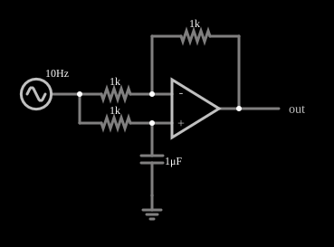

# Filtro passa-tudo de primeira ordem

<!-- navegacao:inicio -->
[Índice](README.md) · [Anterior: Switched-Capacitor Filter](switchedcap.md) · [Próximo: Allpass w/ Square](allpass2.md)
<!-- navegacao:fim -->

## Objetivo

Mostrar o filtro passa-tudo (*all-pass*): ele deixa passar todas as frequências com o mesmo ganho ($1$) e só muda a **fase** do sinal, de $0^\circ$ em baixas frequências a $-180^\circ$ em altas.

## O circuito

<!-- esquema:inicio -->

<!-- esquema:fim -->

A fonte é um gerador de varredura logarítmica de $5\ \text{V}$ de pico, de $10$ a $2000\ \text{Hz}$ em $0{,}1\ \text{s}$ (ida e volta). A entrada vai à entrada inversora do amplificador operacional por um resistor de $1\ \text{k}\Omega$ e à entrada não inversora por outro resistor de $1\ \text{k}\Omega$ seguido de um capacitor de $1\ \mu\text{F}$ para a terra; um resistor de $1\ \text{k}\Omega$ liga a saída à entrada inversora. Dois osciloscópios mostram a entrada e a saída.

<!-- componentes:inicio -->
| N.º | Tipo | Elemento | Valores |
|----:|------|----------|---------|
| 0 | `OpAmpElm` | op-amp | Max Output (V) = 15; Min Output (V) = -15; Gain = 100k |
| 1 | `ResistorElm` | resistor | Resistance (ohms) = 1k |
| 2 | `ResistorElm` | resistor | Resistance (ohms) = 1k |
| 4 | `ResistorElm` | resistor | Resistance (ohms) = 1k |
| 6 | `CapacitorElm` | capacitor | Capacitance (F) = 1μ; Trapezoidal Approximation = sim; Initial Voltage (on Reset) = 1m; Series Resistance = 0 |
| 7 | `GroundElm` | ground | Symbol = Earth |
| 9 | `SweepElm` | sweep (log) | Min Frequency (Hz) = 10; Max Frequency (Hz) = 2k; Sweep Time (s) = 100m; Logarithmic = sim; Max Voltage = 5; Bidirectional = sim |
| 10 | `OutputElm` | output | Show Voltage = não |
<!-- componentes:fim -->

## Teoria

A entrada não inversora recebe a entrada filtrada por um passa-baixas $RC$: $V_+ = V_\text{in}/(1 + sRC)$. Com $R_f = R_1$, o amplificador é a combinação de um não inversor (ganho $2$) para $V_+$ e de um inversor (ganho $-1$) para $V_\text{in}$:

$$V_\text{out} = 2\,V_+ - V_\text{in} = V_\text{in}\left(\frac{2}{1 + sRC} - 1\right) = V_\text{in}\,\frac{1 - sRC}{1 + sRC}.$$

O módulo é $1$ em qualquer frequência, e a fase é

$$\varphi(f) = -2\arctan\left(\frac{f}{f_0}\right), \qquad f_0 = \frac{1}{2\pi RC} = \frac{1}{2\pi\cdot 1\ \text{k}\Omega\cdot 1\ \mu\text{F}} \approx 159\ \text{Hz}.$$

Em $f_0$ a fase é $-90^\circ$. O atraso de grupo, $\tau_g = 2RC/(1 + (f/f_0)^2)$, é de $2\ \text{ms}$ em baixas frequências e diminui acima de $f_0$.

## Resultados esperados

A amplitude da saída é igual à da entrada ($5\ \text{V}$) durante toda a varredura:

| Janela | Máximo da saída | Mínimo da saída |
|--------|----------------:|----------------:|
| $20$ a $60\ \text{ms}$ | $5{,}134\ \text{V}$ | $-5{,}138\ \text{V}$ |
| $90$ a $100\ \text{ms}$ | $5{,}008\ \text{V}$ | |

Os desvios de $2{,}7\%$ na primeira janela vêm de a frequência da varredura variar com o tempo (o ganho unitário vale para um sinal estacionário). As verificações conferem que a amplitude fica em $5\ \text{V}$ com tolerância de 3%.

## O que observar

- Os dois osciloscópios têm a mesma amplitude, mas a saída fica **atrasada** em relação à entrada, cada vez mais, até a diferença de meio ciclo em altas frequências.
- O filtro não altera o espectro de amplitude: o seu efeito só se percebe na forma de onda de sinais com vários harmônicos (veja o exemplo seguinte, com onda quadrada).
- Mude o capacitor e $f_0$ muda na proporção inversa.

## Limites do modelo

Operacional ideal e resistores iguais. Com tolerância de $1\%$ nos resistores o ganho deixa de ser exatamente $1$ e o módulo ondula levemente. O ganho unitário só vale na região em que o operacional tem muito ganho de malha aberta.

## Referências

- A. S. Sedra e K. C. Smith, *Microeletrônica*, Pearson.
- P. Horowitz e W. Hill, *The Art of Electronics*, Cambridge University Press.
- S. Franco, *Design with Operational Amplifiers and Analog Integrated Circuits*, McGraw-Hill.

O circuito deste exemplo faz parte da coleção do simulador original de Paul Falstad e Iain Sharp (CircuitJS1); a explicação é deste projeto.
