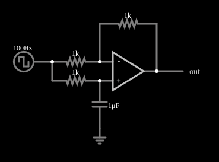

# Filtro passa-tudo com onda quadrada

<!-- navegacao:inicio -->
[Índice](README.md) · [Anterior: Allpass](allpass1.md) · [Próximo: Butterworth Low-Pass](actbutterlo.md)
<!-- navegacao:fim -->

## Objetivo

Mostrar, no domínio do tempo, o efeito de um filtro passa-tudo: ele não muda o módulo de nenhuma frequência, mas desloca a fase de cada uma de forma diferente, o que **deforma** uma onda quadrada, formada pela soma de vários harmônicos.

## O circuito

<!-- esquema:inicio -->

<!-- esquema:fim -->

O mesmo circuito do exemplo anterior (filtro passa-tudo de primeira ordem, com $R = 1\ \text{k}\Omega$ e $C = 1\ \mu\text{F}$), alimentado por uma onda quadrada de $100\ \text{Hz}$ e $\pm 5\ \text{V}$. Um osciloscópio mostra a saída.

<!-- componentes:inicio -->
| N.º | Tipo | Elemento | Valores |
|----:|------|----------|---------|
| 0 | `OpAmpElm` | op-amp | Max Output (V) = 15; Min Output (V) = -15; Gain = 100k |
| 1 | `ResistorElm` | resistor | Resistance (ohms) = 1k |
| 2 | `ResistorElm` | resistor | Resistance (ohms) = 1k |
| 4 | `ResistorElm` | resistor | Resistance (ohms) = 1k |
| 6 | `CapacitorElm` | capacitor | Capacitance (F) = 1μ; Trapezoidal Approximation = sim; Initial Voltage (on Reset) = 1m; Series Resistance = 0 |
| 7 | `GroundElm` | ground | Symbol = Earth |
| 9 | `OutputElm` | output | Show Voltage = não |
| 10 | `RailElm` | square wave gen | Max Voltage = 5; Waveform = Square Wave; DC Offset (V) = 0; Internal Resistance (ohms) = 0; Show Voltage = não; Specify As = Frequency/Duty Cycle; Frequency (Hz) = 100; Phase Offset (degrees) = 0; Duty Cycle = 50; Rise/Fall Time (s) = 0 |
<!-- componentes:fim -->

## Teoria

A função de transferência é $H(s) = (1 - s\tau)/(1 + s\tau)$, com $\tau = RC = 1\ \text{ms}$. A saída é $V_\text{out} = 2V_+ - V_\text{in}$, onde $V_+$ é a tensão no capacitor, que **não pode variar instantaneamente**. Quando a entrada dá um degrau de $\Delta V$, a saída salta de $-\Delta V$ (porque $V_+$ ainda não mudou) e depois decai exponencialmente para o novo valor com constante de tempo $\tau$.

Para um degrau de $-5$ para $+5\ \text{V}$ ($\Delta V = 10\ \text{V}$), com $V_+ = -5\ \text{V}$ no instante do degrau:

$$V_\text{out}(0^+) = 2\,(-5) - 5 = -15\ \text{V}, \qquad V_\text{out}(t) = 5 - 20\,e^{-t/\tau}.$$

Cada degrau de $10\ \text{V}$ da entrada produz, portanto, um pico de quase $\mp 15\ \text{V}$, três vezes a amplitude da entrada, que depois relaxa em direção a $\pm 5\ \text{V}$.

## Resultados esperados

Para a transição de subida em $t = 100\ \text{ms}$ (a entrada passa de $-5$ para $+5\ \text{V}$):

| Instante | $t - 100\ \text{ms}$ | $5 - 20\,e^{-t/\tau}$ | Simulador |
|----------|-----------------------:|-----------------------:|----------:|
| $100{,}1\ \text{ms}$ | $0{,}1\ \text{ms}$ | $-13{,}10\ \text{V}$ | $-13{,}02\ \text{V}$ |
| $100{,}5\ \text{ms}$ | $0{,}5\ \text{ms}$ | $-7{,}13\ \text{V}$ | $-7{,}08\ \text{V}$ |
| $104{,}9\ \text{ms}$ | $4{,}9\ \text{ms}$ | $4{,}85\ \text{V}$ | $4{,}85\ \text{V}$ |

Em um intervalo de $0{,}1\ \text{s}$ os extremos da saída são $\pm 14{,}82\ \text{V}$, quase o valor de $15\ \text{V}$ previsto para o primeiro passo depois do degrau (o simulador amostra a saída a cada $5\ \mu\text{s}$). As verificações conferem os três pontos (tolerância de 1%) e os extremos.

## O que observar

- A onda quadrada de $\pm 5\ \text{V}$ sai com picos de $\pm 15\ \text{V}$ em cada flanco e relaxamentos exponenciais nos patamares: a forma de onda está muito diferente, apesar de o filtro ter ganho unitário em todas as frequências.
- O sinal sai deformado porque os harmônicos da quadrada sofrem atrasos de fase diferentes (o atraso de grupo muda com a frequência).
- Compare com o filtro passa-tudo de primeira ordem excitado por senoides, em que só se vê um atraso.

## Limites do modelo

O operacional é ideal, com saturação em $\pm 15\ \text{V}$; o primeiro passo após o degrau chega a $-14{,}9\ \text{V}$, muito perto do limite. Com um degrau maior, o operacional saturaria e a resposta deixaria de seguir a fórmula.

## Referências

- A. S. Sedra e K. C. Smith, *Microeletrônica*, Pearson.
- P. Horowitz e W. Hill, *The Art of Electronics*, Cambridge University Press.
- S. Franco, *Design with Operational Amplifiers and Analog Integrated Circuits*, McGraw-Hill.

O circuito deste exemplo faz parte da coleção do simulador original de Paul Falstad e Iain Sharp (CircuitJS1); a explicação é deste projeto.
