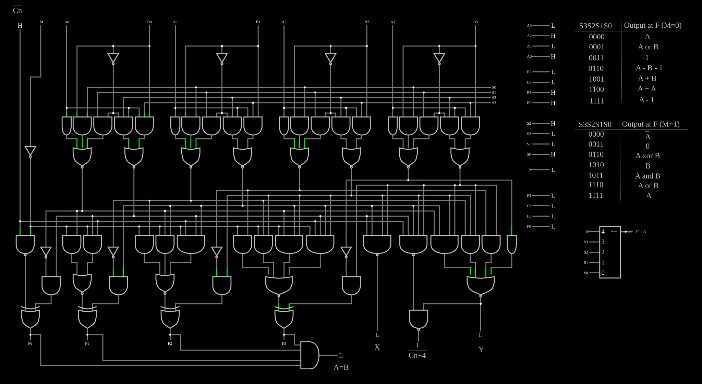

# Unidade lógica e aritmética 74181

<!-- navegacao:inicio -->
[Índice](README.md) · [Anterior: Brent-Kung Adder](brentkung.md)
<!-- navegacao:fim -->

## Objetivo

Mostrar, porta a porta, a **74181**, a primeira ULA completa num único circuito integrado (Texas Instruments, 1970): com quatro bits de seleção e um bit de modo, ela faz 16 funções lógicas e 16 operações aritméticas sobre dois números de 4 bits, e foi o coração de minicomputadores como o PDP-11/45 e o Xerox Alto.

## O circuito

<!-- esquema:inicio -->

<!-- esquema:fim -->

O circuito reproduz o diagrama lógico da 74181 com portas AND, NOR, XOR e inversores ideais. As entradas lógicas são:

- os operandos $A_3 \dots A_0$ (elementos 113 a 116) e $B_3 \dots B_0$ (elementos 128 a 125);
- a seleção $S_3 S_2 S_1 S_0$ (elementos 360 a 357) e o modo $M$ (elemento 409): $M = 0$ para aritmética e $M = 1$ para lógica;
- o vai-um de entrada $\overline{C_n}$ (elemento 324), ativo em nível baixo.

As saídas são o resultado $F_3 \dots F_0$ (elementos 419 a 416), o vai-um de saída $\overline{C_{n+4}}$ (elemento 335), também ativo em nível baixo, os sinais de grupo $X$ (elemento 325) e $Y$ (elemento 330), e $A = B$ (elemento 351). Um mostrador de instrução (elemento 411) lê $S$ e $M$ por um divisor de barramento e escreve o nome da operação; duas tabelas de texto ao lado resumem algumas funções. O exemplo abre com $A = 0101 = 5$, $B = 0011 = 3$, $S = 1001$, $M = 0$ e $\overline{C_n} = 1$ (sem vai-um): a operação $F = A + B$.

<!-- componentes:inicio -->
| N.º | Tipo | Elemento | Valores |
|----:|------|----------|---------|
| 0 | `AndGateElm` | AND gate | # of Inputs = 3; High Logic Voltage = 5; Schmitt Inputs = não; Invert Inputs = não; Propagation Delay (s) = 0; DeMorgan's Symbol = não |
| 1 | `AndGateElm` | AND gate | # of Inputs = 3; High Logic Voltage = 5; Schmitt Inputs = não; Invert Inputs = não; Propagation Delay (s) = 0; DeMorgan's Symbol = não |
| 2 | `AndGateElm` | AND gate | # of Inputs = 2; High Logic Voltage = 5; Schmitt Inputs = não; Invert Inputs = não; Propagation Delay (s) = 0; DeMorgan's Symbol = não |
| 3 | `AndGateElm` | AND gate | # of Inputs = 2; High Logic Voltage = 5; Schmitt Inputs = não; Invert Inputs = não; Propagation Delay (s) = 0; DeMorgan's Symbol = não |
| 4 | `InverterElm` | inverter | Slew Rate (V/ns) = 500m; High Logic Voltage = 5; DeMorgan's Symbol = não |
| 19 | `AndGateElm` | AND gate | # of Inputs = 1; High Logic Voltage = 5; Schmitt Inputs = não; Invert Inputs = não; Propagation Delay (s) = 0; DeMorgan's Symbol = não |
| 23 | `LabeledNodeElm` | Labeled Node | Text = A3; Internal Node = não; Rotate Text When Vertical = não |
| 24 | `LabeledNodeElm` | Labeled Node | Text = B3; Internal Node = não; Rotate Text When Vertical = não |
| 25 | `LabeledNodeElm` | Labeled Node | Text = B2; Internal Node = não; Rotate Text When Vertical = não |
| 26 | `LabeledNodeElm` | Labeled Node | Text = A2; Internal Node = não; Rotate Text When Vertical = não |
| 30 | `AndGateElm` | AND gate | # of Inputs = 1; High Logic Voltage = 5; Schmitt Inputs = não; Invert Inputs = não; Propagation Delay (s) = 0; DeMorgan's Symbol = não |
| 45 | `InverterElm` | inverter | Slew Rate (V/ns) = 500m; High Logic Voltage = 5; DeMorgan's Symbol = não |
| 46 | `AndGateElm` | AND gate | # of Inputs = 2; High Logic Voltage = 5; Schmitt Inputs = não; Invert Inputs = não; Propagation Delay (s) = 0; DeMorgan's Symbol = não |
| 47 | `AndGateElm` | AND gate | # of Inputs = 2; High Logic Voltage = 5; Schmitt Inputs = não; Invert Inputs = não; Propagation Delay (s) = 0; DeMorgan's Symbol = não |
| 48 | `AndGateElm` | AND gate | # of Inputs = 3; High Logic Voltage = 5; Schmitt Inputs = não; Invert Inputs = não; Propagation Delay (s) = 0; DeMorgan's Symbol = não |
| 49 | `AndGateElm` | AND gate | # of Inputs = 3; High Logic Voltage = 5; Schmitt Inputs = não; Invert Inputs = não; Propagation Delay (s) = 0; DeMorgan's Symbol = não |
| 50 | `LabeledNodeElm` | Labeled Node | Text = B1; Internal Node = não; Rotate Text When Vertical = não |
| 51 | `LabeledNodeElm` | Labeled Node | Text = A1; Internal Node = não; Rotate Text When Vertical = não |
| 55 | `AndGateElm` | AND gate | # of Inputs = 1; High Logic Voltage = 5; Schmitt Inputs = não; Invert Inputs = não; Propagation Delay (s) = 0; DeMorgan's Symbol = não |
| 70 | `InverterElm` | inverter | Slew Rate (V/ns) = 500m; High Logic Voltage = 5; DeMorgan's Symbol = não |
| 71 | `AndGateElm` | AND gate | # of Inputs = 2; High Logic Voltage = 5; Schmitt Inputs = não; Invert Inputs = não; Propagation Delay (s) = 0; DeMorgan's Symbol = não |
| 72 | `AndGateElm` | AND gate | # of Inputs = 2; High Logic Voltage = 5; Schmitt Inputs = não; Invert Inputs = não; Propagation Delay (s) = 0; DeMorgan's Symbol = não |
| 73 | `AndGateElm` | AND gate | # of Inputs = 3; High Logic Voltage = 5; Schmitt Inputs = não; Invert Inputs = não; Propagation Delay (s) = 0; DeMorgan's Symbol = não |
| 74 | `AndGateElm` | AND gate | # of Inputs = 3; High Logic Voltage = 5; Schmitt Inputs = não; Invert Inputs = não; Propagation Delay (s) = 0; DeMorgan's Symbol = não |
| 75 | `LabeledNodeElm` | Labeled Node | Text = B0; Internal Node = não; Rotate Text When Vertical = não |
| 76 | `LabeledNodeElm` | Labeled Node | Text = A0; Internal Node = não; Rotate Text When Vertical = não |
| 80 | `AndGateElm` | AND gate | # of Inputs = 1; High Logic Voltage = 5; Schmitt Inputs = não; Invert Inputs = não; Propagation Delay (s) = 0; DeMorgan's Symbol = não |
| 95 | `InverterElm` | inverter | Slew Rate (V/ns) = 500m; High Logic Voltage = 5; DeMorgan's Symbol = não |
| 96 | `AndGateElm` | AND gate | # of Inputs = 2; High Logic Voltage = 5; Schmitt Inputs = não; Invert Inputs = não; Propagation Delay (s) = 0; DeMorgan's Symbol = não |
| 97 | `AndGateElm` | AND gate | # of Inputs = 2; High Logic Voltage = 5; Schmitt Inputs = não; Invert Inputs = não; Propagation Delay (s) = 0; DeMorgan's Symbol = não |
| 98 | `AndGateElm` | AND gate | # of Inputs = 3; High Logic Voltage = 5; Schmitt Inputs = não; Invert Inputs = não; Propagation Delay (s) = 0; DeMorgan's Symbol = não |
| 99 | `AndGateElm` | AND gate | # of Inputs = 3; High Logic Voltage = 5; Schmitt Inputs = não; Invert Inputs = não; Propagation Delay (s) = 0; DeMorgan's Symbol = não |
| 113 | `LogicInputElm` | logic input | Momentary Switch = não; High Logic Voltage = 5; Low Voltage = 0; Numeric = não; Ternary = não; Keyboard Shortcut =  |
| 114 | `LogicInputElm` | logic input | Momentary Switch = não; High Logic Voltage = 5; Low Voltage = 0; Numeric = não; Ternary = não; Keyboard Shortcut =  |
| 115 | `LogicInputElm` | logic input | Momentary Switch = não; High Logic Voltage = 5; Low Voltage = 0; Numeric = não; Ternary = não; Keyboard Shortcut =  |
| 116 | `LogicInputElm` | logic input | Momentary Switch = não; High Logic Voltage = 5; Low Voltage = 0; Numeric = não; Ternary = não; Keyboard Shortcut =  |
| 117 | `LabeledNodeElm` | Labeled Node | Text = A3; Internal Node = não; Rotate Text When Vertical = não |
| 118 | `LabeledNodeElm` | Labeled Node | Text = A2; Internal Node = não; Rotate Text When Vertical = não |
| 119 | `LabeledNodeElm` | Labeled Node | Text = A1; Internal Node = não; Rotate Text When Vertical = não |
| 120 | `LabeledNodeElm` | Labeled Node | Text = A0; Internal Node = não; Rotate Text When Vertical = não |
| 121 | `LabeledNodeElm` | Labeled Node | Text = B0; Internal Node = não; Rotate Text When Vertical = não |
| 122 | `LabeledNodeElm` | Labeled Node | Text = B1; Internal Node = não; Rotate Text When Vertical = não |
| 123 | `LabeledNodeElm` | Labeled Node | Text = B2; Internal Node = não; Rotate Text When Vertical = não |
| 124 | `LabeledNodeElm` | Labeled Node | Text = B3; Internal Node = não; Rotate Text When Vertical = não |
| 125 | `LogicInputElm` | logic input | Momentary Switch = não; High Logic Voltage = 5; Low Voltage = 0; Numeric = não; Ternary = não; Keyboard Shortcut =  |
| 126 | `LogicInputElm` | logic input | Momentary Switch = não; High Logic Voltage = 5; Low Voltage = 0; Numeric = não; Ternary = não; Keyboard Shortcut =  |
| 127 | `LogicInputElm` | logic input | Momentary Switch = não; High Logic Voltage = 5; Low Voltage = 0; Numeric = não; Ternary = não; Keyboard Shortcut =  |
| 128 | `LogicInputElm` | logic input | Momentary Switch = não; High Logic Voltage = 5; Low Voltage = 0; Numeric = não; Ternary = não; Keyboard Shortcut =  |
| 129 | `NorGateElm` | NOR gate | # of Inputs = 2; High Logic Voltage = 5; Schmitt Inputs = não; Invert Inputs = não; Propagation Delay (s) = 0; DeMorgan's Symbol = não |
| 130 | `NorGateElm` | NOR gate | # of Inputs = 3; High Logic Voltage = 5; Schmitt Inputs = não; Invert Inputs = não; Propagation Delay (s) = 0; DeMorgan's Symbol = não |
| 139 | `NorGateElm` | NOR gate | # of Inputs = 3; High Logic Voltage = 5; Schmitt Inputs = não; Invert Inputs = não; Propagation Delay (s) = 0; DeMorgan's Symbol = não |
| 140 | `NorGateElm` | NOR gate | # of Inputs = 2; High Logic Voltage = 5; Schmitt Inputs = não; Invert Inputs = não; Propagation Delay (s) = 0; DeMorgan's Symbol = não |
| 145 | `NorGateElm` | NOR gate | # of Inputs = 3; High Logic Voltage = 5; Schmitt Inputs = não; Invert Inputs = não; Propagation Delay (s) = 0; DeMorgan's Symbol = não |
| 146 | `NorGateElm` | NOR gate | # of Inputs = 2; High Logic Voltage = 5; Schmitt Inputs = não; Invert Inputs = não; Propagation Delay (s) = 0; DeMorgan's Symbol = não |
| 151 | `NorGateElm` | NOR gate | # of Inputs = 3; High Logic Voltage = 5; Schmitt Inputs = não; Invert Inputs = não; Propagation Delay (s) = 0; DeMorgan's Symbol = não |
| 152 | `NorGateElm` | NOR gate | # of Inputs = 2; High Logic Voltage = 5; Schmitt Inputs = não; Invert Inputs = não; Propagation Delay (s) = 0; DeMorgan's Symbol = não |
| 153 | `AndGateElm` | AND gate | # of Inputs = 2; High Logic Voltage = 5; Schmitt Inputs = não; Invert Inputs = não; Propagation Delay (s) = 0; DeMorgan's Symbol = não |
| 154 | `AndGateElm` | AND gate | # of Inputs = 3; High Logic Voltage = 5; Schmitt Inputs = não; Invert Inputs = não; Propagation Delay (s) = 0; DeMorgan's Symbol = não |
| 155 | `AndGateElm` | AND gate | # of Inputs = 4; High Logic Voltage = 5; Schmitt Inputs = não; Invert Inputs = não; Propagation Delay (s) = 0; DeMorgan's Symbol = não |
| 156 | `AndGateElm` | AND gate | # of Inputs = 5; High Logic Voltage = 5; Schmitt Inputs = não; Invert Inputs = não; Propagation Delay (s) = 0; DeMorgan's Symbol = não |
| 159 | `InverterElm` | inverter | Slew Rate (V/ns) = 500m; High Logic Voltage = 5; DeMorgan's Symbol = não |
| 160 | `AndGateElm` | AND gate | # of Inputs = 2; High Logic Voltage = 5; Schmitt Inputs = não; Invert Inputs = não; Propagation Delay (s) = 0; DeMorgan's Symbol = não |
| 169 | `NorGateElm` | NOR gate | # of Inputs = 4; High Logic Voltage = 5; Schmitt Inputs = não; Invert Inputs = não; Propagation Delay (s) = 0; DeMorgan's Symbol = não |
| 188 | `NandGateElm` | NAND gate | # of Inputs = 4; High Logic Voltage = 5; Schmitt Inputs = não; Invert Inputs = não; Propagation Delay (s) = 0; DeMorgan's Symbol = não |
| 210 | `AndGateElm` | AND gate | # of Inputs = 1; High Logic Voltage = 5; Schmitt Inputs = não; Invert Inputs = não; Propagation Delay (s) = 0; DeMorgan's Symbol = não |
| 211 | `AndGateElm` | AND gate | # of Inputs = 2; High Logic Voltage = 5; Schmitt Inputs = não; Invert Inputs = não; Propagation Delay (s) = 0; DeMorgan's Symbol = não |
| 212 | `AndGateElm` | AND gate | # of Inputs = 3; High Logic Voltage = 5; Schmitt Inputs = não; Invert Inputs = não; Propagation Delay (s) = 0; DeMorgan's Symbol = não |
| 213 | `AndGateElm` | AND gate | # of Inputs = 4; High Logic Voltage = 5; Schmitt Inputs = não; Invert Inputs = não; Propagation Delay (s) = 0; DeMorgan's Symbol = não |
| 214 | `NandGateElm` | NAND gate | # of Inputs = 5; High Logic Voltage = 5; Schmitt Inputs = não; Invert Inputs = não; Propagation Delay (s) = 0; DeMorgan's Symbol = não |
| 215 | `AndGateElm` | AND gate | # of Inputs = 2; High Logic Voltage = 5; Schmitt Inputs = não; Invert Inputs = não; Propagation Delay (s) = 0; DeMorgan's Symbol = não |
| 216 | `InverterElm` | inverter | Slew Rate (V/ns) = 500m; High Logic Voltage = 5; DeMorgan's Symbol = não |
| 218 | `AndGateElm` | AND gate | # of Inputs = 4; High Logic Voltage = 5; Schmitt Inputs = não; Invert Inputs = não; Propagation Delay (s) = 0; DeMorgan's Symbol = não |
| 219 | `AndGateElm` | AND gate | # of Inputs = 3; High Logic Voltage = 5; Schmitt Inputs = não; Invert Inputs = não; Propagation Delay (s) = 0; DeMorgan's Symbol = não |
| 220 | `AndGateElm` | AND gate | # of Inputs = 2; High Logic Voltage = 5; Schmitt Inputs = não; Invert Inputs = não; Propagation Delay (s) = 0; DeMorgan's Symbol = não |
| 222 | `InverterElm` | inverter | Slew Rate (V/ns) = 500m; High Logic Voltage = 5; DeMorgan's Symbol = não |
| 223 | `AndGateElm` | AND gate | # of Inputs = 2; High Logic Voltage = 5; Schmitt Inputs = não; Invert Inputs = não; Propagation Delay (s) = 0; DeMorgan's Symbol = não |
| 224 | `AndGateElm` | AND gate | # of Inputs = 3; High Logic Voltage = 5; Schmitt Inputs = não; Invert Inputs = não; Propagation Delay (s) = 0; DeMorgan's Symbol = não |
| 225 | `AndGateElm` | AND gate | # of Inputs = 2; High Logic Voltage = 5; Schmitt Inputs = não; Invert Inputs = não; Propagation Delay (s) = 0; DeMorgan's Symbol = não |
| 226 | `AndGateElm` | AND gate | # of Inputs = 2; High Logic Voltage = 5; Schmitt Inputs = não; Invert Inputs = não; Propagation Delay (s) = 0; DeMorgan's Symbol = não |
| 227 | `InverterElm` | inverter | Slew Rate (V/ns) = 500m; High Logic Voltage = 5; DeMorgan's Symbol = não |
| 291 | `NandGateElm` | NAND gate | # of Inputs = 2; High Logic Voltage = 5; Schmitt Inputs = não; Invert Inputs = não; Propagation Delay (s) = 0; DeMorgan's Symbol = não |
| 293 | `XorGateElm` | XOR gate | # of Inputs = 2; High Logic Voltage = 5; Schmitt Inputs = não; Propagation Delay (s) = 0; DeMorgan's Symbol = não |
| 296 | `NorGateElm` | NOR gate | # of Inputs = 2; High Logic Voltage = 5; Schmitt Inputs = não; Invert Inputs = não; Propagation Delay (s) = 0; DeMorgan's Symbol = não |
| 299 | `NorGateElm` | NOR gate | # of Inputs = 3; High Logic Voltage = 5; Schmitt Inputs = não; Invert Inputs = não; Propagation Delay (s) = 0; DeMorgan's Symbol = não |
| 302 | `XorGateElm` | XOR gate | # of Inputs = 2; High Logic Voltage = 5; Schmitt Inputs = não; Propagation Delay (s) = 0; DeMorgan's Symbol = não |
| 303 | `XorGateElm` | XOR gate | # of Inputs = 2; High Logic Voltage = 5; Schmitt Inputs = não; Propagation Delay (s) = 0; DeMorgan's Symbol = não |
| 305 | `NorGateElm` | NOR gate | # of Inputs = 4; High Logic Voltage = 5; Schmitt Inputs = não; Invert Inputs = não; Propagation Delay (s) = 0; DeMorgan's Symbol = não |
| 314 | `XorGateElm` | XOR gate | # of Inputs = 2; High Logic Voltage = 5; Schmitt Inputs = não; Propagation Delay (s) = 0; DeMorgan's Symbol = não |
| 316 | `NandGateElm` | NAND gate | # of Inputs = 2; High Logic Voltage = 5; Schmitt Inputs = não; Invert Inputs = não; Propagation Delay (s) = 0; DeMorgan's Symbol = não |
| 323 | `InverterElm` | inverter | Slew Rate (V/ns) = 500m; High Logic Voltage = 5; DeMorgan's Symbol = não |
| 324 | `LogicInputElm` | logic input | Momentary Switch = não; High Logic Voltage = 5; Low Voltage = 0; Numeric = não; Ternary = não; Keyboard Shortcut =  |
| 325 | `LogicOutputElm` | logic output | Threshold = 2.5; Current Required = não; Numeric = não; Ternary = não |
| 326 | `LabeledNodeElm` | Labeled Node | Text = F3; Internal Node = não; Rotate Text When Vertical = não |
| 327 | `LabeledNodeElm` | Labeled Node | Text = F2; Internal Node = não; Rotate Text When Vertical = não |
| 328 | `LabeledNodeElm` | Labeled Node | Text = F1; Internal Node = não; Rotate Text When Vertical = não |
| 329 | `LabeledNodeElm` | Labeled Node | Text = F0; Internal Node = não; Rotate Text When Vertical = não |
| 330 | `LogicOutputElm` | logic output | Threshold = 2.5; Current Required = não; Numeric = não; Ternary = não |
| 331 | `TextElm` | text | Text = Cn; Size = 24; Draw Bar On Top = sim; Color = #c0c0c0 |
| 335 | `LogicOutputElm` | logic output | Threshold = 2.5; Current Required = não; Numeric = não; Ternary = não |
| 336 | `TextElm` | text | Text = X; Size = 24; Draw Bar On Top = não; Color = #c0c0c0 |
| 337 | `TextElm` | text | Text = Cn+4; Size = 24; Draw Bar On Top = sim; Color = #c0c0c0 |
| 338 | `TextElm` | text | Text = Y; Size = 24; Draw Bar On Top = não; Color = #c0c0c0 |
| 340 | `AndGateElm` | AND gate | # of Inputs = 4; High Logic Voltage = 5; Schmitt Inputs = não; Invert Inputs = não; Propagation Delay (s) = 0; DeMorgan's Symbol = não |
| 351 | `LogicOutputElm` | logic output | Threshold = 2.5; Current Required = não; Numeric = não; Ternary = não |
| 352 | `TextElm` | text | Text = A=B; Size = 24; Draw Bar On Top = não; Color = #c0c0c0 |
| 353 | `LabeledNodeElm` | Labeled Node | Text = S0; Internal Node = não; Rotate Text When Vertical = não |
| 354 | `LabeledNodeElm` | Labeled Node | Text = S1; Internal Node = não; Rotate Text When Vertical = não |
| 355 | `LabeledNodeElm` | Labeled Node | Text = S2; Internal Node = não; Rotate Text When Vertical = não |
| 356 | `LabeledNodeElm` | Labeled Node | Text = S3; Internal Node = não; Rotate Text When Vertical = não |
| 357 | `LogicInputElm` | logic input | Momentary Switch = não; High Logic Voltage = 5; Low Voltage = 0; Numeric = não; Ternary = não; Keyboard Shortcut =  |
| 358 | `LogicInputElm` | logic input | Momentary Switch = não; High Logic Voltage = 5; Low Voltage = 0; Numeric = não; Ternary = não; Keyboard Shortcut =  |
| 359 | `LogicInputElm` | logic input | Momentary Switch = não; High Logic Voltage = 5; Low Voltage = 0; Numeric = não; Ternary = não; Keyboard Shortcut =  |
| 360 | `LogicInputElm` | logic input | Momentary Switch = não; High Logic Voltage = 5; Low Voltage = 0; Numeric = não; Ternary = não; Keyboard Shortcut =  |
| 361 | `LabeledNodeElm` | Labeled Node | Text = S0; Internal Node = não; Rotate Text When Vertical = não |
| 362 | `LabeledNodeElm` | Labeled Node | Text = S1; Internal Node = não; Rotate Text When Vertical = não |
| 363 | `LabeledNodeElm` | Labeled Node | Text = S2; Internal Node = não; Rotate Text When Vertical = não |
| 364 | `LabeledNodeElm` | Labeled Node | Text = S3; Internal Node = não; Rotate Text When Vertical = não |
| 365 | `TextElm` | text | Text = 1100; Size = 24; Draw Bar On Top = não; Color = #c0c0c0 |
| 366 | `TextElm` | text | Text = A + A; Size = 24; Draw Bar On Top = não; Color = #c0c0c0 |
| 367 | `TextElm` | text | Text = 1001; Size = 24; Draw Bar On Top = não; Color = #c0c0c0 |
| 368 | `TextElm` | text | Text = A + B; Size = 24; Draw Bar On Top = não; Color = #c0c0c0 |
| 369 | `TextElm` | text | Text = 0110; Size = 24; Draw Bar On Top = não; Color = #c0c0c0 |
| 370 | `TextElm` | text | Text = A - B - 1; Size = 24; Draw Bar On Top = não; Color = #c0c0c0 |
| 371 | `TextElm` | text | Text = 0011; Size = 24; Draw Bar On Top = não; Color = #c0c0c0 |
| 372 | `TextElm` | text | Text = -1; Size = 24; Draw Bar On Top = não; Color = #c0c0c0 |
| 373 | `TextElm` | text | Text = 0001; Size = 24; Draw Bar On Top = não; Color = #c0c0c0 |
| 374 | `TextElm` | text | Text = A or B; Size = 24; Draw Bar On Top = não; Color = #c0c0c0 |
| 375 | `TextElm` | text | Text = A; Size = 24; Draw Bar On Top = não; Color = #c0c0c0 |
| 376 | `TextElm` | text | Text = 0000; Size = 24; Draw Bar On Top = não; Color = #c0c0c0 |
| 377 | `TextElm` | text | Text = Output at F (M=0); Size = 24; Draw Bar On Top = não; Color = #c0c0c0 |
| 378 | `TextElm` | text | Text = S3S2S1S0; Size = 24; Draw Bar On Top = não; Color = #c0c0c0 |
| 379 | `TextElm` | text | Text = 1111; Size = 24; Draw Bar On Top = não; Color = #c0c0c0 |
| 380 | `TextElm` | text | Text = A - 1; Size = 24; Draw Bar On Top = não; Color = #c0c0c0 |
| 381 | `TextElm` | text | Text = S3S2S1S0; Size = 24; Draw Bar On Top = não; Color = #c0c0c0 |
| 382 | `TextElm` | text | Text = Output at F (M=1); Size = 24; Draw Bar On Top = não; Color = #c0c0c0 |
| 383 | `TextElm` | text | Text = 0000; Size = 24; Draw Bar On Top = não; Color = #c0c0c0 |
| 384 | `TextElm` | text | Text = A; Size = 24; Draw Bar On Top = sim; Color = #c0c0c0 |
| 385 | `TextElm` | text | Text = 0; Size = 24; Draw Bar On Top = não; Color = #c0c0c0 |
| 386 | `TextElm` | text | Text = 0011; Size = 24; Draw Bar On Top = não; Color = #c0c0c0 |
| 387 | `TextElm` | text | Text = A xor B; Size = 24; Draw Bar On Top = não; Color = #c0c0c0 |
| 388 | `TextElm` | text | Text = 0110; Size = 24; Draw Bar On Top = não; Color = #c0c0c0 |
| 389 | `TextElm` | text | Text = B; Size = 24; Draw Bar On Top = não; Color = #c0c0c0 |
| 390 | `TextElm` | text | Text = 1010; Size = 24; Draw Bar On Top = não; Color = #c0c0c0 |
| 391 | `TextElm` | text | Text = A and B; Size = 24; Draw Bar On Top = não; Color = #c0c0c0 |
| 392 | `TextElm` | text | Text = 1011; Size = 24; Draw Bar On Top = não; Color = #c0c0c0 |
| 393 | `TextElm` | text | Text = A or B; Size = 24; Draw Bar On Top = não; Color = #c0c0c0 |
| 394 | `TextElm` | text | Text = 1110; Size = 24; Draw Bar On Top = não; Color = #c0c0c0 |
| 395 | `TextElm` | text | Text = A; Size = 24; Draw Bar On Top = não; Color = #c0c0c0 |
| 396 | `TextElm` | text | Text = 1111; Size = 24; Draw Bar On Top = não; Color = #c0c0c0 |
| 397 | `LineElm` |  |  |
| 398 | `LineElm` |  |  |
| 399 | `LineElm` |  |  |
| 400 | `LineElm` |  |  |
| 401 | `LabeledNodeElm` | Labeled Node | Text = S3; Internal Node = não; Rotate Text When Vertical = não |
| 402 | `LabeledNodeElm` | Labeled Node | Text = S2; Internal Node = não; Rotate Text When Vertical = não |
| 403 | `LabeledNodeElm` | Labeled Node | Text = S1; Internal Node = não; Rotate Text When Vertical = não |
| 404 | `LabeledNodeElm` | Labeled Node | Text = S0; Internal Node = não; Rotate Text When Vertical = não |
| 405 | `LabeledNodeElm` | Labeled Node | Text = M; Internal Node = não; Rotate Text When Vertical = não |
| 406 | `LabeledNodeElm` | Labeled Node | Text = M; Internal Node = não; Rotate Text When Vertical = não |
| 408 | `LabeledNodeElm` | Labeled Node | Text = M; Internal Node = não; Rotate Text When Vertical = não |
| 409 | `LogicInputElm` | logic input | Momentary Switch = não; High Logic Voltage = 5; Low Voltage = 0; Numeric = não; Ternary = não; Keyboard Shortcut =  |
| 410 | `BusSplitterElm` | Bus Splitter | High Logic Voltage = 5; # of Bits = 5 |
| 411 | `InstructionDisplayElm` | instruction display | Bus Width = 5; Threshold Voltage = 2.5; Lookup Table = 0=F = A 1=F = A or B 3=F = -1 6=F = A - B - 1 9=F = A + B 12 |
| 412 | `LabeledNodeElm` | Labeled Node | Text = F0; Internal Node = não; Rotate Text When Vertical = não |
| 413 | `LabeledNodeElm` | Labeled Node | Text = F1; Internal Node = não; Rotate Text When Vertical = não |
| 414 | `LabeledNodeElm` | Labeled Node | Text = F2; Internal Node = não; Rotate Text When Vertical = não |
| 415 | `LabeledNodeElm` | Labeled Node | Text = F3; Internal Node = não; Rotate Text When Vertical = não |
| 416 | `LogicOutputElm` | logic output | Threshold = 2.5; Current Required = não; Numeric = não; Ternary = não |
| 417 | `LogicOutputElm` | logic output | Threshold = 2.5; Current Required = não; Numeric = não; Ternary = não |
| 418 | `LogicOutputElm` | logic output | Threshold = 2.5; Current Required = não; Numeric = não; Ternary = não |
| 419 | `LogicOutputElm` | logic output | Threshold = 2.5; Current Required = não; Numeric = não; Ternary = não |
<!-- componentes:fim -->

## Teoria

Em cada bit, a 74181 calcula dois sinais intermediários controlados por $S$:

$$\overline{P_i} = \overline{A_i + B_i S_0 + \overline{B_i} S_1}, \qquad \overline{G_i} = \overline{A_i \overline{B_i} S_2 + A_i B_i S_3},$$

que fazem o papel de "propagação" e "geração" generalizados: na soma ($S = 1001$) eles são exatamente $\overline{A_i + B_i}$ e $\overline{A_i B_i}$, e $\overline{P_i} \oplus \overline{G_i} = A_i \oplus B_i$. O resultado de cada bit é essa XOR combinada, por outra XOR, com o vai-um que chega ao bit, calculado por uma lógica de **vai-um antecipado** (*carry look-ahead*) a partir dos $P_i$, $G_i$ e de $C_n$; com $M = 1$, essa lógica é forçada a um valor fixo e o termo do vai-um desaparece, deixando uma função lógica bit a bit. As saídas $X$ e $Y$ são a propagação e a geração do grupo de 4 bits, que o gerador de vai-um 74182 usa para encadear várias 74181 sem *ripple* entre elas.

Com dados em nível alto, algumas das 32 funções são:

| $S_3 S_2 S_1 S_0$ | $M = 1$ (lógica) | $M = 0$, sem vai-um (aritmética) |
|------|------|------|
| 0000 | $\overline{A}$ | $A$ |
| 0001 | $\overline{A + B}$ | $A + B$ (OU) |
| 0011 | $0$ | $-1$ |
| 0110 | $A \oplus B$ | $A - B - 1$ |
| 1001 | $\overline{A \oplus B}$ | $A$ mais $B$ |
| 1011 | $AB$ | $AB - 1$ |
| 1100 | $1$ | $A$ mais $A$ |
| 1111 | $A$ | $A - 1$ |

Com $\overline{C_n} = 0$, cada operação aritmética soma $1$ ($A - B - 1$ vira $A - B$). A saída $A = B$ é uma AND dos quatro bits de $F$: com a operação $A - B - 1$, $F = 1111$ exatamente quando $A = B$, e a pastilha vira um comparador.

## Resultados esperados

O simulador reproduz a tabela de funções da folha de dados; por exemplo, com $A = 0101$ e $B = 0011$:

| $S$ | $M$ | $\overline{C_n}$ | $F$ | Operação |
|------|----:|----:|------|------|
| 1001 | 0 | 1 | $1000 = 8$ | $5 + 3$ |
| 1001 | 0 | 0 | $1001 = 9$ | $5 + 3 + 1$ |
| 0101 | 0 | 1 | $1011 = 11$ | $(A + B)$ mais $A\overline{B}$: $7 + 4$ |
| 0011 | 0 | 1 | $1111$ | $-1$ (e $A = B$ em $1$) |
| 0000 | 0 | 1 | $0101$ | $A$ |
| 1001 | 1 | — | $1001$ | $\overline{A \oplus B}$ |
| 0001 | 1 | — | $1000$ | $\overline{A + B}$ |
| 0110 | 1 | — | $0110$ | $A \oplus B$ |
| 1100 | 1 | — | $1111$ | $1$ |

Com $A = 1110 = 14$, $B = 3$ e $A + B$, o simulador dá $F = 0001$ e $\overline{C_{n+4}} = 0$: $14 + 3 = 17 = 16 + 1$, com vai-um de saída.

## O que observar

Mude $S$ e $M$ e leia o nome da operação no mostrador de instrução; depois mude $A$ e $B$ e confira o resultado. Monte $A = B$ com $S = 0110$ e $M = 0$ e veja a saída $A = B$ acender. No modo lógico, o vai-um de saída não tem significado.

## Limites do modelo

- As portas são ideais e sem atraso; a 74181 real soma 4 bits em algumas dezenas de nanossegundos, e o sentido do vai-um antecipado é justamente reduzir esse tempo.
- O mostrador de instrução e as tabelas de texto são auxílios do exemplo, não partes da pastilha.
- A pastilha real tem a saída $A = B$ em coletor aberto, para ligar várias em *wired-AND*; aqui ela é uma saída lógica comum.

## Referências

Texas Instruments, folha de dados SN74181 (*4-Bit Arithmetic Logic Units/Function Generators*) e SN74182; Ken Shirriff, "Inside the vintage 74181 ALU chip: how it works and why it's so strange" (2017), análise do diagrama lógico; Mano, *Computer System Architecture*, capítulo sobre a unidade lógica e aritmética.

O circuito deste exemplo faz parte da coleção do simulador original de Paul Falstad e Iain Sharp (CircuitJS1); a explicação é deste projeto.
