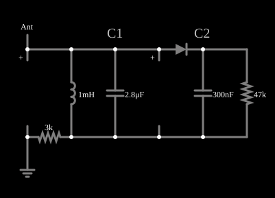

# Detector de AM

<!-- navegacao:inicio -->
[Índice](README.md) · [Anterior: Spike Generator](spikegen.md) · [Próximo: Waveform Clipper](diodeclip.md)
<!-- navegacao:fim -->

## Objetivo

Mostrar um receptor de rádio AM elementar: um circuito LC sintonizado escolhe uma estação entre várias, e um diodo com um filtro RC recupera a informação (a envoltória) da portadora.

## O circuito

<!-- esquema:inicio -->

<!-- esquema:fim -->

Uma antena simulada (amplificada) entrega a soma de três estações AM, de $3000$, $2710$ e $2433\ \text{Hz}$, mais uma estação FM de cerca de $2200\ \text{Hz}$. A antena alimenta, por um resistor de $3\ \text{k}\Omega$, um circuito ressonante paralelo formado por um indutor de $1\ \text{mH}$ e um capacitor de $2{,}81\ \mu\text{F}$. Um diodo liga o circuito ressonante a um filtro RC de $0{,}3\ \mu\text{F}$ e $47\ \text{k}\Omega$. Três osciloscópios mostram a antena, a portadora selecionada e a saída.

<!-- componentes:inicio -->
| N.º | Tipo | Elemento | Valores |
|----:|------|----------|---------|
| 0 | `ResistorElm` | resistor | Resistance (ohms) = 3k |
| 1 | `InductorElm` | inductor | Inductance (H) = 1m; Trapezoidal Approximation = sim; Initial Current (on Reset) (A) = 0; Saturation Current (A) (0=none) = 0 |
| 3 | `CapacitorElm` | capacitor | Capacitance (F) = 2.8μ; Trapezoidal Approximation = sim; Initial Voltage (on Reset) = 1m; Series Resistance = 0 |
| 5 | `CapacitorElm` | capacitor | Capacitance (F) = 300n; Trapezoidal Approximation = sim; Initial Voltage (on Reset) = 1m; Series Resistance = 0 |
| 7 | `ResistorElm` | resistor | Resistance (ohms) = 47k |
| 10 | `AntennaElm` | Antenna (amplified) |  |
| 11 | `GroundElm` | ground | Symbol = Earth |
| 12 | `ProbeElm` | voltmeter | Show Voltage = não; Value = Voltage; Scale = Auto; Use Circle Symbol = não; Series Resistance (0 = infinite) = 0 |
| 13 | `DiodeElm` | diode | Model = default |
| 17 | `ProbeElm` | voltmeter | Show Voltage = não; Value = Voltage; Scale = Auto; Use Circle Symbol = não; Series Resistance (0 = infinite) = 0 |
| 18 | `TextElm` | text | Text = C1; Size = 20; Draw Bar On Top = não; Color = #c0c0c0 |
| 19 | `TextElm` | text | Text = C2; Size = 20; Draw Bar On Top = não; Color = #c0c0c0 |
<!-- componentes:fim -->

## Teoria

O diodo do simulador (modelo "default") segue a equação de Shockley,

$$i = I_s\left(e^{v/(nV_T)} - 1\right),\qquad I_s = 1{,}714\cdot 10^{-7}\ \text{A},\quad n = 2,\quad V_T = 25{,}865\ \text{mV},$$

sem resistência série. Para uma corrente $i \gg I_s$ a tensão é $v = nV_T\ln(i/I_s + 1)$, que dá $0{,}806\ \text{V}$ em $1\ \text{A}$, $0{,}568\ \text{V}$ em $10\ \text{mA}$ e $0{,}449\ \text{V}$ em $1\ \text{mA}$: a tensão cresce $nV_T\ln 10 = 119\ \text{mV}$ a cada década de corrente. Para $v < 0$ a corrente tende a $-I_s = -0{,}17\ \mu\text{A}$.

**Sintonia.** O circuito ressonante tem frequência $f_0 = \dfrac{1}{2\pi\sqrt{LC}} = \dfrac{1}{2\pi\sqrt{1\ \text{mH}\cdot 2{,}81\ \mu\text{F}}} = 3000\ \text{Hz}$, e seleciona a estação em $3000\ \text{Hz}$, rejeitando as demais (em $2710$ e $2433\ \text{Hz}$).

**Detecção.** Uma portadora modulada em amplitude é $v(t) = A\,[1 + m\,s(t)]\cos\omega_c t$. O diodo deixa passar só os semiciclos positivos, e o filtro RC, com $\tau = 47\ \text{k}\Omega\cdot 0{,}3\ \mu\text{F} = 14\ \text{ms}$ (muito maior que o período da portadora, $0{,}33\ \text{ms}$, e menor que o da modulação), segue a envoltória $A\,[1 + m\,s(t)]$: a saída é o sinal de áudio $s(t)$ somado a uma componente contínua.

## Resultados esperados

No simulador a estação de $3000\ \text{Hz}$ é modulada a $12\ \text{Hz}$ (as de $2710$ e $2433\ \text{Hz}$, a $13$ e $14\ \text{Hz}$); o espectro do sinal de saída, tirado da simulação, tem seu pico em $12{,}0\ \text{Hz}$ e o circuito ressonante oscila em $3000{,}0\ \text{Hz}$, de modo que o receptor seleciona a estação certa. A saída fica entre $1{,}30$ e $4{,}90\ \text{V}$ em torno de um valor médio de $3{,}01\ \text{V}$.

As verificações conferem a média, o máximo e o mínimo da saída, em $4\ \text{s}$ (de $0{,}5$ a $4{,}5\ \text{s}$), com tolerância de 1%; são valores do próprio simulador, sem cálculo independente (a antena é uma fonte do simulador cuja definição é a soma de sinais acima).

## O que observar

- A saída oscila a $12\ \text{Hz}$, a frequência da modulação da estação sintonizada.
- Mude o capacitor (ou o indutor): a sintonia muda para $f_0 = 1/(2\pi\sqrt{LC})$, e o receptor passa a selecionar outra estação, de modulação a $13$ ou $14\ \text{Hz}$.
- Aumente o capacitor de saída ou o resistor: o filtro suaviza mais a envoltória (mas segue pior a modulação).

## Limites do modelo

Um receptor real tem amplificação de RF, rejeição da frequência imagem e controle automático de ganho; a antena do simulador é uma soma de senoides, não um sinal de rádio. O diodo é de silício (queda de $\approx 0{,}5$ a $0{,}7\ \text{V}$), de modo que sinais pequenos seriam mal detectados (um detector de germânio ou Schottky resolve isso).

## Referências

- P. Horowitz e W. Hill, *The Art of Electronics*, Cambridge University Press.
- A. S. Sedra e K. C. Smith, *Microeletrônica*, Pearson.

O circuito deste exemplo faz parte da coleção do simulador original de Paul Falstad e Iain Sharp (CircuitJS1); a explicação é deste projeto.
