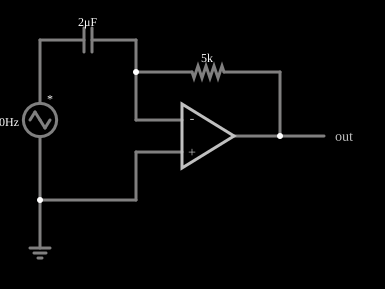

# Derivador inversor

<!-- navegacao:inicio -->
[Índice](README.md) · [Anterior: Integrator](amp-integ.md) · [Próximo: Schmitt Trigger](amp-schmitt.md)
<!-- navegacao:fim -->

## Objetivo

Mostrar o derivador com amplificador operacional: a saída é proporcional à taxa de variação da entrada. Alimentado por uma onda triangular, ele devolve uma onda quadrada.

## O circuito

<!-- esquema:inicio -->

<!-- esquema:fim -->

Uma fonte de onda triangular de $40\ \text{Hz}$ e $5\ \text{V}$ de pico liga-se, por um capacitor de $2\ \mu\text{F}$, à entrada inversora de um amplificador operacional (com a entrada não inversora no terra). Um resistor de $5\ \text{k}\Omega$ liga a saída à entrada inversora. Esse operacional tem ganho de malha aberta de apenas $1000$ (e não $10^5$), o que ajuda a estabilidade do derivador. Um elemento de saída e dois osciloscópios mostram a entrada e a saída.

<!-- componentes:inicio -->
| N.º | Tipo | Elemento | Valores |
|----:|------|----------|---------|
| 0 | `VoltageElm` | triangle gen | Max Voltage = 5; Waveform = Triangle; DC Offset (V) = 0; Internal Resistance (ohms) = 0; Show Voltage = não; Frequency (Hz) = 40; Phase Offset (degrees) = 0 |
| 1 | `GroundElm` | ground | Symbol = Earth |
| 6 | `OpAmpElm` | op-amp | Max Output (V) = 15; Min Output (V) = -15; Gain = 1k |
| 7 | `CapacitorElm` | capacitor | Capacitance (F) = 2μ; Trapezoidal Approximation = sim; Initial Voltage (on Reset) = 1m; Series Resistance = 0 |
| 8 | `ResistorElm` | resistor | Resistance (ohms) = 5k |
| 10 | `OutputElm` | output | Show Voltage = não |
<!-- componentes:fim -->

## Teoria

Pelo terra virtual, a corrente no capacitor, $C\,dV_\text{in}/dt$, passa toda pelo resistor de realimentação:

$$V_\text{out} = -R\,C\,\frac{dV_\text{in}}{dt}, \qquad RC = 5\ \text{k}\Omega\cdot 2\ \mu\text{F} = 10\ \text{ms}.$$

Uma triangular de pico $V_p = 5\ \text{V}$ e frequência $f = 40\ \text{Hz}$ tem inclinação constante de módulo $4V_p f = 800\ \text{V/s}$ em cada meio ciclo. A saída é, portanto, uma quadrada de amplitude

$$|V_\text{out}| = RC\cdot 800\ \text{V/s} = 8\ \text{V}$$

com polaridade oposta à da inclinação da entrada: $-8\ \text{V}$ quando a entrada sobe e $+8\ \text{V}$ quando ela desce.

## Resultados esperados

Em $t = 10\ \text{ms}$ a entrada está subindo ($2{,}996\ \text{V}$) e a saída vale $-7{,}992\ \text{V}$; em $t = 20\ \text{ms}$ a entrada está descendo e a saída vale $+7{,}992\ \text{V}$, uma quadrada de $\pm 8\ \text{V}$ (a diferença de $8\ \text{mV}$ vem do ganho finito). As verificações conferem os dois instantes e os extremos da saída em uma janela de $0{,}1\ \text{s}$.

## O que observar

- A saída é uma onda quadrada, que muda de sinal nos picos da triangular.
- Troque a triangular por uma senoide: a saída será uma cossenoide $-RC\,\omega V_p\cos\omega t$, adiantada de $90^\circ$ e invertida.
- Aumentar a frequência aumenta a amplitude de saída na mesma proporção: o derivador amplifica o ruído de alta frequência.

## Limites do modelo

O derivador ideal tem ganho que cresce sem limite com a frequência, o que o torna instável e ruidoso; em circuitos reais coloca-se um resistor em série com o capacitor e um capacitor em paralelo com o resistor de realimentação. O ganho de malha aberta reduzido deste exemplo faz esse papel de forma simplificada.

## Referências

- A. S. Sedra e K. C. Smith, *Microeletrônica*, Pearson.
- P. Horowitz e W. Hill, *The Art of Electronics*, Cambridge University Press.
- J. W. Nilsson e S. A. Riedel, *Circuitos Elétricos*, Pearson.

O circuito deste exemplo faz parte da coleção do simulador original de Paul Falstad e Iain Sharp (CircuitJS1); a explicação é deste projeto.
