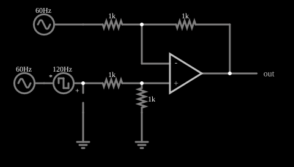

# Amplificador diferencial

<!-- navegacao:inicio -->
[Índice](README.md) · [Anterior: Follower](amp-follower.md) · [Próximo: Summing Amplifier](amp-sum.md)
<!-- navegacao:fim -->

## Objetivo

Mostrar o amplificador diferencial: ele amplifica somente a *diferença* entre duas entradas e rejeita o sinal que é comum a ambas. O exemplo põe um sinal pequeno (quadrado de $1\ \text{V}$) sobre um sinal comum muito maior (senoide de $5\ \text{V}$) e recupera apenas o pequeno.

## O circuito

<!-- esquema:inicio -->

<!-- esquema:fim -->

Quatro resistores de $1\ \text{k}\Omega$ montam o amplificador diferencial: duas entradas, uma para cada lado de um amplificador operacional, cada uma por um resistor; a entrada inversora recebe também o resistor de realimentação da saída, e a não inversora tem um resistor para a terra. As duas entradas partem da mesma fonte senoidal de $60\ \text{Hz}$ e $5\ \text{V}$ de pico (o sinal *comum*); em série com uma delas há uma fonte de onda quadrada de $120\ \text{Hz}$ e $1\ \text{V}$ (o sinal *diferencial*). Um elemento de saída e três osciloscópios mostram o sinal comum (a fonte de $60\ \text{Hz}$), a tensão em uma das entradas (a senoide com o quadrado somado) e a saída.

<!-- componentes:inicio -->
| N.º | Tipo | Elemento | Valores |
|----:|------|----------|---------|
| 0 | `OpAmpElm` | op-amp | Max Output (V) = 15; Min Output (V) = -15; Gain = 100k |
| 3 | `ResistorElm` | resistor | Resistance (ohms) = 1k |
| 4 | `ResistorElm` | resistor | Resistance (ohms) = 1k |
| 5 | `ResistorElm` | resistor | Resistance (ohms) = 1k |
| 6 | `GroundElm` | ground | Symbol = Earth |
| 7 | `ResistorElm` | resistor | Resistance (ohms) = 1k |
| 8 | `RailElm` | A/C source | Max Voltage = 5; Waveform = A/C; DC Offset (V) = 0; Internal Resistance (ohms) = 0; Show Voltage = não; Frequency (Hz) = 60; Phase Offset (degrees) = 0 |
| 9 | `OutputElm` | output | Show Voltage = não |
| 10 | `VoltageElm` | square wave gen | Max Voltage = 1; Waveform = Square Wave; DC Offset (V) = 0; Internal Resistance (ohms) = 0; Show Voltage = não; Specify As = Frequency/Duty Cycle; Frequency (Hz) = 120; Phase Offset (degrees) = 0; Duty Cycle = 50; Rise/Fall Time (s) = 0 |
| 11 | `RailElm` | A/C source | Max Voltage = 5; Waveform = A/C; DC Offset (V) = 0; Internal Resistance (ohms) = 0; Show Voltage = não; Frequency (Hz) = 60; Phase Offset (degrees) = 0 |
| 12 | `ProbeElm` | voltmeter | Show Voltage = não; Value = Voltage; Scale = Auto; Use Circle Symbol = não; Series Resistance (0 = infinite) = 0 |
| 13 | `GroundElm` | ground | Symbol = Earth |
<!-- componentes:fim -->

## Teoria

Com resistores iguais ($R_1 = R_2 = R_3 = R_4 = R$) e realimentação negativa,

$$V_\text{out} = \frac{R_f}{R_1}\,(V_2 - V_1) = V_2 - V_1,$$

onde $V_1$ e $V_2$ são as tensões das duas entradas. Qualquer parcela comum às duas se cancela. Aqui $V_1 = V_c$ e $V_2 = V_c - v_d$, com $V_c$ a senoide de $60\ \text{Hz}$ e $v_d$ o quadrado de $1\ \text{V}$, e portanto

$$V_\text{out} = -v_d.$$

A rejeição do sinal comum depende do casamento entre os resistores; com valores exatos ela é limitada apenas pelo ganho finito do operacional.

## Resultados esperados

A senoide de $5\ \text{V}$ de pico praticamente desaparece da saída. Em $t = 10\ \text{ms}$, quando o quadrado está em $+1\ \text{V}$ e o sinal comum vale $-2{,}93\ \text{V}$, a saída é $-0{,}99998\ \text{V}$, ou seja, $-1\ \text{V}$ a menos de $20\ \mu\text{V}$. Em um ciclo, a saída varia entre $-1$ e $+1\ \text{V}$, uma onda quadrada de $120\ \text{Hz}$ invertida. As verificações conferem a saída nesse instante e os extremos em uma janela de dois ciclos do sinal comum.

## O que observar

- No osciloscópio do sinal comum a senoide é grande; na saída ela some e sobra o quadrado.
- Observe que a saída está **invertida** em relação à fonte quadrada, porque ela foi ligada na entrada que dá $V_2 - V_1$ com sinal negativo.
- Se mudar um dos resistores (por exemplo, $R_3$), a rejeição piora e uma parte da senoide aparece na saída.

## Limites do modelo

Resistores e operacional ideais: a rejeição de modo comum só é limitada pelo ganho de malha aberta. Em circuitos reais, a tolerância dos resistores (1% já dá cerca de $-40\ \text{dB}$ de rejeição) e a resposta em frequência do operacional dominam. Para melhor desempenho usa-se o amplificador de instrumentação.

## Referências

- A. S. Sedra e K. C. Smith, *Microeletrônica*, Pearson.
- P. Horowitz e W. Hill, *The Art of Electronics*, Cambridge University Press.
- W. G. Jung, *Op Amp Applications Handbook*, Newnes.

O circuito deste exemplo faz parte da coleção do simulador original de Paul Falstad e Iain Sharp (CircuitJS1); a explicação é deste projeto.
