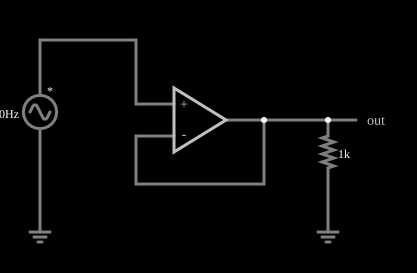

# Seguidor de tensão

<!-- navegacao:inicio -->
[Índice](README.md) · [Anterior: Noninverting Amplifier](amp-noninvert.md) · [Próximo: Differential Amplifier](amp-diff.md)
<!-- navegacao:fim -->

## Objetivo

Mostrar o seguidor de tensão (*buffer*): ganho 1, impedância de entrada alta e impedância de saída baixa. Ele isola uma fonte de uma carga, permitindo que a carga consuma corrente sem que a fonte a forneça.

## O circuito

<!-- esquema:inicio -->

<!-- esquema:fim -->

Uma fonte senoidal de $40\ \text{Hz}$ e $5\ \text{V}$ de pico liga-se à entrada não inversora de um amplificador operacional cuja saída está ligada diretamente à entrada inversora. A saída alimenta um resistor de carga de $1\ \text{k}\Omega$ ligado à terra. Dois osciloscópios mostram a entrada e a saída.

<!-- componentes:inicio -->
| N.º | Tipo | Elemento | Valores |
|----:|------|----------|---------|
| 0 | `VoltageElm` | A/C source | Max Voltage = 5; Waveform = A/C; DC Offset (V) = 0; Internal Resistance (ohms) = 0; Show Voltage = não; Frequency (Hz) = 40; Phase Offset (degrees) = 0 |
| 1 | `GroundElm` | ground | Symbol = Earth |
| 3 | `OpAmpElm` | op-amp | Max Output (V) = 15; Min Output (V) = -15; Gain = 100k |
| 8 | `OutputElm` | output | Show Voltage = não |
| 10 | `ResistorElm` | resistor | Resistance (ohms) = 1k |
| 11 | `GroundElm` | ground | Symbol = Earth |
<!-- componentes:fim -->

## Teoria

Como no exemplo de realimentação, $V_\text{out} = \dfrac{A}{1+A}\,V_\text{in} \approx V_\text{in}$. O interesse do circuito está nas **impedâncias**: a entrada não inversora não drena corrente, de modo que a fonte vê uma carga praticamente infinita; a saída, por sua vez, mantém a tensão quando a carga puxa corrente, porque a realimentação corrige qualquer queda (impedância de saída $R_\text{out}/(1+A)$).

$$I_L = \frac{V_\text{out}}{R_L}\quad(\text{fornecida pela saída, não pela fonte}).$$

## Resultados esperados

Em $t = 10\ \text{ms}$ a entrada vale $2{,}944\ \text{V}$:

| Grandeza | Valor |
|----------|------:|
| Saída $V_\text{out}$ | $2{,}944\ \text{V}$ (a menos de $29\ \mu\text{V}$) |
| Corrente na carga de $1\ \text{k}\Omega$ | $2{,}944\ \text{mA}$ |
| Corrente fornecida pela fonte | $0$ |

As verificações conferem a saída, a corrente na carga e a corrente nula da fonte.

## O que observar

- As curvas de entrada e saída coincidem.
- A corrente de $2{,}9\ \text{mA}$ aparece na carga mas não na fonte: a energia vem da alimentação do operacional.
- Troque o resistor de carga por um menor e veja a saída continuar igual à entrada (enquanto a corrente estiver dentro do que o modelo permite).

## Limites do modelo

O modelo não limita a corrente de saída do operacional (um real fornece algumas dezenas de miliampères) e não inclui a resistência de saída, a banda finita ou a instabilidade com cargas capacitivas.

## Referências

- A. S. Sedra e K. C. Smith, *Microeletrônica*, Pearson.
- P. Horowitz e W. Hill, *The Art of Electronics*, Cambridge University Press.
- R. L. Boylestad e L. Nashelsky, *Dispositivos Eletrônicos e Teoria de Circuitos*, Pearson.

O circuito deste exemplo faz parte da coleção do simulador original de Paul Falstad e Iain Sharp (CircuitJS1); a explicação é deste projeto.
