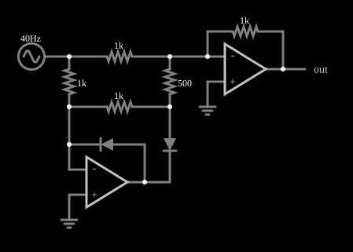

# Retificador de onda completa de precisão

<!-- navegacao:inicio -->
[Índice](README.md) · [Anterior: Half-Wave Rectifier (inverting)](amp-rect.md) · [Próximo: Peak Detector](peak-detect.md)
<!-- navegacao:fim -->

## Objetivo

Mostrar o retificador de onda completa de precisão, que produz o valor absoluto $|V_\text{in}|$ de um sinal alternado usando dois amplificadores operacionais e dois diodos: um estágio retifica meia onda e um segundo estágio o soma com a entrada, com os pesos certos.

## O circuito

<!-- esquema:inicio -->

<!-- esquema:fim -->

O sinal é uma senoide de $40\ \text{Hz}$ e $1\ \text{V}$ de pico. O primeiro operacional, com dois diodos e resistores de $1\ \text{k}\Omega$, é um retificador de meia onda inversor, como no exemplo anterior. O segundo operacional é um somador inversor com resistor de realimentação de $1\ \text{k}\Omega$ e duas entradas: a tensão de entrada, por um resistor de $1\ \text{k}\Omega$, e a saída do primeiro estágio, por um resistor de $500\ \Omega$. Um elemento de saída e dois osciloscópios mostram a entrada e a saída.

<!-- componentes:inicio -->
| N.º | Tipo | Elemento | Valores |
|----:|------|----------|---------|
| 0 | `OpAmpElm` | op-amp | Max Output (V) = 15; Min Output (V) = -15; Gain = 100k |
| 1 | `GroundElm` | ground | Symbol = Earth |
| 3 | `DiodeElm` | diode | Model = default |
| 5 | `DiodeElm` | diode | Model = default |
| 8 | `ResistorElm` | resistor | Resistance (ohms) = 1k |
| 9 | `ResistorElm` | resistor | Resistance (ohms) = 1k |
| 10 | `ResistorElm` | resistor | Resistance (ohms) = 1k |
| 11 | `ResistorElm` | resistor | Resistance (ohms) = 500 |
| 12 | `OpAmpElm` | op-amp | Max Output (V) = 15; Min Output (V) = -15; Gain = 100k |
| 15 | `ResistorElm` | resistor | Resistance (ohms) = 1k |
| 17 | `GroundElm` | ground | Symbol = Earth |
| 18 | `OutputElm` | output | Show Voltage = não |
| 19 | `RailElm` | A/C source | Max Voltage = 1; Waveform = A/C; DC Offset (V) = 0; Internal Resistance (ohms) = 0; Show Voltage = não; Frequency (Hz) = 40; Phase Offset (degrees) = 0 |
<!-- componentes:fim -->

## Teoria

Seja $V_1$ a saída do primeiro estágio, o retificador de meia onda inversor de ganho $-1$:

$$V_1 = \begin{cases} -V_\text{in}, & V_\text{in} > 0,\\ 0, & V_\text{in} \le 0.\end{cases}$$

O segundo estágio soma a entrada, com peso 1, e $V_1$, com peso 2 (o resistor de $500\ \Omega$ é metade de $1\ \text{k}\Omega$), e inverte:

$$V_\text{out} = -\left(V_\text{in} + 2\,V_1\right).$$

- Se $V_\text{in} > 0$: $V_1 = -V_\text{in}$ e $V_\text{out} = -V_\text{in} + 2V_\text{in} = V_\text{in}$.
- Se $V_\text{in} < 0$: $V_1 = 0$ e $V_\text{out} = -V_\text{in} = |V_\text{in}|$.

Nos dois casos $V_\text{out} = |V_\text{in}|$. O sinal de saída tem o dobro da frequência da entrada, porque cada semiciclo vira um pulso positivo.

## Resultados esperados

| Instante | $V_\text{in}$ | $V_\text{out}$ |
|----------|---------------:|----------------:|
| $t = 7{,}5\ \text{ms}$ | $+0{,}9514\ \text{V}$ | $+0{,}9510\ \text{V}$ |
| $t = 17{,}5\ \text{ms}$ | $-0{,}9507\ \text{V}$ | $+0{,}9505\ \text{V}$ |

Num ciclo de $25\ \text{ms}$ a saída varia de $0$ a $1\ \text{V}$, com frequência de $80\ \text{Hz}$. As verificações conferem a saída nos dois instantes, os extremos e a frequência, numa janela de $0{,}1\ \text{s}$.

## O que observar

- Nos dois semiciclos da entrada a saída é positiva: há duas "lombadas" por ciclo de entrada.
- Mude o resistor de $500\ \Omega$ para outro valor e o peso de $V_1$ deixa de ser 2: os dois pulsos de saída ficam diferentes, o que mostra a importância dos pesos casados.
- O operacional do primeiro estágio vai a $-1{,}07\ \text{V}$ em $t = 10\ \text{ms}$ ($\approx -V_\text{in} - V_D$).

## Limites do modelo

Operacionais e diodos ideais; na prática, a precisão do retificador depende do casamento dos três resistores do somador (1% de tolerância já mede $|V_\text{in}|$ com erro apreciável), e do *slew rate* do primeiro estágio, que limita a frequência. A saída em um circuito real é limitada pela alimentação dos operacionais.

## Referências

- A. S. Sedra e K. C. Smith, *Microeletrônica*, Pearson.
- P. Horowitz e W. Hill, *The Art of Electronics*, Cambridge University Press.
- W. G. Jung, *Op Amp Applications Handbook*, Newnes.

O circuito deste exemplo faz parte da coleção do simulador original de Paul Falstad e Iain Sharp (CircuitJS1); a explicação é deste projeto.
