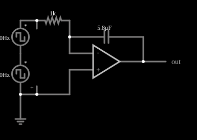

# Integrador com amplificador operacional

<!-- navegacao:inicio -->
[Índice](README.md) · [Anterior: Peak Detector](peak-detect.md) · [Próximo: Differentiator (inverting)](amp-dfdx.md)
<!-- navegacao:fim -->

## Objetivo

Mostrar o integrador com amplificador operacional: a saída é proporcional à integral da entrada. Como a entrada é uma soma de duas ondas quadradas, a saída é uma sequência de rampas, cada uma com a inclinação do nível de entrada correspondente.

## O circuito

<!-- esquema:inicio -->

<!-- esquema:fim -->

Um resistor de $1\ \text{k}\Omega$ liga a entrada ao terminal inversor de um amplificador operacional (com a entrada não inversora no terra) e um capacitor de $5{,}8\ \mu\text{F}$ liga a saída ao terminal inversor. A entrada é a soma de duas fontes de onda quadrada em série: uma de $40\ \text{Hz}$ e $\pm 5\ \text{V}$ (com fase de $180^\circ$) e outra de $80\ \text{Hz}$ e $\pm 2\ \text{V}$. Um elemento de saída e dois osciloscópios mostram a entrada e a saída.

<!-- componentes:inicio -->
| N.º | Tipo | Elemento | Valores |
|----:|------|----------|---------|
| 0 | `GroundElm` | ground | Symbol = Earth |
| 5 | `OpAmpElm` | op-amp | Max Output (V) = 15; Min Output (V) = -15; Gain = 100k |
| 6 | `CapacitorElm` | capacitor | Capacitance (F) = 5.8μ; Trapezoidal Approximation = sim; Initial Voltage (on Reset) = 1m; Series Resistance = 0 |
| 7 | `OutputElm` | output | Show Voltage = não |
| 8 | `VoltageElm` | square wave gen | Max Voltage = 5; Waveform = Square Wave; DC Offset (V) = 0; Internal Resistance (ohms) = 0; Show Voltage = não; Specify As = Frequency/Duty Cycle; Frequency (Hz) = 40; Phase Offset (degrees) = 180; Duty Cycle = 50; Rise/Fall Time (s) = 0 |
| 9 | `VoltageElm` | square wave gen | Max Voltage = 2; Waveform = Square Wave; DC Offset (V) = 0; Internal Resistance (ohms) = 0; Show Voltage = não; Specify As = Frequency/Duty Cycle; Frequency (Hz) = 80; Phase Offset (degrees) = 0; Duty Cycle = 50; Rise/Fall Time (s) = 0 |
| 10 | `ProbeElm` | voltmeter | Show Voltage = não; Value = Voltage; Scale = Auto; Use Circle Symbol = não; Series Resistance (0 = infinite) = 0 |
| 14 | `ResistorElm` | resistor | Resistance (ohms) = 1k |
<!-- componentes:fim -->

## Teoria

Pelo terra virtual, a corrente no resistor é $V_\text{in}/R$ e passa toda pelo capacitor:

$$V_\text{out}(t) = V_\text{out}(0) - \frac{1}{RC}\int_0^t V_\text{in}\,d\tau, \qquad RC = 1\ \text{k}\Omega\cdot 5{,}8\ \mu\text{F} = 5{,}8\ \text{ms}.$$

Num trecho em que a entrada é constante, a saída é uma rampa de inclinação $-V_\text{in}/RC$. A entrada soma duas quadradas e assume, a cada $6{,}25\ \text{ms}$, os valores $-3$, $-7$, $+7$ e $+3\ \text{V}$ (em um ciclo de $25\ \text{ms}$). Em cada trecho a saída varia de $-V_\text{in}\,(6{,}25\ \text{ms})/RC$:

| Trecho | $V_\text{in}$ | Variação da saída |
|--------|-------------:|------------------:|
| $0$ a $6{,}25\ \text{ms}$ | $-3\ \text{V}$ | $+3{,}23\ \text{V}$ |
| $6{,}25$ a $12{,}5\ \text{ms}$ | $-7\ \text{V}$ | $+7{,}54\ \text{V}$ |
| $12{,}5$ a $18{,}75\ \text{ms}$ | $+7\ \text{V}$ | $-7{,}54\ \text{V}$ |
| $18{,}75$ a $25\ \text{ms}$ | $+3\ \text{V}$ | $-3{,}23\ \text{V}$ |

Como a entrada tem valor médio nulo, a saída volta ao ponto inicial a cada ciclo.

## Resultados esperados

Com o capacitor inicialmente descarregado, a saída oscila entre $0$ e $3{,}23 + 7{,}54 = 10{,}78\ \text{V}$. O simulador dá:

| Instante | Entrada | Saída |
|----------|--------:|------:|
| $10\ \text{ms}$ | $-7\ \text{V}$ | $7{,}743\ \text{V}$ (cálculo: $7{,}76\ \text{V}$) |
| $12{,}5\ \text{ms}$ | $+7\ \text{V}$ | $10{,}76\ \text{V}$ (máximo) |
| $25\ \text{ms}$ | $-3\ \text{V}$ | $0{,}001\ \text{V}$ (mínimo) |

A diferença de cerca de $0{,}2\%$ para o cálculo vem do ganho finito de $10^5$. As verificações conferem a saída em dois instantes e os extremos em um ciclo.

## O que observar

- A saída é uma linha quebrada: rampas íngremes nos trechos de $\pm 7\ \text{V}$ e rampas suaves nos de $\pm 3\ \text{V}$.
- A saída sobe quando a entrada é negativa (o integrador é **inversor**).
- Acrescente um nível contínuo à entrada e a saída derivará continuamente até saturar: sem realimentação em corrente contínua o integrador acumula qualquer *offset*.

## Limites do modelo

Operacional e capacitor ideais: não há fuga no capacitor, tensão de *offset* nem corrente de polarização, que num integrador real fazem a saída derivar. Por isso, integradores reais costumam ter um resistor em paralelo com o capacitor ou uma chave de reinício.

## Referências

- A. S. Sedra e K. C. Smith, *Microeletrônica*, Pearson.
- P. Horowitz e W. Hill, *The Art of Electronics*, Cambridge University Press.
- J. W. Nilsson e S. A. Riedel, *Circuitos Elétricos*, Pearson.

O circuito deste exemplo faz parte da coleção do simulador original de Paul Falstad e Iain Sharp (CircuitJS1); a explicação é deste projeto.
