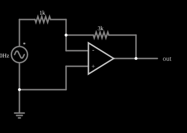

# Amplificador inversor

<!-- navegacao:inicio -->
[Índice](README.md) · [Próximo: Noninverting Amplifier](amp-noninvert.md)
<!-- navegacao:fim -->

## Objetivo

Mostrar o amplificador inversor, a configuração mais simples com realimentação negativa: o ganho depende só de dois resistores e vale $-R_f/R_1$. O exemplo também mostra o conceito de *terra virtual* na entrada inversora.

## O circuito

<!-- esquema:inicio -->

<!-- esquema:fim -->

Uma fonte senoidal de $40\ \text{Hz}$ e $5\ \text{V}$ de pico alimenta, por um resistor de $1\ \text{k}\Omega$ ($R_1$), a entrada inversora do amplificador operacional. Um resistor de $3\ \text{k}\Omega$ ($R_f$) liga a saída à entrada inversora, fechando a malha de realimentação negativa. A entrada não inversora está ligada à terra. Um elemento de saída mostra a tensão de saída e dois osciloscópios mostram a entrada e a saída.

<!-- componentes:inicio -->
| N.º | Tipo | Elemento | Valores |
|----:|------|----------|---------|
| 0 | `VoltageElm` | A/C source | Max Voltage = 5; Waveform = A/C; DC Offset (V) = 0; Internal Resistance (ohms) = 0; Show Voltage = não; Frequency (Hz) = 40; Phase Offset (degrees) = 0 |
| 1 | `GroundElm` | ground | Symbol = Earth |
| 2 | `ResistorElm` | resistor | Resistance (ohms) = 1k |
| 3 | `ResistorElm` | resistor | Resistance (ohms) = 3k |
| 9 | `OpAmpElm` | op-amp | Max Output (V) = 15; Min Output (V) = -15; Gain = 100k |
| 10 | `OutputElm` | output | Show Voltage = não |
<!-- componentes:fim -->

## Teoria

Como o ganho de malha aberta $A$ é enorme, a realimentação negativa força a diferença entre as entradas a ser quase zero. A entrada não inversora está no terra, então a inversora fica em $0\ \text{V}$ (terra virtual), embora não esteja ligada ao terra. A corrente de entrada, $i = V_\text{in}/R_1$, não pode entrar no operacional (impedância de entrada ideal) e passa toda por $R_f$:

$$V_\text{out} = 0 - R_f\,i = -\frac{R_f}{R_1}\,V_\text{in}.$$

Com ganho finito $A$, o valor exato é $-\dfrac{R_f}{R_1}\,\dfrac{1}{1 + (1+R_f/R_1)/A}$, praticamente igual ao ideal quando $A = 10^5$. A impedância de entrada do circuito é $R_1$, porque a entrada inversora é um terra virtual.

## Resultados esperados

Com $R_f/R_1 = 3$ o ganho é $-3$ e a saída, de pico $15\ \text{V}$, toca o limite de saída do operacional. Em $t = 10\ \text{ms}$:

| Grandeza | Valor |
|----------|------:|
| Entrada $V_\text{in}$ | $2{,}944\ \text{V}$ |
| Corrente em $R_1$ e em $R_f$ | $2{,}944\ \text{mA}$ |
| Entrada inversora (terra virtual) | $\approx 0{,}09\ \text{mV}$ |
| Saída $V_\text{out}$ | $-8{,}832\ \text{V}$ ($= -3 \times 2{,}944$) |

As verificações conferem, nesse instante, a saída, a tensão da entrada inversora e a corrente em $R_1$ e, em um ciclo inteiro, o mínimo da saída ($-15\ \text{V}$).

## O que observar

- A saída é uma senoide três vezes maior que a entrada e **em oposição de fase** (invertida) nos dois osciloscópios.
- A entrada inversora fica praticamente em $0\ \text{V}$ o tempo todo, apesar de a entrada variar de $-5$ a $+5\ \text{V}$.
- Se o ganho passasse de 3 (maior $R_f$ ou menor $R_1$), a saída seria achatada no limite de $\pm 15\ \text{V}$.

## Limites do modelo

O operacional é ideal, exceto pelo ganho finito de $10^5$ e pela saturação em $\pm 15\ \text{V}$: não há *offset*, correntes de polarização, resistência de saída nem limite de banda ou de *slew rate*. Em um circuito real o ganho de $-3$ vale só até a frequência em que o ganho de malha aberta ainda é muito maior que 3.

## Referências

- A. S. Sedra e K. C. Smith, *Microeletrônica*, Pearson.
- P. Horowitz e W. Hill, *The Art of Electronics*, Cambridge University Press.
- J. W. Nilsson e S. A. Riedel, *Circuitos Elétricos*, Pearson.

O circuito deste exemplo faz parte da coleção do simulador original de Paul Falstad e Iain Sharp (CircuitJS1); a explicação é deste projeto.
