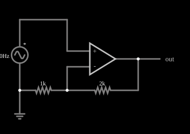

# Amplificador não inversor

<!-- navegacao:inicio -->
[Índice](README.md) · [Anterior: Inverting Amplifier](amp-invert.md) · [Próximo: Follower](amp-follower.md)
<!-- navegacao:fim -->

## Objetivo

Mostrar o amplificador não inversor: um ganho maior ou igual a 1, dado por $1 + R_f/R_1$, sem inverter o sinal e com impedância de entrada praticamente infinita.

## O circuito

<!-- esquema:inicio -->

<!-- esquema:fim -->

A fonte senoidal de $40\ \text{Hz}$ e $5\ \text{V}$ de pico está ligada diretamente à entrada não inversora do amplificador operacional. A entrada inversora recebe uma fração da saída por um divisor: um resistor $R_f = 2\ \text{k}\Omega$ entre a saída e a entrada inversora e um resistor $R_1 = 1\ \text{k}\Omega$ da entrada inversora à terra. Um elemento de saída e dois osciloscópios mostram entrada e saída.

<!-- componentes:inicio -->
| N.º | Tipo | Elemento | Valores |
|----:|------|----------|---------|
| 0 | `VoltageElm` | A/C source | Max Voltage = 5; Waveform = A/C; DC Offset (V) = 0; Internal Resistance (ohms) = 0; Show Voltage = não; Frequency (Hz) = 40; Phase Offset (degrees) = 0 |
| 1 | `GroundElm` | ground | Symbol = Earth |
| 3 | `OpAmpElm` | op-amp | Max Output (V) = 15; Min Output (V) = -15; Gain = 100k |
| 5 | `ResistorElm` | resistor | Resistance (ohms) = 2k |
| 6 | `ResistorElm` | resistor | Resistance (ohms) = 1k |
| 9 | `OutputElm` | output | Show Voltage = não |
<!-- componentes:fim -->

## Teoria

A realimentação negativa leva as duas entradas ao mesmo potencial, então a entrada inversora fica em $V_\text{in}$. Essa tensão é a saída dividida por $R_f$ e $R_1$:

$$V_- = V_\text{out}\,\frac{R_1}{R_1 + R_f} = V_\text{in}\quad\Longrightarrow\quad V_\text{out} = \left(1 + \frac{R_f}{R_1}\right) V_\text{in}.$$

Diferente do inversor, o sinal vai direto à entrada do operacional, que, idealmente, não drena corrente: a impedância de entrada do circuito é muito alta. O ganho nunca é menor que 1, e o caso $R_f = 0$ (ou $R_1 \to \infty$) é o seguidor de tensão.

## Resultados esperados

Com $R_f/R_1 = 2$ o ganho é $3$ e a saída tem pico de $15\ \text{V}$, no limite do operacional. Em $t = 10\ \text{ms}$:

| Grandeza | Valor |
|----------|------:|
| Entrada $V_\text{in}$ | $2{,}944\ \text{V}$ |
| Corrente de $R_f$ e $R_1$ (divisor) | $2{,}944\ \text{mA}$ |
| Corrente que a fonte fornece | $0$ |
| Saída $V_\text{out}$ | $8{,}832\ \text{V}$ ($= 3 \times 2{,}944$) |

As verificações conferem a saída, a corrente nula na fonte, a corrente no divisor e, em um ciclo inteiro, o máximo da saída ($15\ \text{V}$).

## O que observar

- A saída está **em fase** com a entrada e três vezes maior.
- A fonte praticamente não fornece corrente: toda a corrente de $2{,}9\ \text{mA}$ vem da saída do operacional e passa pelo divisor.
- Compare com o amplificador inversor, em que a fonte fornecia a corrente de $R_1$.

## Limites do modelo

Operacional ideal com ganho $10^5$ e saturação em $\pm 15\ \text{V}$; não há corrente de polarização nas entradas nem tensão de *offset*, e a banda é infinita. Na prática o ganho cai com a frequência e a saída não ultrapassa a alimentação.

## Referências

- A. S. Sedra e K. C. Smith, *Microeletrônica*, Pearson.
- P. Horowitz e W. Hill, *The Art of Electronics*, Cambridge University Press.
- J. W. Nilsson e S. A. Riedel, *Circuitos Elétricos*, Pearson.

O circuito deste exemplo faz parte da coleção do simulador original de Paul Falstad e Iain Sharp (CircuitJS1); a explicação é deste projeto.
