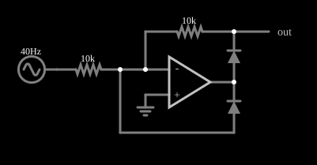

# Retificador de meia onda de precisão

<!-- navegacao:inicio -->
[Índice](README.md) · [Anterior: Op-Amp Feedback](opampfeedback.md) · [Próximo: Full-Wave Rectifier](amp-fullrect.md)
<!-- navegacao:fim -->

## Objetivo

Mostrar como um amplificador operacional elimina a queda de tensão de um diodo e permite retificar sinais menores que os $0{,}6\ \text{V}$ que um diodo comum exige para conduzir. É o retificador de meia onda de precisão (*super diodo*), na versão inversora.

## O circuito

<!-- esquema:inicio -->

<!-- esquema:fim -->

Uma fonte senoidal de $40\ \text{Hz}$ e apenas $0{,}5\ \text{V}$ de pico liga-se, por um resistor de $10\ \text{k}\Omega$, à entrada inversora de um amplificador operacional cuja entrada não inversora está ligada à terra. Dois diodos fazem a realimentação: um liga a saída do operacional à entrada inversora e o outro liga a saída do operacional ao nó de saída do circuito, que volta à entrada inversora por um resistor de $10\ \text{k}\Omega$. Um elemento de saída e dois osciloscópios mostram a entrada e a saída.

<!-- componentes:inicio -->
| N.º | Tipo | Elemento | Valores |
|----:|------|----------|---------|
| 0 | `OpAmpElm` | op-amp | Max Output (V) = 15; Min Output (V) = -15; Gain = 100k |
| 2 | `DiodeElm` | diode | Model = default |
| 4 | `ResistorElm` | resistor | Resistance (ohms) = 10k |
| 7 | `DiodeElm` | diode | Model = default |
| 8 | `ResistorElm` | resistor | Resistance (ohms) = 10k |
| 9 | `RailElm` | A/C source | Max Voltage = 500m; Waveform = A/C; DC Offset (V) = 0; Internal Resistance (ohms) = 0; Show Voltage = não; Frequency (Hz) = 40; Phase Offset (degrees) = 0 |
| 10 | `GroundElm` | ground | Symbol = Earth |
| 11 | `OutputElm` | output | Show Voltage = não |
<!-- componentes:fim -->

## Teoria

Quando a entrada é **positiva**, a saída do operacional vai para baixo e conduz o diodo que a liga à entrada inversora: ele fecha a malha e mantém o nó inversor em $0\ \text{V}$ (terra virtual). O outro diodo fica reverso, e a tensão de saída do circuito, ligada ao terra virtual por um resistor, é praticamente $0\ \text{V}$.

Quando a entrada é **negativa**, a saída do operacional vai para cima e conduz o outro diodo, que alimenta o resistor de realimentação; o circuito é então um amplificador inversor:

$$V_\text{out} = -\frac{R_f}{R_1}\,V_\text{in} = -V_\text{in} \qquad (V_\text{in} < 0).$$

A queda do diodo ($\approx 0{,}6\ \text{V}$) fica *dentro da malha de realimentação*: a saída do operacional ajusta-se à queda necessária, de modo que o erro visto na saída do circuito é a queda dividida pelo ganho de malha aberta, desprezível. Por isso o circuito retifica mesmo sinais de $0{,}5\ \text{V}$, que um diodo simples bloquearia.

## Resultados esperados

$$V_\text{out} = \begin{cases} -V_\text{in}, & V_\text{in} < 0,\\ 0, & V_\text{in} \ge 0. \end{cases}$$

| Instante | $V_\text{in}$ | $V_\text{out}$ |
|----------|---------------:|----------------:|
| $t = 10\ \text{ms}$ | $+0{,}294\ \text{V}$ | $-0{,}0017\ \text{V}$ ($\approx 0$) |
| $t = 17{,}5\ \text{ms}$ | $-0{,}475\ \text{V}$ | $+0{,}4736\ \text{V}$ |

Os extremos da saída em um ciclo são $0$ e $+0{,}5\ \text{V}$. As verificações conferem as duas linhas da tabela (tolerâncias de 1% e de $5\ \text{mV}$) e os extremos.

## O que observar

- A saída tem só os semiciclos negativos da entrada, **invertidos** (positivos): a forma de onda é uma série de meias senoides.
- Aumente a amplitude da fonte e a forma não muda; com um diodo simples, nada passaria abaixo de $0{,}6\ \text{V}$.
- A saída do operacional (quando conduz o diodo da realimentação) vai a $-0{,}27\ \text{V}$ no instante $t = 10\ \text{ms}$: é a queda do diodo, que o amplificador fornece sem que a saída do circuito a sinta.

## Limites do modelo

Operacional ideal (ganho de $10^5$, sem *slew rate*): em um circuito real, quando a entrada muda de sinal a saída do operacional precisa percorrer toda a queda dos diodos, e isso limita a frequência máxima, com distorção perto do cruzamento por zero. O erro também cresce com a carga ligada à saída (aqui sem carga).

## Referências

- A. S. Sedra e K. C. Smith, *Microeletrônica*, Pearson.
- P. Horowitz e W. Hill, *The Art of Electronics*, Cambridge University Press.
- W. G. Jung, *Op Amp Applications Handbook*, Newnes.

O circuito deste exemplo faz parte da coleção do simulador original de Paul Falstad e Iain Sharp (CircuitJS1); a explicação é deste projeto.
