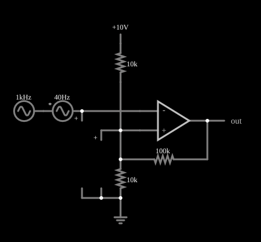

# Disparador de Schmitt com amplificador operacional

<!-- navegacao:inicio -->
[Índice](README.md) · [Anterior: Differentiator (inverting)](amp-dfdx.md) · [Próximo: Negative Impedance Converter](nic-r.md)
<!-- navegacao:fim -->

## Objetivo

Mostrar o disparador de Schmitt: um comparador com realimentação positiva que tem dois limiares diferentes (histerese) e, por isso, não oscila quando a entrada tem ruído perto do ponto de comutação.

## O circuito

<!-- esquema:inicio -->

<!-- esquema:fim -->

A entrada ligada à entrada inversora é uma senoide lenta de $40\ \text{Hz}$ e $5\ \text{V}$ de pico em torno de $5\ \text{V}$, somada a um ruído senoidal de $1\ \text{kHz}$ e $1\ \text{V}$ de pico. A entrada não inversora está ligada a um divisor: um resistor de $10\ \text{k}\Omega$ a uma fonte de $10\ \text{V}$, um de $10\ \text{k}\Omega$ à terra e um de $100\ \text{k}\Omega$ à saída do operacional (realimentação positiva). Um elemento de saída e três osciloscópios mostram a entrada, o limiar e a saída.

<!-- componentes:inicio -->
| N.º | Tipo | Elemento | Valores |
|----:|------|----------|---------|
| 0 | `OpAmpElm` | op-amp | Max Output (V) = 15; Min Output (V) = -15; Gain = 100k |
| 2 | `ResistorElm` | resistor | Resistance (ohms) = 100k |
| 6 | `ResistorElm` | resistor | Resistance (ohms) = 10k |
| 7 | `ResistorElm` | resistor | Resistance (ohms) = 10k |
| 8 | `GroundElm` | ground | Symbol = Earth |
| 9 | `OutputElm` | output | Show Voltage = não |
| 10 | `RailElm` | voltage source | Voltage = 10; Waveform = D/C; DC Offset (V) = 0; Internal Resistance (ohms) = 0 |
| 12 | `VoltageElm` | A/C source | Max Voltage = 5; Waveform = A/C; DC Offset (V) = 0; Internal Resistance (ohms) = 0; Show Voltage = não; Frequency (Hz) = 40; Phase Offset (degrees) = 0 |
| 13 | `RailElm` | A/C source | Max Voltage = 1; Waveform = A/C; DC Offset (V) = 5; Internal Resistance (ohms) = 0; Show Voltage = não; Frequency (Hz) = 1k; Phase Offset (degrees) = 0 |
| 14 | `ProbeElm` | voltmeter | Show Voltage = não; Value = Voltage; Scale = Auto; Use Circle Symbol = não; Series Resistance (0 = infinite) = 0 |
| 17 | `ProbeElm` | voltmeter | Show Voltage = não; Value = Voltage; Scale = Auto; Use Circle Symbol = não; Series Resistance (0 = infinite) = 0 |
<!-- componentes:fim -->

## Teoria

A tensão na entrada não inversora depende do estado da saída, $V_\text{out} = \pm V_\text{sat}$ ($V_\text{sat} = 15\ \text{V}$). Pelo teorema de Millman, com $R_a = 10\ \text{k}\Omega$ (a $10\ \text{V}$), $R_b = 10\ \text{k}\Omega$ (à terra) e $R_f = 100\ \text{k}\Omega$ (à saída):

$$V_+ = \frac{\dfrac{10}{R_a} + \dfrac{V_\text{out}}{R_f}}{\dfrac{1}{R_a}+\dfrac{1}{R_b}+\dfrac{1}{R_f}}
= \begin{cases} \dfrac{1\ \text{mA} + 0{,}15\ \text{mA}}{0{,}21\ \text{mS}} = 5{,}476\ \text{V} & (V_\text{out} = +15\ \text{V}),\\[3mm] \dfrac{1\ \text{mA} - 0{,}15\ \text{mA}}{0{,}21\ \text{mS}} = 4{,}048\ \text{V} & (V_\text{out} = -15\ \text{V}).\end{cases}$$

Como a entrada do sinal está na entrada **inversora**, a saída vai a $+15\ \text{V}$ quando $V_\text{in} < V_+$ e a $-15\ \text{V}$ quando $V_\text{in} > V_+$. Com a saída em $+15\ \text{V}$ a entrada precisa subir acima do **limiar superior** $5{,}476\ \text{V}$ para derrubar a saída; com a saída em $-15\ \text{V}$ ela precisa descer abaixo do **limiar inferior** $4{,}048\ \text{V}$ para a saída voltar. A largura da histerese é $5{,}476 - 4{,}048 = 1{,}429\ \text{V}$.

## Resultados esperados

| Instante | Entrada | Saída | $V_+$ (limiar) |
|----------|--------:|------:|---------------:|
| $t = 10\ \text{ms}$ | $2{,}02\ \text{V}$ | $+15{,}0\ \text{V}$ | $5{,}4762\ \text{V}$ |
| $t = 18{,}75\ \text{ms}$ | $9{,}00\ \text{V}$ | $-15{,}0\ \text{V}$ | $4{,}0476\ \text{V}$ |

As verificações conferem as duas linhas, tanto a saída quanto a tensão do limiar sobre o resistor de $10\ \text{k}\Omega$ ligado à terra.

## O que observar

- O limiar muda de $5{,}48$ para $4{,}05\ \text{V}$ junto com a saída; no osciloscópio vê-se o degrau do limiar.
- O ruído de $1\ \text{kHz}$ tem $2\ \text{V}$ de pico a pico, **maior** que a histerese de $1{,}43\ \text{V}$; perto dos cruzamentos o ruído ainda pode provocar comutações extras. Para filtrá-lo por completo, a histerese deveria ser maior que o pico a pico do ruído.
- Aumente $R_f$ (menos realimentação) e a histerese diminui; diminua $R_f$ e ela aumenta.

## Limites do modelo

Operacional ideal, saída saturada em exatamente $\pm 15\ \text{V}$ e comutação instantânea. Em um comparador real a saída fica abaixo da alimentação e há atraso de propagação; os limiares dependem das tolerâncias dos resistores.

## Referências

- A. S. Sedra e K. C. Smith, *Microeletrônica*, Pearson.
- P. Horowitz e W. Hill, *The Art of Electronics*, Cambridge University Press.
- R. L. Boylestad e L. Nashelsky, *Dispositivos Eletrônicos e Teoria de Circuitos*, Pearson.

O circuito deste exemplo faz parte da coleção do simulador original de Paul Falstad e Iain Sharp (CircuitJS1); a explicação é deste projeto.
