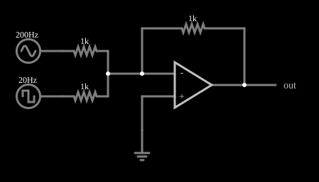

# Amplificador somador

<!-- navegacao:inicio -->
[Índice](README.md) · [Anterior: Differential Amplifier](amp-diff.md) · [Próximo: Log Amplifier](logconvert.md)
<!-- navegacao:fim -->

## Objetivo

Mostrar o amplificador somador (inversor), que soma várias tensões de entrada, cada uma com o seu peso, e é usado em misturadores de áudio e em conversores digital-analógicos.

## O circuito

<!-- esquema:inicio -->

<!-- esquema:fim -->

O amplificador operacional está em configuração inversora, com um resistor de realimentação $R_f = 1\ \text{k}\Omega$ entre a saída e a entrada inversora. Duas fontes chegam à entrada inversora, cada uma por um resistor de $1\ \text{k}\Omega$: uma senoide de $200\ \text{Hz}$ e $5\ \text{V}$ de pico e uma onda quadrada de $20\ \text{Hz}$ entre $-2$ e $+2\ \text{V}$. A entrada não inversora está ligada à terra. Três osciloscópios mostram as duas entradas e a saída.

<!-- componentes:inicio -->
| N.º | Tipo | Elemento | Valores |
|----:|------|----------|---------|
| 0 | `OpAmpElm` | op-amp | Max Output (V) = 15; Min Output (V) = -15; Gain = 100k |
| 3 | `ResistorElm` | resistor | Resistance (ohms) = 1k |
| 5 | `GroundElm` | ground | Symbol = Earth |
| 9 | `ResistorElm` | resistor | Resistance (ohms) = 1k |
| 10 | `ResistorElm` | resistor | Resistance (ohms) = 1k |
| 11 | `RailElm` | A/C source | Max Voltage = 5; Waveform = A/C; DC Offset (V) = 0; Internal Resistance (ohms) = 0; Show Voltage = não; Frequency (Hz) = 200; Phase Offset (degrees) = 0 |
| 12 | `RailElm` | square wave gen | Max Voltage = 2; Waveform = Square Wave; DC Offset (V) = 0; Internal Resistance (ohms) = 0; Show Voltage = não; Specify As = Frequency/Duty Cycle; Frequency (Hz) = 20; Phase Offset (degrees) = 0; Duty Cycle = 50; Rise/Fall Time (s) = 0 |
| 13 | `OutputElm` | output | Show Voltage = não |
<!-- componentes:fim -->

## Teoria

A entrada inversora é um terra virtual ($\approx 0\ \text{V}$), então cada fonte injeta a corrente $V_k/R_k$ e todas elas somam-se e passam por $R_f$:

$$V_\text{out} = -R_f\left(\frac{V_1}{R_1} + \frac{V_2}{R_2}\right).$$

Como as fontes não se enxergam (cada uma vê um terra virtual), não há interação entre elas; os pesos são $R_f/R_k$ e podem ser ajustados de forma independente. Com $R_1 = R_2 = R_f$ a saída é simplesmente $-(V_1 + V_2)$.

## Resultados esperados

Com os três resistores iguais, $V_\text{out} = -(V_1 + V_2)$. Em $t = 10\ \text{ms}$ a senoide está perto de zero ($-0{,}031\ \text{V}$) e o quadrado está em $+2\ \text{V}$, de modo que a saída é $-1{,}9685\ \text{V}$. Os extremos da soma são $\pm(5 + 2) = \pm 7\ \text{V}$, e o simulador dá $\pm 6{,}9998\ \text{V}$ em uma janela de um período do quadrado. As verificações conferem a saída nesse instante, a tensão da entrada inversora (terra virtual) e os dois extremos.

## O que observar

- A saída é a senoide de $200\ \text{Hz}$ **invertida** e deslocada para baixo (em $2\ \text{V}$) enquanto o quadrado de $20\ \text{Hz}$ está em $+2\ \text{V}$, e para cima quando ele está em $-2\ \text{V}$.
- Mude os valores dos resistores de entrada para dar pesos diferentes às duas fontes.
- A entrada inversora fica em cerca de $0\ \text{V}$ todo o tempo.

## Limites do modelo

O operacional é ideal, com ganho $10^5$ e saturação em $\pm 15\ \text{V}$. Em um mixer real, a precisão dos pesos depende da tolerância dos resistores, e a banda e o ruído do operacional limitam o desempenho.

## Referências

- A. S. Sedra e K. C. Smith, *Microeletrônica*, Pearson.
- P. Horowitz e W. Hill, *The Art of Electronics*, Cambridge University Press.
- W. G. Jung, *Op Amp Applications Handbook*, Newnes.

O circuito deste exemplo faz parte da coleção do simulador original de Paul Falstad e Iain Sharp (CircuitJS1); a explicação é deste projeto.
