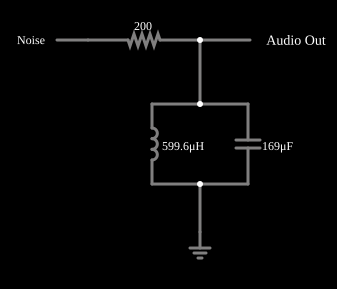

# Filtro passa-faixa estreito com ruído

<!-- navegacao:inicio -->
[Índice](README.md) · [Anterior: Band-pass Filter](bandpass.md) · [Próximo: Notch Filter](notch.md)
<!-- navegacao:fim -->

## Objetivo

Mostrar a seletividade de um filtro passa-faixa de alto $Q$: um ruído branco entra e só uma faixa estreita em torno da ressonância sai, de modo que o ouvido percebe um tom de 500 Hz.

## O circuito

<!-- esquema:inicio -->

<!-- esquema:fim -->

Um gerador de ruído de 5 V alimenta, através de um resistor de $200\ \Omega$, um circuito LC paralelo de $0{,}6\ \text{mH}$ e $169\ \mu\text{F}$ para a terra; a saída vai a uma saída de áudio (1 s, 8000 amostras por segundo).

<!-- componentes:inicio -->
| N.º | Tipo | Elemento | Valores |
|----:|------|----------|---------|
| 6 | `InductorElm` | inductor | Inductance (H) = 599.6μ; Trapezoidal Approximation = sim; Initial Current (on Reset) (A) = 0; Saturation Current (A) (0=none) = 0 |
| 7 | `CapacitorElm` | capacitor | Capacitance (F) = 169μ; Trapezoidal Approximation = sim; Initial Voltage (on Reset) = 1m; Series Resistance = 0 |
| 8 | `ResistorElm` | resistor | Resistance (ohms) = 200 |
| 9 | `GroundElm` | ground | Symbol = Earth |
| 10 | `RailElm` | noise gen | Max Voltage = 5; Waveform = Noise; DC Offset (V) = 0; Internal Resistance (ohms) = 0; Show Voltage = não |
| 11 | `AudioOutputElm` | audio output | Duration (s) = 1; Sampling Rate = 8000 |
<!-- componentes:fim -->

## Teoria

O ruído branco tem densidade espectral uniforme: todas as frequências com a mesma potência. O filtro passa-faixa de segunda ordem (tanque com resistor em série) tem

$$H(j\omega) = \frac{1}{1 + jQ\left(\dfrac{\omega}{\omega_0}-\dfrac{\omega_0}{\omega}\right)},\qquad f_0 = \frac{1}{2\pi\sqrt{LC}},\quad Q = R\sqrt{\frac CL},\quad B = \frac{f_0}{Q},$$

e deixa passar só as componentes do ruído numa faixa de largura $B$ em torno de $f_0$; a saída é um sinal quase senoidal, de amplitude e fase que variam lentamente (ruído de banda estreita).

## Resultados esperados

$f_0 = 500{,}1\ \text{Hz}$ e $Q = 106$, de modo que a faixa de meia potência vai de $497{,}9\ \text{Hz}$ a $502{,}3\ \text{Hz}$ ($B = 4{,}4\ \text{Hz}$). Esta é uma propriedade do filtro, calculada pela análise do circuito. Como a entrada é um ruído aleatório, o resultado numérico muda a cada execução, e o exemplo é para ser ouvido: o ouvido percebe um tom de 500 Hz cuja intensidade oscila.

## O que observar

- Ouça a saída de áudio: um tom em torno de 500 Hz, com um "tremor" de amplitude (a envoltória varia na escala de $1/B \approx 0{,}2\ \text{s}$).
- Aumente $R$ para estreitar mais a faixa.

## Limites do modelo

Gerador de ruído e componentes ideais. A saída é áudio: a verificação numérica não se aplica porque a entrada é aleatória.

## Referências

- P. Horowitz e W. Hill, *The Art of Electronics*, Cambridge University Press.
- A. S. Sedra e K. C. Smith, *Microeletrônica*, Pearson.

O circuito deste exemplo faz parte da coleção do simulador original de Paul Falstad e Iain Sharp (CircuitJS1); a explicação é deste projeto.
