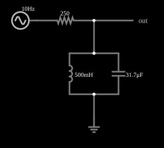

# Filtro passa-faixa (circuito tanque)

<!-- navegacao:inicio -->
[Índice](README.md) · [Anterior: Low-Pass Filter (RL)](filt-lopass-l.md) · [Próximo: Band-pass w/ Noise](bandnoise.md)
<!-- navegacao:fim -->

## Objetivo

Mostrar um filtro passa-faixa de segunda ordem: um circuito LC em paralelo ("tanque") ligado à terra, alimentado através de um resistor, deixa passar só as frequências em torno da ressonância $f_0$.

## O circuito

<!-- esquema:inicio -->

<!-- esquema:fim -->

Um resistor de $250\ \Omega$ em série com a entrada, e, em paralelo para a terra, um indutor de $500\ \text{mH}$ e um capacitor de $31{,}7\ \mu\text{F}$; a saída é a tensão no tanque. O sinal de teste é uma fonte de **varredura de frequência**: uma senoide de 5 V de pico cuja frequência varia, de forma logarítmica, de 10 Hz a 150 Hz em 0,5 s e depois volta. Como a frequência é uma função conhecida do tempo, $f(t)=f_{min}(f_{max}/f_{min})^{t/T}$, a tensão de saída ao longo do tempo mostra a resposta em frequência do filtro.

<!-- componentes:inicio -->
| N.º | Tipo | Elemento | Valores |
|----:|------|----------|---------|
| 6 | `InductorElm` | inductor | Inductance (H) = 500m; Trapezoidal Approximation = sim; Initial Current (on Reset) (A) = 0; Saturation Current (A) (0=none) = 0 |
| 7 | `CapacitorElm` | capacitor | Capacitance (F) = 31.7μ; Trapezoidal Approximation = sim; Initial Voltage (on Reset) = 1m; Series Resistance = 0 |
| 8 | `ResistorElm` | resistor | Resistance (ohms) = 250 |
| 9 | `OutputElm` | output | Show Voltage = não |
| 10 | `GroundElm` | ground | Symbol = Earth |
| 11 | `SweepElm` | sweep (log) | Min Frequency (Hz) = 10; Max Frequency (Hz) = 150; Sweep Time (s) = 500m; Logarithmic = sim; Max Voltage = 5; Bidirectional = sim |
<!-- componentes:fim -->

## Teoria

O tanque tem admitância $Y = j\omega C + 1/(j\omega L)$ e a função de transferência é

$$H(j\omega) = \frac{1/Y}{R + 1/Y} = \frac{1}{1 + jR\left(\omega C - \dfrac{1}{\omega L}\right)} = \frac{1}{1 + jQ\left(\dfrac{\omega}{\omega_0} - \dfrac{\omega_0}{\omega}\right)},$$

com a frequência central e o fator de qualidade

$$f_0 = \frac{1}{2\pi\sqrt{LC}},\qquad Q = R\sqrt{\frac{C}{L}},\qquad B = \frac{f_0}{Q}.$$

Em $f_0$ o tanque tem impedância infinita e $|H|=1$; nos extremos de $B$ (frequências de meia potência), $|H| = 0{,}707$.

## Resultados esperados

$f_0 = 39{,}98\ \text{Hz}$, $Q = 1{,}99$ e $B = 20{,}1\ \text{Hz}$. A varredura chega a $f_0$ em $t=255{,}9\ \text{ms}$.

| $f$ | instante | $\|H\|$ | $V_{out,pico}$ |
|----:|---------:|--------:|---------------:|
| 20 Hz | 128,0 ms | 0,318 | 1,59 V |
| 35 Hz | 231,3 ms | 0,883 | 4,42 V |
| **39,98 Hz** | **255,9 ms** | **1,000** | **5,00 V** |
| 45 Hz | 277,7 ms | 0,904 | 4,52 V |
| 60 Hz | 330,8 ms | 0,516 | 2,58 V |
| 100 Hz | 425,1 ms | 0,233 | 1,16 V |

**Efeito da varredura.** O tanque responde com uma constante de tempo de $2Q/\omega_0 \approx 16\ \text{ms}$, comparável ao tempo que a varredura leva para atravessar a banda ($B/\dot f \approx 90\ \text{ms}$). Por isso a amplitude que o osciloscópio mostra no pico é menor que a de regime permanente: a integração numérica das equações do tanque com a mesma varredura dá um máximo de $4{,}239\ \text{V}$ (e não $5\ \text{V}$) na janela de 241 ms a 271 ms, e é isso que a primeira verificação confere. Com uma varredura lenta o pico chegaria a $5\ \text{V}$. A segunda verificação confere a saída em 100 Hz, longe da ressonância, onde vale a teoria de regime permanente (tolerância de 5%).

## O que observar

- A curva de saída tem um pico em torno de 40 Hz, com largura de cerca de 20 Hz.
- Aumente $R$: $Q$ aumenta e o pico fica mais estreito; mude $L$ ou $C$ para deslocar $f_0$.

## Limites do modelo

Como a frequência varia continuamente, a amplitude vista num instante aproxima a resposta em regime permanente daquela frequência (as verificações usam janelas curtas em torno do instante e uma tolerância que cobre esse efeito). Componentes ideais. Num indutor real a resistência do fio reduz o pico. A varredura rápida reduz o pico observado (veja acima).

## Referências

- J. W. Nilsson e S. A. Riedel, *Circuitos Elétricos*, Pearson.
- A. S. Sedra e K. C. Smith, *Microeletrônica*, Pearson.
- P. Horowitz e W. Hill, *The Art of Electronics*, Cambridge University Press.

O circuito deste exemplo faz parte da coleção do simulador original de Paul Falstad e Iain Sharp (CircuitJS1); a explicação é deste projeto.
