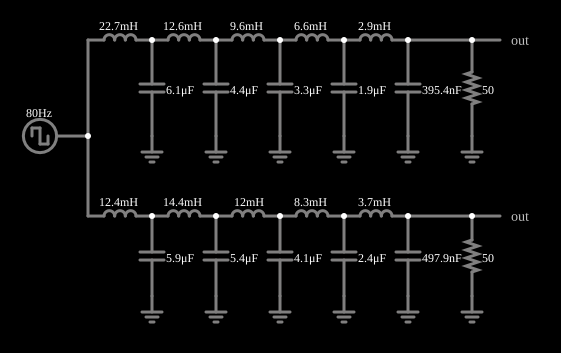

# Bessel contra Butterworth

<!-- navegacao:inicio -->
[Índice](README.md) · [Anterior: Butterworth Band-Stop](butterbandstop.md) · [Próximo: Band-pass with Ringing](ringing.md)
<!-- navegacao:fim -->

## Objetivo

Comparar dois filtros passa-baixas de décima ordem com a mesma frequência de corte: o de Butterworth, de resposta de módulo plana, e o de Bessel, de atraso de grupo plano. A diferença aparece na resposta a um degrau: o primeiro oscila, o segundo não.

## O circuito

<!-- esquema:inicio -->

<!-- esquema:fim -->

Duas escadas LC de cinco indutores e cinco capacitores, com carga de $50\ \Omega$, uma com os valores de Bessel e outra com os de Butterworth. Um gerador de onda quadrada de 80 Hz e $\pm5\ \text{V}$ alimenta as duas e dois osciloscópios mostram as saídas.

<!-- componentes:inicio -->
| N.º | Tipo | Elemento | Valores |
|----:|------|----------|---------|
| 0 | `CapacitorElm` | capacitor | Capacitance (F) = 6.1μ; Trapezoidal Approximation = sim; Initial Voltage (on Reset) = 1m; Series Resistance = 0 |
| 1 | `InductorElm` | inductor | Inductance (H) = 22.7m; Trapezoidal Approximation = sim; Initial Current (on Reset) (A) = 0; Saturation Current (A) (0=none) = 0 |
| 3 | `ResistorElm` | resistor | Resistance (ohms) = 50 |
| 4 | `GroundElm` | ground | Symbol = Earth |
| 5 | `GroundElm` | ground | Symbol = Earth |
| 6 | `OutputElm` | output | Show Voltage = não |
| 7 | `CapacitorElm` | capacitor | Capacitance (F) = 4.4μ; Trapezoidal Approximation = sim; Initial Voltage (on Reset) = 1m; Series Resistance = 0 |
| 8 | `InductorElm` | inductor | Inductance (H) = 12.6m; Trapezoidal Approximation = sim; Initial Current (on Reset) (A) = 0; Saturation Current (A) (0=none) = 0 |
| 9 | `GroundElm` | ground | Symbol = Earth |
| 10 | `CapacitorElm` | capacitor | Capacitance (F) = 3.3μ; Trapezoidal Approximation = sim; Initial Voltage (on Reset) = 1m; Series Resistance = 0 |
| 11 | `InductorElm` | inductor | Inductance (H) = 9.6m; Trapezoidal Approximation = sim; Initial Current (on Reset) (A) = 0; Saturation Current (A) (0=none) = 0 |
| 12 | `GroundElm` | ground | Symbol = Earth |
| 13 | `CapacitorElm` | capacitor | Capacitance (F) = 1.9μ; Trapezoidal Approximation = sim; Initial Voltage (on Reset) = 1m; Series Resistance = 0 |
| 14 | `InductorElm` | inductor | Inductance (H) = 6.6m; Trapezoidal Approximation = sim; Initial Current (on Reset) (A) = 0; Saturation Current (A) (0=none) = 0 |
| 15 | `GroundElm` | ground | Symbol = Earth |
| 16 | `CapacitorElm` | capacitor | Capacitance (F) = 395.4n; Trapezoidal Approximation = sim; Initial Voltage (on Reset) = 1m; Series Resistance = 0 |
| 17 | `InductorElm` | inductor | Inductance (H) = 2.9m; Trapezoidal Approximation = sim; Initial Current (on Reset) (A) = 0; Saturation Current (A) (0=none) = 0 |
| 18 | `GroundElm` | ground | Symbol = Earth |
| 19 | `GroundElm` | ground | Symbol = Earth |
| 20 | `InductorElm` | inductor | Inductance (H) = 3.7m; Trapezoidal Approximation = sim; Initial Current (on Reset) (A) = 0; Saturation Current (A) (0=none) = 0 |
| 21 | `CapacitorElm` | capacitor | Capacitance (F) = 497.9n; Trapezoidal Approximation = sim; Initial Voltage (on Reset) = 1m; Series Resistance = 0 |
| 22 | `GroundElm` | ground | Symbol = Earth |
| 23 | `InductorElm` | inductor | Inductance (H) = 8.3m; Trapezoidal Approximation = sim; Initial Current (on Reset) (A) = 0; Saturation Current (A) (0=none) = 0 |
| 24 | `CapacitorElm` | capacitor | Capacitance (F) = 2.4μ; Trapezoidal Approximation = sim; Initial Voltage (on Reset) = 1m; Series Resistance = 0 |
| 25 | `GroundElm` | ground | Symbol = Earth |
| 26 | `InductorElm` | inductor | Inductance (H) = 12m; Trapezoidal Approximation = sim; Initial Current (on Reset) (A) = 0; Saturation Current (A) (0=none) = 0 |
| 27 | `CapacitorElm` | capacitor | Capacitance (F) = 4.1μ; Trapezoidal Approximation = sim; Initial Voltage (on Reset) = 1m; Series Resistance = 0 |
| 28 | `GroundElm` | ground | Symbol = Earth |
| 29 | `InductorElm` | inductor | Inductance (H) = 14.4m; Trapezoidal Approximation = sim; Initial Current (on Reset) (A) = 0; Saturation Current (A) (0=none) = 0 |
| 30 | `CapacitorElm` | capacitor | Capacitance (F) = 5.4μ; Trapezoidal Approximation = sim; Initial Voltage (on Reset) = 1m; Series Resistance = 0 |
| 31 | `OutputElm` | output | Show Voltage = não |
| 32 | `GroundElm` | ground | Symbol = Earth |
| 33 | `GroundElm` | ground | Symbol = Earth |
| 34 | `ResistorElm` | resistor | Resistance (ohms) = 50 |
| 36 | `InductorElm` | inductor | Inductance (H) = 12.4m; Trapezoidal Approximation = sim; Initial Current (on Reset) (A) = 0; Saturation Current (A) (0=none) = 0 |
| 37 | `CapacitorElm` | capacitor | Capacitance (F) = 5.9μ; Trapezoidal Approximation = sim; Initial Voltage (on Reset) = 1m; Series Resistance = 0 |
| 40 | `RailElm` | square wave gen | Max Voltage = 5; Waveform = Square Wave; DC Offset (V) = 0; Internal Resistance (ohms) = 0; Show Voltage = não; Specify As = Frequency/Duty Cycle; Frequency (Hz) = 80; Phase Offset (degrees) = 0; Duty Cycle = 50; Rise/Fall Time (s) = 0 |
<!-- componentes:fim -->

## Teoria

A resposta a um degrau depende da **fase** do filtro, não só do módulo. Um filtro de **Butterworth** privilegia a planura do módulo, e seus polos próximos do eixo imaginário produzem **sobressinal** e oscilação ("ringing"). Um filtro de **Bessel** (Thomson) privilegia a linearidade da fase, isto é, um **atraso de grupo** constante,

$$\tau_g(\omega) = -\frac{d\varphi}{d\omega}\approx \text{constante},$$

de modo que todas as componentes de frequência da banda passante sofrem o mesmo atraso e a forma de onda é preservada: o degrau sobe sem sobressinal. O preço é uma transição do módulo menos íngreme.

## Resultados esperados

Calculando a resposta a um degrau a partir da função de transferência de cada escada, obtém-se um sobressinal de $17{,}8\%$ para o filtro de Butterworth e de $0{,}12\%$ para o de Bessel; com um degrau de $10\ \text{V}$ ($-5\ \text{V}$ a $+5\ \text{V}$), o máximo da saída é $5 + 10\cdot0{,}178 = 6{,}78\ \text{V}$ para o Butterworth e $5{,}012\ \text{V}$ para o Bessel. O tempo de subida (10% a 90%) é de cerca de $0{,}49\ \text{ms}$ no Butterworth e $0{,}66\ \text{ms}$ no Bessel (o de Bessel é mais lento). As verificações conferem os dois máximos, no primeiro meio ciclo.

## O que observar

- A saída do Butterworth passa de 5 V e oscila antes de assentar; a do Bessel sobe suavemente.
- Mas o Butterworth sobe mais depressa, e é mais seletivo em frequência.

## Limites do modelo

Escadas LC ideais. O sobressinal calculado é o de um filtro excitado por fonte ideal e terminado em $50\ \Omega$.

## Referências

- A. S. Sedra e K. C. Smith, *Microeletrônica*, Pearson.
- P. Horowitz e W. Hill, *The Art of Electronics*, Cambridge University Press.

O circuito deste exemplo faz parte da coleção do simulador original de Paul Falstad e Iain Sharp (CircuitJS1); a explicação é deste projeto.
