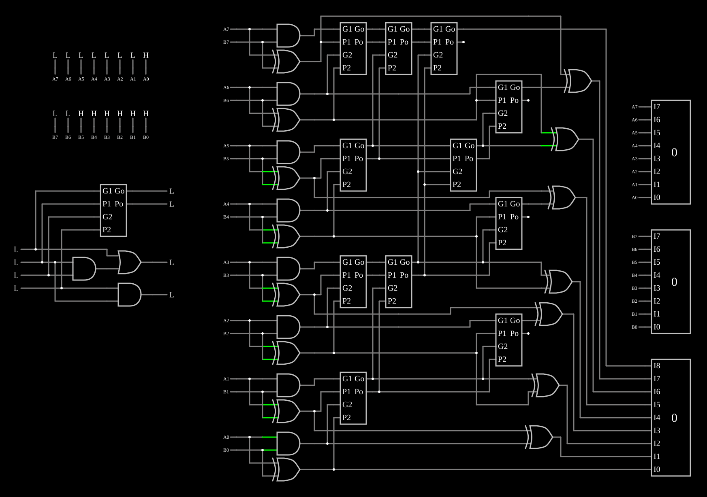

# Somador Brent-Kung de 8 bits

<!-- navegacao:inicio -->
[Índice](README.md) · [Anterior: 7-Segment LED Decoder](7segdecoder.md) · [Próximo: 74181 ALU](alu74181.md)
<!-- navegacao:fim -->

## Objetivo

Mostrar um **somador de prefixos paralelos**: em vez de esperar o vai-um atravessar os oito bits um a um, os vai-uns são calculados por uma árvore de operadores de geração e propagação, com atraso que cresce com $\log_2 n$. A topologia de Brent e Kung é a que usa menos operadores entre as árvores de prefixos de profundidade logarítmica.

## O circuito

<!-- esquema:inicio -->

<!-- esquema:fim -->

- **Entradas:** dois números de 8 bits, $A_7 \dots A_0$ (fila de cima) e $B_7 \dots B_0$ (fila de baixo), com o bit mais significativo à esquerda; nós rotulados ($A_0$, $B_0$, …) levam cada bit ao seu lugar no circuito. Três mostradores decimais exibem $A$ (elemento 294), $B$ (elemento 311) e a soma de 9 bits (elemento 275).
- **Pré-processamento:** para cada bit, uma AND dá $g_i = A_i B_i$ e uma XOR dá $p_i = A_i \oplus B_i$.
- **Árvore de prefixos:** onze instâncias do subcircuito *operator*, em cinco níveis, calculam os pares $(G, P)$ de cada prefixo $i{:}0$.
- **Soma:** XORs finais fazem $S_i = p_i \oplus G_{i-1:0}$; o vai-um final $G_{7:0}$ é o nono bit.
- **Demonstração do operador** (à esquerda, embaixo): quatro entradas, $g_1$ (elemento 243), $p_1$ (elemento 244), $g_0$ (elemento 248) e $p_0$ (elemento 249), alimentam o operador feito com portas (saídas $G$, elemento 266, e $P$, elemento 267) e uma instância do subcircuito (saídas 264 e 265), para comparar.

O exemplo abre com $A = 1$ e $B = 63$.

<!-- componentes:inicio -->
| N.º | Tipo | Elemento | Valores |
|----:|------|----------|---------|
| 4 | `XorGateElm` | XOR gate | # of Inputs = 2; High Logic Voltage = 5; Schmitt Inputs = não; Propagation Delay (s) = 0; DeMorgan's Symbol = não |
| 5 | `AndGateElm` | AND gate | # of Inputs = 2; High Logic Voltage = 5; Schmitt Inputs = não; Invert Inputs = não; Propagation Delay (s) = 0; DeMorgan's Symbol = não |
| 6 | `LogicInputElm` | logic input | Momentary Switch = não; High Logic Voltage = 5; Low Voltage = 0; Numeric = não; Ternary = não; Keyboard Shortcut =  |
| 7 | `LogicInputElm` | logic input | Momentary Switch = não; High Logic Voltage = 5; Low Voltage = 0; Numeric = não; Ternary = não; Keyboard Shortcut =  |
| 8 | `LogicInputElm` | logic input | Momentary Switch = não; High Logic Voltage = 5; Low Voltage = 0; Numeric = não; Ternary = não; Keyboard Shortcut =  |
| 9 | `LogicInputElm` | logic input | Momentary Switch = não; High Logic Voltage = 5; Low Voltage = 0; Numeric = não; Ternary = não; Keyboard Shortcut =  |
| 10 | `LabeledNodeElm` | Labeled Node | Text = A1; Internal Node = não; Rotate Text When Vertical = não |
| 11 | `LabeledNodeElm` | Labeled Node | Text = A0; Internal Node = não; Rotate Text When Vertical = não |
| 12 | `LabeledNodeElm` | Labeled Node | Text = B1; Internal Node = não; Rotate Text When Vertical = não |
| 13 | `LabeledNodeElm` | Labeled Node | Text = B0; Internal Node = não; Rotate Text When Vertical = não |
| 14 | `LabeledNodeElm` | Labeled Node | Text = B0; Internal Node = não; Rotate Text When Vertical = não |
| 15 | `LabeledNodeElm` | Labeled Node | Text = A0; Internal Node = não; Rotate Text When Vertical = não |
| 20 | `LabeledNodeElm` | Labeled Node | Text = A1; Internal Node = não; Rotate Text When Vertical = não |
| 21 | `LabeledNodeElm` | Labeled Node | Text = B1; Internal Node = não; Rotate Text When Vertical = não |
| 22 | `AndGateElm` | AND gate | # of Inputs = 2; High Logic Voltage = 5; Schmitt Inputs = não; Invert Inputs = não; Propagation Delay (s) = 0; DeMorgan's Symbol = não |
| 23 | `XorGateElm` | XOR gate | # of Inputs = 2; High Logic Voltage = 5; Schmitt Inputs = não; Propagation Delay (s) = 0; DeMorgan's Symbol = não |
| 38 | `LogicInputElm` | logic input | Momentary Switch = não; High Logic Voltage = 5; Low Voltage = 0; Numeric = não; Ternary = não; Keyboard Shortcut =  |
| 39 | `LogicInputElm` | logic input | Momentary Switch = não; High Logic Voltage = 5; Low Voltage = 0; Numeric = não; Ternary = não; Keyboard Shortcut =  |
| 41 | `LabeledNodeElm` | Labeled Node | Text = A2; Internal Node = não; Rotate Text When Vertical = não |
| 42 | `LabeledNodeElm` | Labeled Node | Text = B2; Internal Node = não; Rotate Text When Vertical = não |
| 62 | `XorGateElm` | XOR gate | # of Inputs = 2; High Logic Voltage = 5; Schmitt Inputs = não; Propagation Delay (s) = 0; DeMorgan's Symbol = não |
| 63 | `AndGateElm` | AND gate | # of Inputs = 2; High Logic Voltage = 5; Schmitt Inputs = não; Invert Inputs = não; Propagation Delay (s) = 0; DeMorgan's Symbol = não |
| 64 | `LabeledNodeElm` | Labeled Node | Text = B3; Internal Node = não; Rotate Text When Vertical = não |
| 65 | `LabeledNodeElm` | Labeled Node | Text = A3; Internal Node = não; Rotate Text When Vertical = não |
| 70 | `LabeledNodeElm` | Labeled Node | Text = A2; Internal Node = não; Rotate Text When Vertical = não |
| 71 | `LabeledNodeElm` | Labeled Node | Text = B2; Internal Node = não; Rotate Text When Vertical = não |
| 72 | `AndGateElm` | AND gate | # of Inputs = 2; High Logic Voltage = 5; Schmitt Inputs = não; Invert Inputs = não; Propagation Delay (s) = 0; DeMorgan's Symbol = não |
| 73 | `XorGateElm` | XOR gate | # of Inputs = 2; High Logic Voltage = 5; Schmitt Inputs = não; Propagation Delay (s) = 0; DeMorgan's Symbol = não |
| 94 | `XorGateElm` | XOR gate | # of Inputs = 2; High Logic Voltage = 5; Schmitt Inputs = não; Propagation Delay (s) = 0; DeMorgan's Symbol = não |
| 95 | `AndGateElm` | AND gate | # of Inputs = 2; High Logic Voltage = 5; Schmitt Inputs = não; Invert Inputs = não; Propagation Delay (s) = 0; DeMorgan's Symbol = não |
| 96 | `LabeledNodeElm` | Labeled Node | Text = B6; Internal Node = não; Rotate Text When Vertical = não |
| 97 | `LabeledNodeElm` | Labeled Node | Text = A6; Internal Node = não; Rotate Text When Vertical = não |
| 102 | `LabeledNodeElm` | Labeled Node | Text = A7; Internal Node = não; Rotate Text When Vertical = não |
| 103 | `LabeledNodeElm` | Labeled Node | Text = B7; Internal Node = não; Rotate Text When Vertical = não |
| 104 | `AndGateElm` | AND gate | # of Inputs = 2; High Logic Voltage = 5; Schmitt Inputs = não; Invert Inputs = não; Propagation Delay (s) = 0; DeMorgan's Symbol = não |
| 105 | `XorGateElm` | XOR gate | # of Inputs = 2; High Logic Voltage = 5; Schmitt Inputs = não; Propagation Delay (s) = 0; DeMorgan's Symbol = não |
| 137 | `XorGateElm` | XOR gate | # of Inputs = 2; High Logic Voltage = 5; Schmitt Inputs = não; Propagation Delay (s) = 0; DeMorgan's Symbol = não |
| 138 | `AndGateElm` | AND gate | # of Inputs = 2; High Logic Voltage = 5; Schmitt Inputs = não; Invert Inputs = não; Propagation Delay (s) = 0; DeMorgan's Symbol = não |
| 139 | `LabeledNodeElm` | Labeled Node | Text = B5; Internal Node = não; Rotate Text When Vertical = não |
| 140 | `LabeledNodeElm` | Labeled Node | Text = A5; Internal Node = não; Rotate Text When Vertical = não |
| 145 | `LabeledNodeElm` | Labeled Node | Text = A4; Internal Node = não; Rotate Text When Vertical = não |
| 146 | `LabeledNodeElm` | Labeled Node | Text = B4; Internal Node = não; Rotate Text When Vertical = não |
| 147 | `AndGateElm` | AND gate | # of Inputs = 2; High Logic Voltage = 5; Schmitt Inputs = não; Invert Inputs = não; Propagation Delay (s) = 0; DeMorgan's Symbol = não |
| 148 | `XorGateElm` | XOR gate | # of Inputs = 2; High Logic Voltage = 5; Schmitt Inputs = não; Propagation Delay (s) = 0; DeMorgan's Symbol = não |
| 197 | `XorGateElm` | XOR gate | # of Inputs = 2; High Logic Voltage = 5; Schmitt Inputs = não; Propagation Delay (s) = 0; DeMorgan's Symbol = não |
| 198 | `XorGateElm` | XOR gate | # of Inputs = 2; High Logic Voltage = 5; Schmitt Inputs = não; Propagation Delay (s) = 0; DeMorgan's Symbol = não |
| 202 | `XorGateElm` | XOR gate | # of Inputs = 2; High Logic Voltage = 5; Schmitt Inputs = não; Propagation Delay (s) = 0; DeMorgan's Symbol = não |
| 204 | `LabeledNodeElm` | Labeled Node | Text = A3; Internal Node = não; Rotate Text When Vertical = não |
| 205 | `LogicInputElm` | logic input | Momentary Switch = não; High Logic Voltage = 5; Low Voltage = 0; Numeric = não; Ternary = não; Keyboard Shortcut =  |
| 206 | `LabeledNodeElm` | Labeled Node | Text = B3; Internal Node = não; Rotate Text When Vertical = não |
| 207 | `LogicInputElm` | logic input | Momentary Switch = não; High Logic Voltage = 5; Low Voltage = 0; Numeric = não; Ternary = não; Keyboard Shortcut =  |
| 208 | `XorGateElm` | XOR gate | # of Inputs = 2; High Logic Voltage = 5; Schmitt Inputs = não; Propagation Delay (s) = 0; DeMorgan's Symbol = não |
| 214 | `LogicInputElm` | logic input | Momentary Switch = não; High Logic Voltage = 5; Low Voltage = 0; Numeric = não; Ternary = não; Keyboard Shortcut =  |
| 215 | `LabeledNodeElm` | Labeled Node | Text = B7; Internal Node = não; Rotate Text When Vertical = não |
| 216 | `LabeledNodeElm` | Labeled Node | Text = B6; Internal Node = não; Rotate Text When Vertical = não |
| 217 | `LogicInputElm` | logic input | Momentary Switch = não; High Logic Voltage = 5; Low Voltage = 0; Numeric = não; Ternary = não; Keyboard Shortcut =  |
| 218 | `LabeledNodeElm` | Labeled Node | Text = B4; Internal Node = não; Rotate Text When Vertical = não |
| 219 | `LabeledNodeElm` | Labeled Node | Text = B5; Internal Node = não; Rotate Text When Vertical = não |
| 220 | `LogicInputElm` | logic input | Momentary Switch = não; High Logic Voltage = 5; Low Voltage = 0; Numeric = não; Ternary = não; Keyboard Shortcut =  |
| 221 | `LogicInputElm` | logic input | Momentary Switch = não; High Logic Voltage = 5; Low Voltage = 0; Numeric = não; Ternary = não; Keyboard Shortcut =  |
| 222 | `LogicInputElm` | logic input | Momentary Switch = não; High Logic Voltage = 5; Low Voltage = 0; Numeric = não; Ternary = não; Keyboard Shortcut =  |
| 223 | `LabeledNodeElm` | Labeled Node | Text = A7; Internal Node = não; Rotate Text When Vertical = não |
| 224 | `LabeledNodeElm` | Labeled Node | Text = A6; Internal Node = não; Rotate Text When Vertical = não |
| 225 | `LogicInputElm` | logic input | Momentary Switch = não; High Logic Voltage = 5; Low Voltage = 0; Numeric = não; Ternary = não; Keyboard Shortcut =  |
| 226 | `LabeledNodeElm` | Labeled Node | Text = A4; Internal Node = não; Rotate Text When Vertical = não |
| 227 | `LabeledNodeElm` | Labeled Node | Text = A5; Internal Node = não; Rotate Text When Vertical = não |
| 228 | `LogicInputElm` | logic input | Momentary Switch = não; High Logic Voltage = 5; Low Voltage = 0; Numeric = não; Ternary = não; Keyboard Shortcut =  |
| 229 | `LogicInputElm` | logic input | Momentary Switch = não; High Logic Voltage = 5; Low Voltage = 0; Numeric = não; Ternary = não; Keyboard Shortcut =  |
| 231 | `XorGateElm` | XOR gate | # of Inputs = 2; High Logic Voltage = 5; Schmitt Inputs = não; Propagation Delay (s) = 0; DeMorgan's Symbol = não |
| 235 | `XorGateElm` | XOR gate | # of Inputs = 2; High Logic Voltage = 5; Schmitt Inputs = não; Propagation Delay (s) = 0; DeMorgan's Symbol = não |
| 238 | `XorGateElm` | XOR gate | # of Inputs = 2; High Logic Voltage = 5; Schmitt Inputs = não; Propagation Delay (s) = 0; DeMorgan's Symbol = não |
| 241 | `AndGateElm` | AND gate | # of Inputs = 2; High Logic Voltage = 5; Schmitt Inputs = não; Invert Inputs = não; Propagation Delay (s) = 0; DeMorgan's Symbol = não |
| 242 | `OrGateElm` | OR gate | # of Inputs = 2; High Logic Voltage = 5; Schmitt Inputs = não; Invert Inputs = não; Propagation Delay (s) = 0; DeMorgan's Symbol = não |
| 243 | `LogicInputElm` | logic input | Momentary Switch = não; High Logic Voltage = 5; Low Voltage = 0; Numeric = não; Ternary = não; Keyboard Shortcut =  |
| 244 | `LogicInputElm` | logic input | Momentary Switch = não; High Logic Voltage = 5; Low Voltage = 0; Numeric = não; Ternary = não; Keyboard Shortcut =  |
| 248 | `LogicInputElm` | logic input | Momentary Switch = não; High Logic Voltage = 5; Low Voltage = 0; Numeric = não; Ternary = não; Keyboard Shortcut =  |
| 249 | `LogicInputElm` | logic input | Momentary Switch = não; High Logic Voltage = 5; Low Voltage = 0; Numeric = não; Ternary = não; Keyboard Shortcut =  |
| 252 | `AndGateElm` | AND gate | # of Inputs = 2; High Logic Voltage = 5; Schmitt Inputs = não; Invert Inputs = não; Propagation Delay (s) = 0; DeMorgan's Symbol = não |
| 264 | `LogicOutputElm` | logic output | Threshold = 2.5; Current Required = não; Numeric = não; Ternary = não |
| 265 | `LogicOutputElm` | logic output | Threshold = 2.5; Current Required = não; Numeric = não; Ternary = não |
| 266 | `LogicOutputElm` | logic output | Threshold = 2.5; Current Required = não; Numeric = não; Ternary = não |
| 267 | `LogicOutputElm` | logic output | Threshold = 2.5; Current Required = não; Numeric = não; Ternary = não |
| 275 | `DecimalDisplayElm` | decimal display | High Logic Voltage = 5; Bit Order = MSB First; # of Bits = 9; Display Mode = Decimal |
| 294 | `DecimalDisplayElm` | decimal display | High Logic Voltage = 5; Bit Order = MSB First; # of Bits = 8; Display Mode = Decimal |
| 295 | `LabeledNodeElm` | Labeled Node | Text = A7; Internal Node = não; Rotate Text When Vertical = não |
| 296 | `LabeledNodeElm` | Labeled Node | Text = B4; Internal Node = não; Rotate Text When Vertical = não |
| 297 | `LabeledNodeElm` | Labeled Node | Text = A4; Internal Node = não; Rotate Text When Vertical = não |
| 298 | `LabeledNodeElm` | Labeled Node | Text = A5; Internal Node = não; Rotate Text When Vertical = não |
| 299 | `LabeledNodeElm` | Labeled Node | Text = B5; Internal Node = não; Rotate Text When Vertical = não |
| 300 | `LabeledNodeElm` | Labeled Node | Text = B7; Internal Node = não; Rotate Text When Vertical = não |
| 301 | `LabeledNodeElm` | Labeled Node | Text = A6; Internal Node = não; Rotate Text When Vertical = não |
| 302 | `LabeledNodeElm` | Labeled Node | Text = B6; Internal Node = não; Rotate Text When Vertical = não |
| 303 | `LabeledNodeElm` | Labeled Node | Text = B2; Internal Node = não; Rotate Text When Vertical = não |
| 304 | `LabeledNodeElm` | Labeled Node | Text = A2; Internal Node = não; Rotate Text When Vertical = não |
| 305 | `LabeledNodeElm` | Labeled Node | Text = A3; Internal Node = não; Rotate Text When Vertical = não |
| 306 | `LabeledNodeElm` | Labeled Node | Text = B3; Internal Node = não; Rotate Text When Vertical = não |
| 307 | `LabeledNodeElm` | Labeled Node | Text = B1; Internal Node = não; Rotate Text When Vertical = não |
| 308 | `LabeledNodeElm` | Labeled Node | Text = A1; Internal Node = não; Rotate Text When Vertical = não |
| 309 | `LabeledNodeElm` | Labeled Node | Text = A0; Internal Node = não; Rotate Text When Vertical = não |
| 310 | `LabeledNodeElm` | Labeled Node | Text = B0; Internal Node = não; Rotate Text When Vertical = não |
| 311 | `DecimalDisplayElm` | decimal display | High Logic Voltage = 5; Bit Order = MSB First; # of Bits = 8; Display Mode = Decimal |
| 312 | `CustomCompositeElm` | subcircuit (operator) | Model Name = operator; High Logic Voltage (0=default) = 0 |
| 313 | `CustomCompositeElm` | subcircuit (operator) | Model Name = operator; High Logic Voltage (0=default) = 0 |
| 314 | `CustomCompositeElm` | subcircuit (operator) | Model Name = operator; High Logic Voltage (0=default) = 0 |
| 315 | `CustomCompositeElm` | subcircuit (operator) | Model Name = operator; High Logic Voltage (0=default) = 0 |
| 316 | `CustomCompositeElm` | subcircuit (operator) | Model Name = operator; High Logic Voltage (0=default) = 0 |
| 317 | `CustomCompositeElm` | subcircuit (operator) | Model Name = operator; High Logic Voltage (0=default) = 0 |
| 318 | `CustomCompositeElm` | subcircuit (operator) | Model Name = operator; High Logic Voltage (0=default) = 0 |
| 319 | `CustomCompositeElm` | subcircuit (operator) | Model Name = operator; High Logic Voltage (0=default) = 0 |
| 320 | `CustomCompositeElm` | subcircuit (operator) | Model Name = operator; High Logic Voltage (0=default) = 0 |
| 321 | `CustomCompositeElm` | subcircuit (operator) | Model Name = operator; High Logic Voltage (0=default) = 0 |
| 322 | `CustomCompositeElm` | subcircuit (operator) | Model Name = operator; High Logic Voltage (0=default) = 0 |
| 323 | `CustomCompositeElm` | subcircuit (operator) | Model Name = operator; High Logic Voltage (0=default) = 0 |
<!-- componentes:fim -->

## Teoria

No bit $i$, um vai-um é **gerado** se $g_i = 1$ e **propagado** (o que chega passa adiante) se $p_i = 1$. Para um bloco de bits $i{:}j$, os mesmos conceitos combinam-se pelo **operador de prefixo**

$$(G, P)_{i:k} \circ (G, P)_{k-1:j} = \left(G_{i:k} + P_{i:k}\,G_{k-1:j},\ \ P_{i:k}\,P_{k-1:j}\right),$$

que é associativo. O vai-um que entra no bit $i$ é $c_i = G_{i-1:0}$ (sem vai-um de entrada), e a soma é $S_i = p_i \oplus c_i$. Calcular todos os $G_{i:0}$ é um problema de **prefixos paralelos**, resolvido por uma árvore:

- **subida:** $(1{:}0), (3{:}2), (5{:}4), (7{:}6)$; depois $(3{:}0), (7{:}4)$; depois $(7{:}0)$: 7 operadores em 3 níveis;
- **descida:** $(5{:}0) = (5{:}4) \circ (3{:}0)$; depois $(2{:}0)$, $(4{:}0)$ e $(6{:}0)$: 4 operadores em 2 níveis.

São $2\log_2 n - 1 = 5$ níveis e $2n - 2 - \log_2 n = 11$ operadores para $n = 8$. Um somador *ripple carry* teria 7 níveis de atraso do vai-um; para $n = 64$, seriam 63 contra 11. A árvore de Kogge-Stone tem só $\log_2 n$ níveis, mas muito mais operadores e fios; a de Brent-Kung troca um pouco de profundidade por área.

## Resultados esperados

O simulador dá as somas corretas; por exemplo:

| $A$ | $B$ | Soma |
|----:|----:|-----:|
| 1 | 63 | 64 |
| 255 | 255 | 510 |
| 129 | 191 | 320 |
| 1 | 61 | 62 |
| 255 | 63 | 318 |

As verificações conferem bits da soma (as entradas do mostrador de 9 bits) para os três primeiros casos. O caso inicial, $1 + 63$, é o pior para um somador *ripple*: o vai-um gerado no bit $0$ precisa atravessar os bits $1$ a $5$ para chegar ao bit $6$.

Na demonstração do operador, o simulador dá $G = g_1 + p_1 g_0$ e $P = p_1 p_0$: por exemplo, com $p_1 = 1$ e $g_0 = 1$, $G = 1$ e $P = 0$; com $p_1 = p_0 = 1$, $P = 1$. As saídas do subcircuito acompanham as das portas.

## O que observar

Monte $1 + 63$ e depois troque o bit $A_0$: a soma muda de $64$ para $63$ e o vai-um percorre a árvore de uma vez, sem passar bit a bit. Use a demonstração para conferir a tabela do operador antes de seguir os sinais na árvore. O somador de um bit está em [Full Adder](fulladd.md).

## Limites do modelo

- As portas são ideais e sem atraso: o ganho de velocidade, que é a razão de ser da árvore, não aparece na simulação, só a estrutura.
- Não há vai-um de entrada; ele entraria como $g_{-1}$ num bit extra da árvore.

## Referências

Brent e Kung, "A Regular Layout for Parallel Adders", *IEEE Transactions on Computers*, C-31(3), 1982; Weste e Harris, *CMOS VLSI Design*, capítulo sobre somadores (somadores de prefixos); Harris, "A Taxonomy of Parallel Prefix Networks", Asilomar, 2003.

O circuito deste exemplo faz parte da coleção do simulador original de Paul Falstad e Iain Sharp (CircuitJS1); a explicação é deste projeto.
