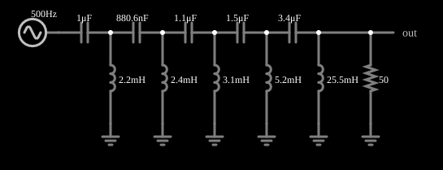

# Filtro passa-altas de Butterworth de 10 polos

<!-- navegacao:inicio -->
[Índice](README.md) · [Anterior: Butterworth Low-Pass (10 pole)](butter10lo.md) · [Próximo: Butterworth Low-Pass w/ Noise](butter10loaud.md)
<!-- navegacao:fim -->

## Objetivo

Mostrar o filtro de Butterworth de décima ordem passa-altas: bloqueia as frequências abaixo de cerca de 2 kHz e passa as acima.

## O circuito

<!-- esquema:inicio -->

<!-- esquema:fim -->

Uma escada de cinco capacitores em série e cinco indutores em derivação, com carga de $50\ \Omega$. O sinal de teste é uma varredura logarítmica de 500 Hz a 8 kHz em 0,1 s, 5 V de pico.

<!-- componentes:inicio -->
| N.º | Tipo | Elemento | Valores |
|----:|------|----------|---------|
| 1 | `ResistorElm` | resistor | Resistance (ohms) = 50 |
| 2 | `GroundElm` | ground | Symbol = Earth |
| 3 | `GroundElm` | ground | Symbol = Earth |
| 4 | `OutputElm` | output | Show Voltage = não |
| 5 | `SweepElm` | sweep (log) | Min Frequency (Hz) = 500; Max Frequency (Hz) = 8k; Sweep Time (s) = 100m; Logarithmic = sim; Max Voltage = 5; Bidirectional = sim |
| 6 | `CapacitorElm` | capacitor | Capacitance (F) = 1μ; Trapezoidal Approximation = sim; Initial Voltage (on Reset) = 1m; Series Resistance = 0 |
| 7 | `InductorElm` | inductor | Inductance (H) = 2.2m; Trapezoidal Approximation = sim; Initial Current (on Reset) (A) = 0; Saturation Current (A) (0=none) = 0 |
| 8 | `GroundElm` | ground | Symbol = Earth |
| 9 | `CapacitorElm` | capacitor | Capacitance (F) = 880.6n; Trapezoidal Approximation = sim; Initial Voltage (on Reset) = 1m; Series Resistance = 0 |
| 10 | `InductorElm` | inductor | Inductance (H) = 2.4m; Trapezoidal Approximation = sim; Initial Current (on Reset) (A) = 0; Saturation Current (A) (0=none) = 0 |
| 11 | `GroundElm` | ground | Symbol = Earth |
| 12 | `CapacitorElm` | capacitor | Capacitance (F) = 1.1μ; Trapezoidal Approximation = sim; Initial Voltage (on Reset) = 1m; Series Resistance = 0 |
| 13 | `InductorElm` | inductor | Inductance (H) = 3.1m; Trapezoidal Approximation = sim; Initial Current (on Reset) (A) = 0; Saturation Current (A) (0=none) = 0 |
| 14 | `GroundElm` | ground | Symbol = Earth |
| 15 | `CapacitorElm` | capacitor | Capacitance (F) = 1.5μ; Trapezoidal Approximation = sim; Initial Voltage (on Reset) = 1m; Series Resistance = 0 |
| 16 | `InductorElm` | inductor | Inductance (H) = 5.2m; Trapezoidal Approximation = sim; Initial Current (on Reset) (A) = 0; Saturation Current (A) (0=none) = 0 |
| 17 | `GroundElm` | ground | Symbol = Earth |
| 18 | `CapacitorElm` | capacitor | Capacitance (F) = 3.4μ; Trapezoidal Approximation = sim; Initial Voltage (on Reset) = 1m; Series Resistance = 0 |
| 19 | `InductorElm` | inductor | Inductance (H) = 25.5m; Trapezoidal Approximation = sim; Initial Current (on Reset) (A) = 0; Saturation Current (A) (0=none) = 0 |
<!-- componentes:fim -->

## Teoria

A resposta de módulo de um filtro de Butterworth de ordem $n$ é "maximamente plana":

$$|H(f)| = \frac{1}{\sqrt{1 + (f_c/f)^{2n}}}\quad\text{(passa-altas)}.$$

Em $f_c$ vale $1/\sqrt2$ ($-3\ \text{dB}$); acima de $f_c$ o ganho cai $20n\ \text{dB}$ por década (para $n=10$, $200\ \text{dB}$ por década), e abaixo dele a curva é praticamente plana. Uma escada LC com $n$ elementos reativos realiza essa resposta com valores de componentes dados por $g_k = 2\sin\dfrac{(2k-1)\pi}{2n}$.

## Resultados esperados

A análise do circuito (regime permanente) dá $f_c = 1994\ \text{Hz}$:

| $f$ | instante | $\|H\|$ | $V_{out,pico}$ |
|----:|---------:|--------:|---------------:|
| 1500 Hz | 39,6 ms | 0,058 | 0,29 V |
| **1994 Hz** | **49,9 ms** | **0,707** | **3,54 V** |
| 2500 Hz | 58,1 ms | 0,995 | 4,97 V |
| 4000 Hz | 75,0 ms | 1,000 | 5,00 V |

**Efeito da varredura.** Como no passa-baixas, a varredura rápida (500 Hz a 8 kHz em 100 ms) faz a amplitude observada diferir da de regime permanente. A integração numérica independente do circuito com a mesma varredura dá: 3,05 V na janela do corte, 5,02 V em 4 kHz (a oscilação que sucede a transição ainda é visível) e 0,26 V em 1,5 kHz. As verificações conferem esses valores (tolerância de 2%, e de $0{,}1\ \text{V}$ absolutos no último).

## O que observar

- A curva de saída é quase nula abaixo de 1,5 kHz e sobe em degrau perto de 2 kHz.
- É a imagem espelhada do passa-baixas de Butterworth.

## Limites do modelo

Componentes ideais; a varredura rápida distorce a resposta observada (veja acima).

## Referências

- A. S. Sedra e K. C. Smith, *Microeletrônica*, Pearson.
- P. Horowitz e W. Hill, *The Art of Electronics*, Cambridge University Press.

O circuito deste exemplo faz parte da coleção do simulador original de Paul Falstad e Iain Sharp (CircuitJS1); a explicação é deste projeto.
