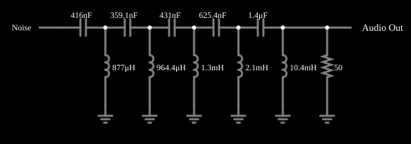

# Passa-altas de Butterworth de 10 polos com ruído

<!-- navegacao:inicio -->
[Índice](README.md) · [Anterior: Butterworth Low-Pass w/ Noise](butter10loaud.md) · [Próximo: Butterworth Band-Stop](butterbandstop.md)
<!-- navegacao:fim -->

## Objetivo

Ouvir o efeito de um filtro passa-altas de décima ordem sobre ruído branco: só os agudos passam, e o som fica "fino".

## O circuito

<!-- esquema:inicio -->

<!-- esquema:fim -->

Uma escada LC passa-altas de dez polos (cinco capacitores em série e cinco indutores em derivação, carga de $50\ \Omega$), alimentada por um gerador de ruído de 5 V; a saída vai a uma saída de áudio (1 s, 8000 amostras por segundo).

<!-- componentes:inicio -->
| N.º | Tipo | Elemento | Valores |
|----:|------|----------|---------|
| 1 | `ResistorElm` | resistor | Resistance (ohms) = 50 |
| 2 | `GroundElm` | ground | Symbol = Earth |
| 3 | `GroundElm` | ground | Symbol = Earth |
| 4 | `CapacitorElm` | capacitor | Capacitance (F) = 416n; Trapezoidal Approximation = sim; Initial Voltage (on Reset) = 1m; Series Resistance = 0 |
| 5 | `InductorElm` | inductor | Inductance (H) = 877μ; Trapezoidal Approximation = sim; Initial Current (on Reset) (A) = 0; Saturation Current (A) (0=none) = 0 |
| 6 | `GroundElm` | ground | Symbol = Earth |
| 7 | `CapacitorElm` | capacitor | Capacitance (F) = 359.1n; Trapezoidal Approximation = sim; Initial Voltage (on Reset) = 1m; Series Resistance = 0 |
| 8 | `InductorElm` | inductor | Inductance (H) = 964.4μ; Trapezoidal Approximation = sim; Initial Current (on Reset) (A) = 0; Saturation Current (A) (0=none) = 0 |
| 9 | `GroundElm` | ground | Symbol = Earth |
| 10 | `CapacitorElm` | capacitor | Capacitance (F) = 431n; Trapezoidal Approximation = sim; Initial Voltage (on Reset) = 1m; Series Resistance = 0 |
| 11 | `InductorElm` | inductor | Inductance (H) = 1.3m; Trapezoidal Approximation = sim; Initial Current (on Reset) (A) = 0; Saturation Current (A) (0=none) = 0 |
| 12 | `GroundElm` | ground | Symbol = Earth |
| 13 | `CapacitorElm` | capacitor | Capacitance (F) = 625.4n; Trapezoidal Approximation = sim; Initial Voltage (on Reset) = 1m; Series Resistance = 0 |
| 14 | `InductorElm` | inductor | Inductance (H) = 2.1m; Trapezoidal Approximation = sim; Initial Current (on Reset) (A) = 0; Saturation Current (A) (0=none) = 0 |
| 15 | `GroundElm` | ground | Symbol = Earth |
| 16 | `CapacitorElm` | capacitor | Capacitance (F) = 1.4μ; Trapezoidal Approximation = sim; Initial Voltage (on Reset) = 1m; Series Resistance = 0 |
| 17 | `InductorElm` | inductor | Inductance (H) = 10.4m; Trapezoidal Approximation = sim; Initial Current (on Reset) (A) = 0; Saturation Current (A) (0=none) = 0 |
| 18 | `RailElm` | noise gen | Max Voltage = 5; Waveform = Noise; DC Offset (V) = 0; Internal Resistance (ohms) = 0; Show Voltage = não |
| 19 | `AudioOutputElm` | audio output | Duration (s) = 1; Sampling Rate = 8000 |
<!-- componentes:fim -->

## Teoria

O ruído branco tem densidade espectral de potência uniforme; a saída de um filtro linear tem densidade $S_{out}(f) = |H(f)|^2 S_{in}(f)$, de modo que o filtro "esculpe" o espectro do ruído e o ouvido percebe só a faixa que passa.

A resposta de módulo de um filtro de Butterworth de ordem $n$ é "maximamente plana":

$$|H(f)| = \frac{1}{\sqrt{1 + (f_c/f)^{2n}}}.$$

Em $f_c$ vale $1/\sqrt2$ ($-3\ \text{dB}$); acima de $f_c$ o ganho cai $20n\ \text{dB}$ por década (para $n=10$, $200\ \text{dB}$ por década), e abaixo dele a curva é praticamente plana. Uma escada LC com $n$ elementos reativos realiza essa resposta com valores de componentes dados por $g_k = 2\sin\dfrac{(2k-1)\pi}{2n}$.

## Resultados esperados

Como a entrada é aleatória, nenhum valor numérico se repete de uma execução para outra; o resultado é para ser ouvido: um chiado agudo, sem graves.

## O que observar

- Ouça a saída: apenas as componentes de alta frequência do ruído.
- Compare com o passa-baixas com ruído.

## Limites do modelo

Gerador de ruído e componentes ideais. A saída é áudio: não há verificação numérica porque a entrada é aleatória.

## Referências

- A. S. Sedra e K. C. Smith, *Microeletrônica*, Pearson.
- P. Horowitz e W. Hill, *The Art of Electronics*, Cambridge University Press.

O circuito deste exemplo faz parte da coleção do simulador original de Paul Falstad e Iain Sharp (CircuitJS1); a explicação é deste projeto.
