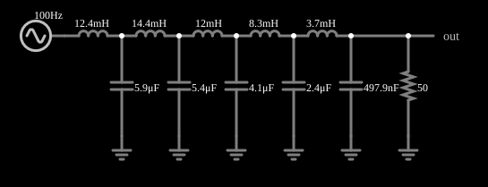

# Filtro passa-baixas de Butterworth de 10 polos

<!-- navegacao:inicio -->
[Índice](README.md) · [Anterior: Crossover](crossover.md) · [Próximo: Butterworth High-Pass (10 pole)](butter10hi.md)
<!-- navegacao:fim -->

## Objetivo

Mostrar um filtro passa-baixas de Butterworth de décima ordem realizado como uma escada LC: passa as frequências abaixo de 1 kHz quase sem atenuação e as corta com muita inclinação.

## O circuito

<!-- esquema:inicio -->

<!-- esquema:fim -->

Uma escada de cinco indutores em série e cinco capacitores em derivação, com carga de $50\ \Omega$ (valores na tabela abaixo). O sinal de teste é uma varredura **linear** de 100 Hz a 2 kHz em 0,15 s e 5 V de pico: $f(t) = f_{min} + (f_{max}-f_{min})\,t/T$.

<!-- componentes:inicio -->
| N.º | Tipo | Elemento | Valores |
|----:|------|----------|---------|
| 0 | `CapacitorElm` | capacitor | Capacitance (F) = 5.9μ; Trapezoidal Approximation = sim; Initial Voltage (on Reset) = 1m; Series Resistance = 0 |
| 1 | `InductorElm` | inductor | Inductance (H) = 12.4m; Trapezoidal Approximation = sim; Initial Current (on Reset) (A) = 0; Saturation Current (A) (0=none) = 0 |
| 3 | `ResistorElm` | resistor | Resistance (ohms) = 50 |
| 4 | `GroundElm` | ground | Symbol = Earth |
| 5 | `GroundElm` | ground | Symbol = Earth |
| 6 | `OutputElm` | output | Show Voltage = não |
| 7 | `SweepElm` | sweep (linear) | Min Frequency (Hz) = 100; Max Frequency (Hz) = 2k; Sweep Time (s) = 150m; Logarithmic = não; Max Voltage = 5; Bidirectional = sim |
| 8 | `CapacitorElm` | capacitor | Capacitance (F) = 5.4μ; Trapezoidal Approximation = sim; Initial Voltage (on Reset) = 1m; Series Resistance = 0 |
| 9 | `InductorElm` | inductor | Inductance (H) = 14.4m; Trapezoidal Approximation = sim; Initial Current (on Reset) (A) = 0; Saturation Current (A) (0=none) = 0 |
| 10 | `GroundElm` | ground | Symbol = Earth |
| 11 | `CapacitorElm` | capacitor | Capacitance (F) = 4.1μ; Trapezoidal Approximation = sim; Initial Voltage (on Reset) = 1m; Series Resistance = 0 |
| 12 | `InductorElm` | inductor | Inductance (H) = 12m; Trapezoidal Approximation = sim; Initial Current (on Reset) (A) = 0; Saturation Current (A) (0=none) = 0 |
| 13 | `GroundElm` | ground | Symbol = Earth |
| 14 | `CapacitorElm` | capacitor | Capacitance (F) = 2.4μ; Trapezoidal Approximation = sim; Initial Voltage (on Reset) = 1m; Series Resistance = 0 |
| 15 | `InductorElm` | inductor | Inductance (H) = 8.3m; Trapezoidal Approximation = sim; Initial Current (on Reset) (A) = 0; Saturation Current (A) (0=none) = 0 |
| 16 | `GroundElm` | ground | Symbol = Earth |
| 17 | `CapacitorElm` | capacitor | Capacitance (F) = 497.9n; Trapezoidal Approximation = sim; Initial Voltage (on Reset) = 1m; Series Resistance = 0 |
| 18 | `InductorElm` | inductor | Inductance (H) = 3.7m; Trapezoidal Approximation = sim; Initial Current (on Reset) (A) = 0; Saturation Current (A) (0=none) = 0 |
| 19 | `GroundElm` | ground | Symbol = Earth |
<!-- componentes:fim -->

## Teoria

A resposta de módulo de um filtro de Butterworth de ordem $n$ é "maximamente plana":

$$|H(f)| = \frac{1}{\sqrt{1 + (f/f_c)^{2n}}}.$$

Em $f_c$ vale $1/\sqrt2$ ($-3\ \text{dB}$); acima de $f_c$ o ganho cai $20n\ \text{dB}$ por década (para $n=10$, $200\ \text{dB}$ por década), e abaixo dele a curva é praticamente plana. Uma escada LC com $n$ elementos reativos realiza essa resposta com valores de componentes dados por $g_k = 2\sin\dfrac{(2k-1)\pi}{2n}$.

Aqui $n = 10$ e $f_c \approx 1\ \text{kHz}$.

## Resultados esperados

A análise do circuito (regime permanente) dá $f_c = 999{,}5\ \text{Hz}$ e

| $f$ | instante | $\|H\|$ | $V_{out,pico}$ |
|----:|---------:|--------:|---------------:|
| 600 Hz | 39,5 ms | 1,000 | 5,00 V |
| 800 Hz | 55,3 ms | 0,994 | 4,97 V |
| **1000 Hz** | **71,1 ms** | **0,707** | **3,54 V** |
| 1500 Hz | 110,5 ms | 0,017 | 0,09 V |
| 2000 Hz | 150 ms | 0,001 | 0,005 V |

**Efeito da varredura.** Um filtro de 10 polos tem atraso de grupo grande perto do corte, e a varredura atravessa de 100 Hz a 2 kHz em apenas 150 ms; a amplitude vista em cada instante não é a de regime permanente. A integração numérica das equações do circuito com a mesma varredura (feita à parte, por um programa independente do simulador) dá, em janelas de 1,5 período em torno de cada instante: 4,98 V a 600 Hz, 4,02 V a 1 kHz (e não 3,54 V: no instante em que a frequência chega ao corte a saída ainda não caiu) e 0,09 V a 1,5 kHz. As verificações conferem esses valores (tolerância de 2%, e de $0{,}05\ \text{V}$ absolutos no último).

## O que observar

- A curva de saída fica quase em 5 V até perto de 1 kHz e depois despenca.
- Compare com o filtro de primeira ordem: ali a queda era de apenas 20 dB por década.

## Limites do modelo

Componentes ideais. O desempenho depende de valores de componentes muito precisos; indutores e capacitores reais com tolerância de 5% deformam a resposta.

## Referências

- A. S. Sedra e K. C. Smith, *Microeletrônica*, Pearson.
- P. Horowitz e W. Hill, *The Art of Electronics*, Cambridge University Press.

O circuito deste exemplo faz parte da coleção do simulador original de Paul Falstad e Iain Sharp (CircuitJS1); a explicação é deste projeto.
