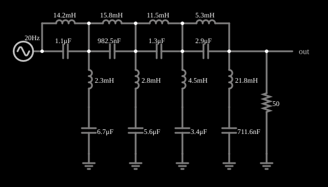

# Filtro rejeita-faixa de Butterworth

<!-- navegacao:inicio -->
[Índice](README.md) · [Anterior: Butterworth High-Pass w/ Noise](butter10hiaud.md) · [Próximo: Bessel vs Butterworth](besselbutter.md)
<!-- navegacao:fim -->

## Objetivo

Mostrar um filtro rejeita-faixa de Butterworth que elimina uma faixa de frequências (de cerca de 650 Hz a 2,5 kHz) e passa as demais.

## O circuito

<!-- esquema:inicio -->

<!-- esquema:fim -->

Uma escada LC de oito indutores e oito capacitores (quatro seções ressonantes em série e quatro em paralelo), com carga de $50\ \Omega$. O sinal de teste é uma varredura logarítmica de 20 Hz a 4 kHz em 0,1 s, 5 V de pico.

<!-- componentes:inicio -->
| N.º | Tipo | Elemento | Valores |
|----:|------|----------|---------|
| 0 | `ResistorElm` | resistor | Resistance (ohms) = 50 |
| 1 | `SweepElm` | sweep (log) | Min Frequency (Hz) = 20; Max Frequency (Hz) = 4k; Sweep Time (s) = 100m; Logarithmic = sim; Max Voltage = 5; Bidirectional = sim |
| 2 | `OutputElm` | output | Show Voltage = não |
| 5 | `GroundElm` | ground | Symbol = Earth |
| 6 | `GroundElm` | ground | Symbol = Earth |
| 7 | `CapacitorElm` | capacitor | Capacitance (F) = 1.1μ; Trapezoidal Approximation = sim; Initial Voltage (on Reset) = 1m; Series Resistance = 0 |
| 8 | `CapacitorElm` | capacitor | Capacitance (F) = 6.7μ; Trapezoidal Approximation = sim; Initial Voltage (on Reset) = 1m; Series Resistance = 0 |
| 9 | `InductorElm` | inductor | Inductance (H) = 14.2m; Trapezoidal Approximation = sim; Initial Current (on Reset) (A) = 0; Saturation Current (A) (0=none) = 0 |
| 10 | `InductorElm` | inductor | Inductance (H) = 2.3m; Trapezoidal Approximation = sim; Initial Current (on Reset) (A) = 0; Saturation Current (A) (0=none) = 0 |
| 13 | `GroundElm` | ground | Symbol = Earth |
| 14 | `CapacitorElm` | capacitor | Capacitance (F) = 982.5n; Trapezoidal Approximation = sim; Initial Voltage (on Reset) = 1m; Series Resistance = 0 |
| 15 | `CapacitorElm` | capacitor | Capacitance (F) = 5.6μ; Trapezoidal Approximation = sim; Initial Voltage (on Reset) = 1m; Series Resistance = 0 |
| 16 | `InductorElm` | inductor | Inductance (H) = 15.8m; Trapezoidal Approximation = sim; Initial Current (on Reset) (A) = 0; Saturation Current (A) (0=none) = 0 |
| 17 | `InductorElm` | inductor | Inductance (H) = 2.8m; Trapezoidal Approximation = sim; Initial Current (on Reset) (A) = 0; Saturation Current (A) (0=none) = 0 |
| 19 | `GroundElm` | ground | Symbol = Earth |
| 20 | `CapacitorElm` | capacitor | Capacitance (F) = 1.3μ; Trapezoidal Approximation = sim; Initial Voltage (on Reset) = 1m; Series Resistance = 0 |
| 21 | `CapacitorElm` | capacitor | Capacitance (F) = 3.4μ; Trapezoidal Approximation = sim; Initial Voltage (on Reset) = 1m; Series Resistance = 0 |
| 22 | `InductorElm` | inductor | Inductance (H) = 11.5m; Trapezoidal Approximation = sim; Initial Current (on Reset) (A) = 0; Saturation Current (A) (0=none) = 0 |
| 23 | `InductorElm` | inductor | Inductance (H) = 4.5m; Trapezoidal Approximation = sim; Initial Current (on Reset) (A) = 0; Saturation Current (A) (0=none) = 0 |
| 25 | `GroundElm` | ground | Symbol = Earth |
| 26 | `CapacitorElm` | capacitor | Capacitance (F) = 2.9μ; Trapezoidal Approximation = sim; Initial Voltage (on Reset) = 1m; Series Resistance = 0 |
| 27 | `CapacitorElm` | capacitor | Capacitance (F) = 711.6n; Trapezoidal Approximation = sim; Initial Voltage (on Reset) = 1m; Series Resistance = 0 |
| 28 | `InductorElm` | inductor | Inductance (H) = 5.3m; Trapezoidal Approximation = sim; Initial Current (on Reset) (A) = 0; Saturation Current (A) (0=none) = 0 |
| 29 | `InductorElm` | inductor | Inductance (H) = 21.8m; Trapezoidal Approximation = sim; Initial Current (on Reset) (A) = 0; Saturation Current (A) (0=none) = 0 |
<!-- componentes:fim -->

## Teoria

Um rejeita-faixa de Butterworth pode ser obtido de um passa-baixas protótipo pela transformação

$$s \;\longrightarrow\; \frac{B\,s}{s^2 + \omega_0^2},\qquad \omega_0^2 = \omega_1\omega_2,\quad B = \omega_2 - \omega_1,$$

que troca cada indutor do protótipo por uma associação paralela LC e cada capacitor por uma série LC. A resposta é plana na faixa passante, tem $-3\ \text{dB}$ nas frequências de corte $f_1$ e $f_2$ e é praticamente nula em torno da frequência central $f_0=\sqrt{f_1 f_2}$.

## Resultados esperados

A análise do circuito (regime permanente) dá $f_1 = 648\ \text{Hz}$ e $f_2 = 2523\ \text{Hz}$, de modo que $f_0 = \sqrt{648\cdot 2523} = 1279\ \text{Hz}$:

| $f$ | $\|H\|$ | $V_{out,pico}$ |
|----:|--------:|---------------:|
| 300 Hz | 1,000 | 5,00 V |
| 648 Hz | 0,707 | 3,54 V |
| 800 Hz | 0,038 | 0,19 V |
| **1279 Hz** | **0,000** | **≈ 0** |
| 2000 Hz | 0,025 | 0,13 V |
| 3000 Hz | 0,993 | 4,97 V |

**Efeito da varredura.** A varredura (20 Hz a 4 kHz em 100 ms) é rápida demais para esses filtros de oito polos: a integração numérica independente do circuito com a mesma varredura dá, em janelas de 1,5 período, 4,93 V a 300 Hz, 4,10 V no corte inferior (e não 3,54 V), 5,44 V a 3 kHz (com oscilação que sucede a faixa rejeitada) e menos de $0{,}25\ \text{V}$ em torno de 1279 Hz. As verificações conferem esses valores (2%, e $0{,}25\ \text{V}$ absolutos na faixa rejeitada).

## O que observar

- A curva de saída fica em 5 V, mergulha entre 650 Hz e 2,5 kHz e volta a 5 V.
- A rejeição é muito mais "retangular" que a de um filtro de segunda ordem (por exemplo, o twin-T).

## Limites do modelo

Componentes ideais; a varredura rápida distorce a resposta observada (veja acima).

## Referências

- A. S. Sedra e K. C. Smith, *Microeletrônica*, Pearson.
- P. Horowitz e W. Hill, *The Art of Electronics*, Cambridge University Press.

O circuito deste exemplo faz parte da coleção do simulador original de Paul Falstad e Iain Sharp (CircuitJS1); a explicação é deste projeto.
