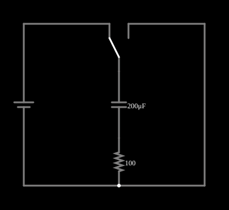

# Carga de um capacitor (circuito RC)

<!-- navegacao:inicio -->
[Índice](README.md) · [Anterior: Resistors](resistors.md) · [Próximo: Inductor](induct.md)
<!-- navegacao:fim -->

## Objetivo

Mostrar a carga de um capacitor por um resistor: a tensão sobe exponencialmente com constante de tempo $\tau = RC$ e a corrente cai com a mesma constante.

## O circuito

<!-- esquema:inicio -->

<!-- esquema:fim -->

Uma fonte de 5 V é ligada, por uma chave de duas posições (SPDT), a um capacitor de $200\ \mu\text{F}$ em série com um resistor de $100\ \Omega$. O osciloscópio mostra a tensão do capacitor. Há um *slider* para a capacitância (de $10\ \mu\text{F}$ a $1\ \text{mF}$).

<!-- componentes:inicio -->
| N.º | Tipo | Elemento | Valores |
|----:|------|----------|---------|
| 0 | `VoltageElm` | voltage source | Voltage = 5; Waveform = D/C; DC Offset (V) = 0; Internal Resistance (ohms) = 0; Show Voltage = não; Circle Symbol = não |
| 1 | `Switch2Elm` | switch (SPDT) | Momentary Switch = não; Group Number (for linking) = 0; # of Throws = 2; Keyboard Shortcut = ; On Resistance (ohms) = 0 |
| 5 | `CapacitorElm` | capacitor | Capacitance (F) = 200μ; Trapezoidal Approximation = sim; Initial Voltage (on Reset) = 1m; Series Resistance = 0 |
| 6 | `ResistorElm` | resistor | Resistance (ohms) = 100 |
<!-- componentes:fim -->

## Teoria

A tensão e a corrente de um capacitor se relacionam por $i = C\,\dfrac{dv}{dt}$. Pela lei das tensões de Kirchhoff, $V = R\,i + v_C$, de onde

$$RC\,\frac{dv_C}{dt} + v_C = V.$$

Com $v_C(0)=v_0$ a solução é

$$v_C(t) = V - (V - v_0)\,e^{-t/\tau},\qquad i(t) = \frac{V - v_0}{R}\,e^{-t/\tau},\qquad \tau = RC.$$

Depois de $\tau$ a tensão chegou a 63% do valor final; depois de $5\tau$, a mais de 99%. A energia guardada é $E = \tfrac12 C v_C^2$.

## Resultados esperados

Aqui $\tau = 100\cdot 200\times10^{-6} = 20\ \text{ms}$ e $v_0 \approx 0$:

| $t$ | $v_C$ | $i$ |
|----:|------:|----:|
| $5\ \text{ms}\ (0{,}25\tau)$ | $1{,}106\ \text{V}$ | $38{,}9\ \text{mA}$ |
| $20\ \text{ms}\ (\tau)$ | $3{,}161\ \text{V}$ | $18{,}4\ \text{mA}$ |
| $100\ \text{ms}\ (5\tau)$ | $4{,}966\ \text{V}$ | $0{,}34\ \text{mA}$ |

Ao final, $E = \tfrac12\cdot 200\ \mu\text{F}\cdot 25 = 2{,}5\ \text{mJ}$. As verificações conferem a tensão em $\tau$ e em $5\tau$ e a corrente em $\tau$.

## O que observar

- Mude a capacitância pelo *slider*: $\tau$ muda na mesma proporção, e a subida no osciloscópio fica mais lenta ou mais rápida.
- A corrente é máxima no início (o capacitor descarregado parece um curto) e tende a zero no fim (o capacitor carregado parece um circuito aberto).
- A chave SPDT escolhe a ligação do ramo; experimente alternar a posição e acompanhe o osciloscópio.

## Limites do modelo

Capacitor ideal, sem resistência série nem fuga; fonte ideal. O exemplo é salvo com uma pequena tensão inicial no capacitor ($1\ \text{mV}$), o que desloca os valores acima em menos de 0,1%.

## Referências

- J. W. Nilsson e S. A. Riedel, *Circuitos Elétricos*, Pearson.
- C. K. Alexander e M. N. O. Sadiku, *Fundamentos de Circuitos Elétricos*, AMGH.

O circuito deste exemplo faz parte da coleção do simulador original de Paul Falstad e Iain Sharp (CircuitJS1); a explicação é deste projeto.
