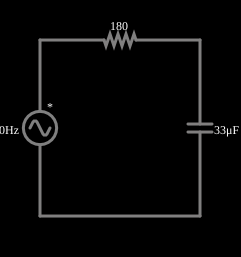

# Capacitor em corrente alternada

<!-- navegacao:inicio -->
[Índice](README.md) · [Próximo: Inductor](inductac.md)
<!-- navegacao:fim -->

## Objetivo

Mostrar como um capacitor responde a uma tensão senoidal: a corrente se adianta à tensão e a amplitude depende da frequência através da reatância capacitiva.

## O circuito

<!-- esquema:inicio -->

<!-- esquema:fim -->

Uma fonte alternada de 5 V de pico e 40 Hz alimenta um resistor de $180\ \Omega$ em série com um capacitor de $33\ \mu\text{F}$. O osciloscópio mostra a tensão do capacitor.

<!-- componentes:inicio -->
| N.º | Tipo | Elemento | Valores |
|----:|------|----------|---------|
| 0 | `VoltageElm` | A/C source | Max Voltage = 5; Waveform = A/C; DC Offset (V) = 0; Internal Resistance (ohms) = 0; Show Voltage = não; Frequency (Hz) = 40; Phase Offset (degrees) = 0 |
| 1 | `ResistorElm` | resistor | Resistance (ohms) = 180 |
| 2 | `CapacitorElm` | capacitor | Capacitance (F) = 33μ; Trapezoidal Approximation = sim; Initial Voltage (on Reset) = 1m; Series Resistance = 0 |
<!-- componentes:fim -->

## Teoria

Em regime permanente senoidal, tensões e correntes são fasores e cada elemento tem uma **impedância**:

$$Z_R = R,\qquad Z_L = j\omega L,\qquad Z_C = \frac{1}{j\omega C},\qquad \omega = 2\pi f.$$

A parte imaginária é a **reatância**: $X_L=\omega L$ (cresce com a frequência) e $X_C = 1/(\omega C)$ (diminui com ela). A amplitude da corrente e a defasagem entre tensão e corrente seguem de $I = V/Z$.

Para o circuito RC série,

$$|Z| = \sqrt{R^2 + X_C^2},\qquad I_{pico} = \frac{V_{pico}}{|Z|},\qquad V_{C,pico} = I_{pico}\,X_C,\qquad \varphi = \arctan\frac{X_C}{R}$$

em que $\varphi$ é o quanto a corrente se adianta à tensão da fonte. A constante de tempo $\tau = RC$ determina em quanto tempo o transitório desaparece.

## Resultados esperados

$X_C = 1/(2\pi\cdot40\cdot33\times10^{-6}) = 120{,}6\ \Omega$, $|Z| = 216{,}6\ \Omega$:

$$I_{pico} = 23{,}08\ \text{mA},\qquad V_{C,pico} = 2{,}783\ \text{V},\qquad \varphi = 33{,}8^\circ.$$

O transitório dura alguns $\tau = 5{,}9\ \text{ms}$. As verificações medem, depois dele (de 100 ms a 200 ms, quatro ciclos), o pico da corrente e o pico da tensão do capacitor.

## O que observar

- A tensão do capacitor está atrasada em relação à corrente (a corrente passa por zero antes).
- Altere a capacitância ou a frequência: $X_C$ muda e, com ela, as amplitudes.

## Limites do modelo

Elementos ideais; capacitor sem resistência série. O valor medido pelo simulador inclui um transitório inicial que as verificações evitam.

## Referências

- J. W. Nilsson e S. A. Riedel, *Circuitos Elétricos*, Pearson.
- C. K. Alexander e M. N. O. Sadiku, *Fundamentos de Circuitos Elétricos*, AMGH.

O circuito deste exemplo faz parte da coleção do simulador original de Paul Falstad e Iain Sharp (CircuitJS1); a explicação é deste projeto.
